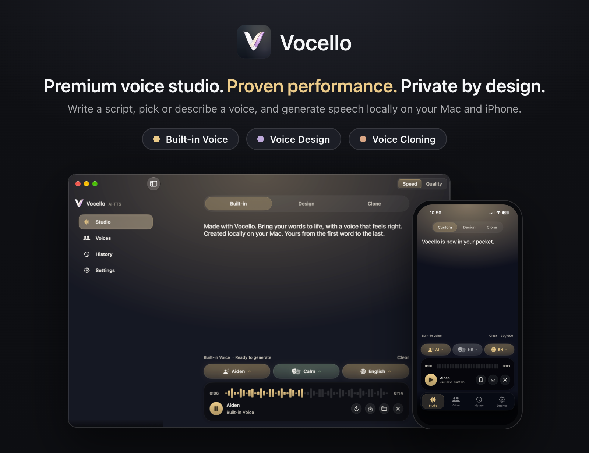
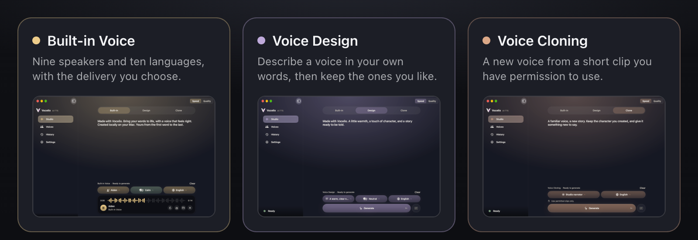
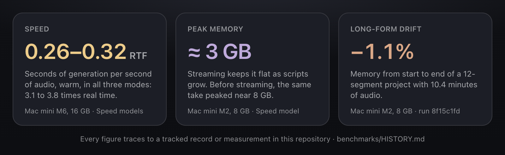
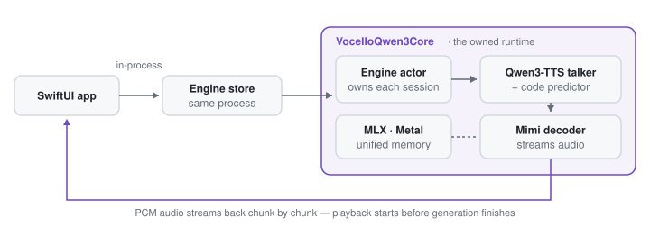
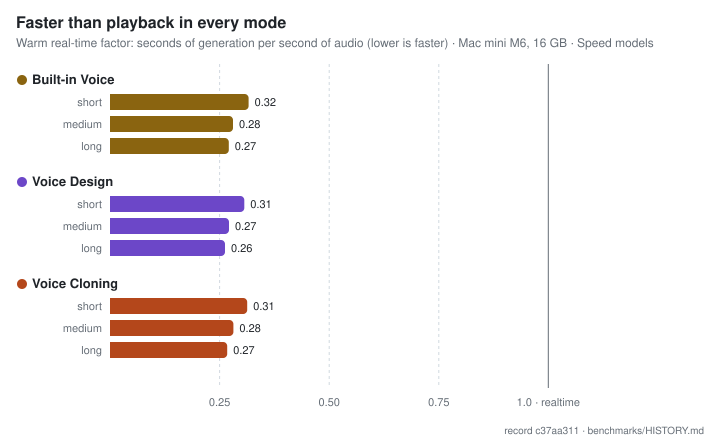

<div align="center">



<br>

<a href="https://github.com/PowerBeef/Vocello/releases/download/v2.4.0/Vocello-macos26.dmg"></a>&nbsp;&nbsp;<a href="https://testflight.apple.com/join/Cvp6yCv7"></a>

<br>

[](#get-vocello) [](https://testflight.apple.com/join/Cvp6yCv7) [](#for-developers) [](https://github.com/QwenLM/Qwen3-TTS) [](#meet-vocello) [](LICENSE)

**[Meet Vocello](#meet-vocello)** · **[Three voices](#three-ways-to-make-a-voice)** · **[Performance](#performance)** · **[Get Vocello](#get-vocello)** · **[For developers](#for-developers)**

</div>

<br>

## Meet Vocello

Vocello is a voice studio for your Mac and iPhone. Write a script, pick one of nine voices or describe a new one, and Vocello speaks it with Qwen3-TTS running on your own Apple Silicon. There is no account, no credits and no cloud: what you write and record stays local.

<table>
<tr>
<td width="33%" valign="top">


**Private by design**<br>
Generation runs locally once the models are installed. Scripts, recordings, voices and takes stay in local storage unless you export them.

</td>
<td width="33%" valign="top">


**Fast**<br>
On a Mac mini M6, once the model is loaded, a minute of speech generates in under 20 seconds, and long scripts play while the rest is still being made.

</td>
<td width="33%" valign="top">


**Native**<br>
Swift and MLX on Apple Silicon, with no Python and no server. Ten languages, long-form projects and a searchable History.

</td>
</tr>
</table>

## Three ways to make a voice



- **Built-in Voice.** Nine Qwen3 speakers in ten languages, with a delivery preset or a few words about how it should sound. Vocello 2.4.0 calls this mode Custom Voice.
- **Voice Design.** Describe a voice ("a warm, clear narrator") and hear it. Save the ones you like to use again.
- **Voice Cloning.** Record or import a clip of a voice you own or have permission to use, and save it to your library. Voice Cloning follows the reference voice, so the clip sets its character.

Paste a whole chapter: past 900 characters, Vocello plans the script into segments that play one after another while the rest generates, then joins them into one file. Languages are detected automatically: Chinese, English, Japanese, Korean, German, French, Russian, Portuguese, Spanish and Italian.

Clone generation waits for your consent in Settings, and **(3.0)** every take carries an inaudible AudioSeal watermark that marks it as AI-generated.

> [!NOTE]
> The Mac download is **Vocello 2.4.0**. This page describes the upcoming **Vocello 3.0**, and **(3.0)** marks what is new in it.

## Performance



<details>
<summary><b>How these were measured</b></summary>

<br>

The real-time factor (RTF) is seconds of generation per second of audio, so lower is faster and anything under 1.0 plays ahead of generation. The speed figures pool warm takes of the Speed models from the canonical benchmark host, a Mac mini M6 with 16 GB; the chart under [Performance, measured](#performance-measured) breaks them down by mode and script length. The 8 GB Mac mini M2 is the support floor: its records (the last canonical one, `379db820`, measured warm RTF 0.53 to 0.82) form an earlier series that is never compared with the M6's. The memory figures come from that M2: streaming took the peak of the same take from about 8 GB to about 3 GB (`benchmarks/OPTIMIZATION.md` §F.1), and a 12-segment long-form project (smoke run `8f15c1fd`) ended 1.1% below its starting footprint.

Every published record is in [`benchmarks/HISTORY.md`](benchmarks/HISTORY.md), and the method is in [`docs/reference/benchmarking-procedure.md`](docs/reference/benchmarking-procedure.md).

</details>

## Get Vocello

**On a Mac:** [download Vocello 2.4.0](https://github.com/PowerBeef/Vocello/releases/download/v2.4.0/Vocello-macos26.dmg), drag it to Applications, then install a voice model from **Settings > Model downloads**. The app is signed with an Apple Developer ID and notarized.

**On iPhone:** [join the public beta on TestFlight](https://testflight.apple.com/join/Cvp6yCv7).

| Platform | Requirements | Model variants | Status |
| --- | --- | --- | --- |
| Mac | macOS 26.0 or newer, Apple Silicon, 8 GB RAM minimum | Speed (4-bit) and Quality (8-bit) | Vocello 2.4.0 is available now |
| iPhone | iPhone 15 Pro or newer, iOS 26.0 or newer | Speed (4-bit) | Public beta via [TestFlight](https://testflight.apple.com/join/Cvp6yCv7) |

Speed uses less memory and suits 8 GB Macs; Quality is a Mac option for 16 GB or more. The three Mac Speed models take about 4.8 GB on disk, because they share one speech tokenizer, stored once.

<details>
<summary><b>Upgrading, and older Macs</b></summary>

<br>

Upgrading from Vocello 2.x keeps your models and data under `~/Library/Application Support/QwenVoice/`. Vocello was called QwenVoice before 2.2.0; old repository links redirect here. Macs on macOS 15 can use the legacy [QwenVoice 1.2.3](https://github.com/PowerBeef/Vocello/releases/tag/v1.2.3). Each release's notes are in [`docs/releases/`](docs/releases/), and the 2.4.0 release attaches [`release-metadata.txt`](https://github.com/PowerBeef/Vocello/releases/download/v2.4.0/release-metadata.txt) with its source and toolchain provenance.

</details>

<br>

---

## For developers

Vocello is a working reference for running a 1.7B-parameter text-to-speech model natively on Apple Silicon: Swift 6 with strict concurrency, a first-party MLX runtime, audio that streams with bounded memory, and a measurement discipline that keeps every performance claim tied to a record. The docs record each decision and the measurement behind it.

### How it works

<picture>
  <source media="(prefers-color-scheme: dark)" srcset="docs/charts/architecture-dark.svg">
  
</picture>

One engine serves three hosts: the Mac app, the iPhone app and the `vocello` command-line tool, all built on `NativeRuntimeFactory`. Every request takes one path from conditioning to a verified 24 kHz mono WAV: an engine actor owns the session, the Qwen3-TTS talker and code predictor sample codec frames, the Mimi decoder turns them into audio, and PCM streams back chunk by chunk to the player, a limiter, an atomic WAV writer and a quality check. → [Architecture](docs/ARCHITECTURE.md)

### Engineering highlights

<table>
<tr>
<td width="50%" valign="top">


**An owned runtime, not a Python wrapper**<br>
The runtime, [`VocelloQwen3Core`](Packages/VocelloQwen3Core/README.md), is derived from mlx-audio-swift v0.1.2 and narrowed to exactly what Vocello ships: about 36,000 of its 49,000 upstream lines were removed. Every retained, changed and added file is tracked in a generated inventory with a named semantic delta, and a facade contract keeps raw MLX types out of the apps.

</td>
<td width="50%" valign="top">


**Streaming that doesn't grow**<br>
Audio crosses an actor-owned, frame-bounded channel: audio-bearing events are never dropped, backpressure suspends the producer instead of buffering, and cancelling a suspended producer wakes it cleanly, by test. Making streaming the default took the peak of the same take from about 8 GB to about 3 GB and made it flat with script length.

</td>
</tr>
<tr>
<td valign="top">


**Launch-bound, not compute-bound**<br>
Profiling showed the GPU idle for most of each frame while the host built the graph. Fusing the code predictor's rotary embedding removed about 600 kernel launches per frame (+26% warm), compiling the per-frame predictor pass added +8 to 11% with byte-identical output, and GPU busy rose from 31 to 37% to about 49%.

</td>
<td valign="top">


**Reproducible by construction**<br>
Every request carries its own seed and fresh sampler state, and nothing samples from process-global state. Cancellation is typed and awaited (user, memory pressure, superseded, shutdown), so a cancelled take can never reach History, and MLX errors arrive as typed failures instead of aborting the process.

</td>
</tr>
<tr>
<td valign="top">


**Proof before merge**<br>
Fixed-seed byte identity gates every scheduling change. Regressions are kept as measured do-nots with their numbers, and the benchmark lane once caught its own observer effect: a +55% swing from the test harness recording the screen. Published records are pass-only and privacy-allowlisted.

</td>
<td valign="top">


**Tested on real hardware**<br>
UI tests drive the native Mac app and a paired iPhone, never a Simulator. Every take passes a byte-bound audio check before it is saved, and long scripts, downloads, cancellation and background exits each have their own lane.

</td>
</tr>
</table>

→ [Optimization ledger](benchmarks/OPTIMIZATION.md) · [Testing runbook](docs/reference/testing-runbook.md) · [MLX guide](docs/reference/mlx-guide.md)

### Performance, measured

Warm real-time factor by mode and script length on the Mac mini M6 (16 GB), pooled from the most recent canonical records of one build (today record `74f026be`, a Vocello 3.0 build from source):

<!-- rtf-chart:start (generated by scripts/generate_readme_charts.py) -->
<picture>
  <source media="(prefers-color-scheme: dark)" srcset="docs/charts/rtf-by-mode-dark.svg">
  
</picture>
<!-- rtf-chart:end -->

The charts regenerate from the named records with `scripts/generate_readme_charts.py`. → [Benchmark history](benchmarks/HISTORY.md)

### Build from source

You need full Xcode (the CI version is pinned in `config/toolchain.json`) on an Apple Silicon Mac with macOS 26 or newer, plus the pinned xcodegen, ripgrep and Python packages. [`docs/reference/development-setup.md`](docs/reference/development-setup.md) sets up a new Mac step by step.

```sh
git clone https://github.com/PowerBeef/Vocello.git
cd Vocello
./scripts/regenerate_project.sh
./scripts/build.sh build
```

`project.yml` generates the Xcode project, and the repository scripts are the build and test interface: `scripts/dev.sh check` runs the lint, contracts and tests your changes touch, and `scripts/dev.sh ci` runs exactly what CI runs. Start with [`CONTRIBUTING.md`](CONTRIBUTING.md); coding agents also read [`CLAUDE.md`](CLAUDE.md).

### Command-line tool

`vocello` drives the same engine without a UI. It writes machine-readable output, with progress on standard error.

```sh
./scripts/build.sh cli
build/vocello models list
build/vocello custom --variant speed --text "The train left at dawn."
echo "Hello there." | build/vocello generate --variant speed --stream --json
```

→ [CLI reference](docs/reference/cli.md)

### Project layout

```text
Sources/                 the apps and the engine
  QwenVoiceApp.swift       macOS app (Views/, ViewModels/, Services/)
  iOS/                     iPhone app
  QwenVoiceCore/           engine host: runtime factory, generation, model delivery
  VocelloCLI/              the vocello command-line tool
Packages/VocelloQwen3Core/ the owned Qwen3-TTS runtime on MLX, with its own tests
Tests/                   unit and iPhone logic tests, Mac and iPhone UI tests
scripts/                 build, test, benchmark and release lanes, and the README art
config/                  machine-readable contracts: models, privacy, release, roadmap
benchmarks/              published benchmark records and the optimization ledger
website/                 vocello.vercel.app (React and Vite)
docs/                    architecture, references, audits, release notes
```

### Design system

Dark-first, warm neutrals on a charcoal canvas, and one accent per mode. Liquid Glass stays on chrome and falls back to solid surfaces under Reduce Transparency and while audio generates. The tokens live in the app's theme and in [`website/src/tokens.css`](website/src/tokens.css).

| Token | Color | Use |
| --- | --- | --- |
| Gold |  | Built-in Voice, the brand accent |
| Lavender |  | Voice Design |
| Terracotta |  | Voice Cloning |
| Charcoal |  | The canvas |
| Text |  | Primary text |

The README art comes from the same tokens: `scripts/readme_art/render.sh` redraws it from the screenshots in `docs/screenshots/`.

### Documentation

| | |
| --- | --- |
| [Architecture](docs/ARCHITECTURE.md) | Ownership, the life of a take, the engine's invariants |
| [Development setup](docs/reference/development-setup.md) | A new Mac, from clone to first build |
| [Testing runbook](docs/reference/testing-runbook.md) | Which lane proves what, on the Mac and on a paired iPhone |
| [Benchmarking](docs/reference/benchmarking-procedure.md) | The protocol behind every published number |
| [Privacy and storage](docs/reference/privacy-storage.md) | What is stored where, and how it is deleted |
| [iPhone app](docs/reference/ios-app-guide.md) | The iPhone app, including the 3.0 export purchase |
| [Roadmap](docs/ROADMAP.md) | What is in flight for 3.0 and what follows |

## License and acknowledgements

Vocello is available under the [MIT License](LICENSE). It builds on [Qwen3-TTS](https://github.com/QwenLM/Qwen3-TTS), [MLX](https://github.com/ml-explore/mlx), [mlx-audio-swift](https://github.com/Blaizzy/mlx-audio-swift) and [GRDB.swift](https://github.com/groue/GRDB.swift). Third-party models and assets keep their own terms; see the [third-party attributions](Sources/Resources/third_party_attributions.json) and the runtime's [notices](Packages/VocelloQwen3Core/NOTICES.md).

<br>

<div align="center">

<br>
<sub>Vocello · a private voice studio for your Mac and iPhone</sub>
</div>
