<div align="center">

<picture>
  <source media="(max-width: 700px)" srcset="docs/readme/hero-narrow.svg">
  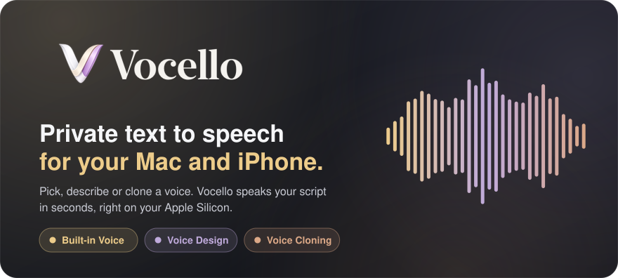
</picture>

<br><br>

<a href="https://github.com/PowerBeef/Vocello/releases/download/v3.2.0/Vocello-macos26.dmg"></a>&nbsp;&nbsp;<a href="https://github.com/PowerBeef/Vocello/releases/download/v3.2.0/Vocello-macos26-cli.pkg"></a>&nbsp;&nbsp;<a href="https://testflight.apple.com/join/Cvp6yCv7"></a>

<br>

**[What it does](#what-it-does)** · **[How it performs](#how-it-performs)** · **[Install](#install-and-requirements)** · **[Under the hood](#under-the-hood)**

</div>

## What is Vocello

Vocello is a voice studio for your Mac and iPhone. Write a script, choose a voice, and Vocello speaks it with [Qwen3-TTS](https://github.com/QwenLM/Qwen3-TTS), an open text-to-speech model, running on your own Apple Silicon.

There is no account, no credits and no cloud. Your scripts, recordings, voices and takes stay on your device unless you export them.

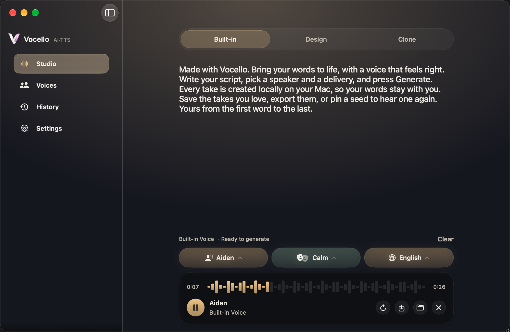

## What it does

<picture>
  <source media="(max-width: 700px)" srcset="docs/readme/modes-narrow.svg">
  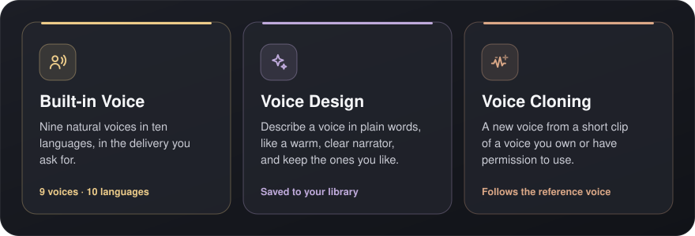
</picture>

- **Built-in Voice.** Nine voices in ten languages, with a delivery preset (calm, whisper, happy and more) or a few words of your own about how it should sound.
- **Voice Design.** Describe a voice, such as "a warm, clear narrator with a gentle British accent", hear it, and save the ones you like.
- **Voice Cloning.** Record or import a short clip of a voice you own or have permission to use. Voice Cloning follows the reference voice, so the clip sets its character, and asks once to confirm permission (also manageable in Settings).

<picture>
  <source media="(max-width: 700px)" srcset="docs/readme/features-narrow.svg">
  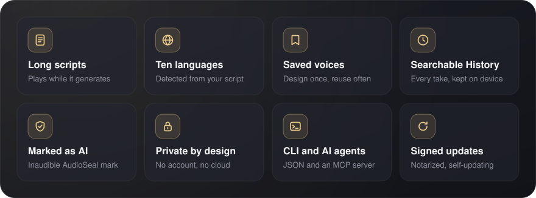
</picture>

Vocello speaks Chinese, English, Japanese, Korean, German, French, Russian, Portuguese, Spanish and Italian, and its interface comes in ten languages too, set apart from the speech language. Paste a whole chapter and it plans the script into segments that play one after another while the rest generates, then joins them into one file.

<table>
<tr>
<td width="50%">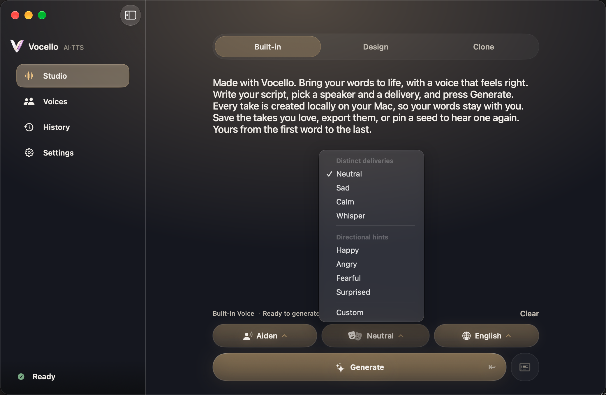</td>
<td width="50%">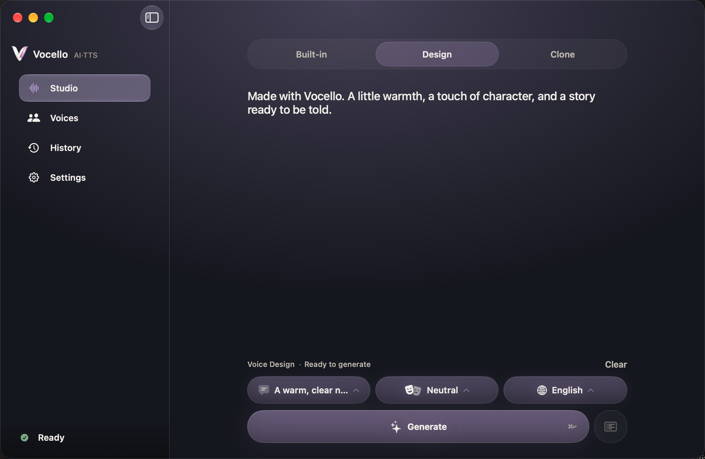</td>
</tr>
<tr>
<td>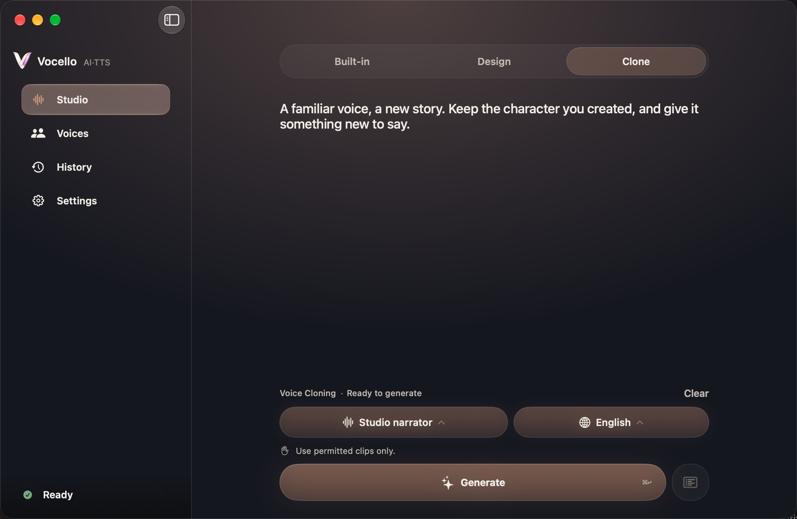</td>
<td>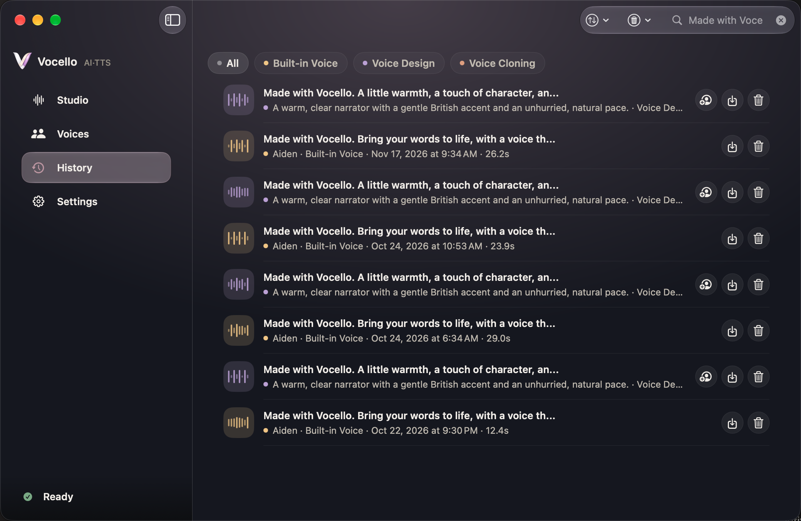</td>
</tr>
</table>

## How it performs

<picture>
  <source media="(max-width: 700px)" srcset="docs/readme/performance-narrow.svg">
  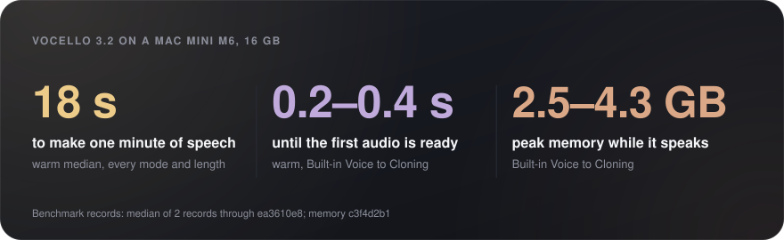
</picture>

Once its model is loaded, Vocello makes speech about three times faster than you can listen to it, in every mode and at every script length, and a long script starts playing while the rest is still being made.

<!-- rtf-chart:start (generated by scripts/generate_readme_charts.py) -->
<picture>
  <source media="(max-width: 700px)" srcset="docs/readme/rtf-by-mode-narrow.svg">
  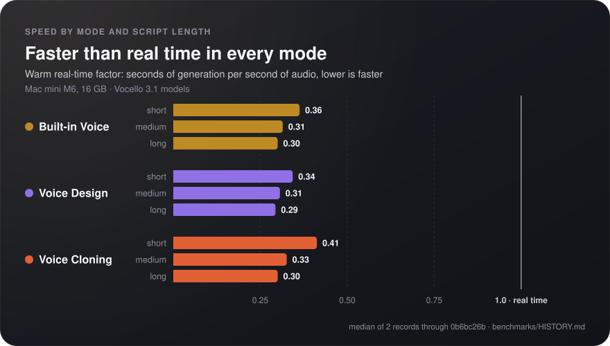
</picture>
<!-- rtf-chart:end -->

The real-time factor is the time it takes to generate one second of audio: at 0.30, a ten-second line takes three seconds. Each bar is the median of the warm takes in the latest benchmark records of the released build, on the benchmark Mac mini M6 (16 GB). The images in this section are regenerated from those records, so the numbers cannot drift from the evidence. → [Benchmark history](benchmarks/HISTORY.md) · [How it is measured](docs/reference/telemetry-and-benchmarking.md)

## Install and requirements

**On a Mac.** [Download Vocello](https://github.com/PowerBeef/Vocello/releases/download/v3.2.0/Vocello-macos26.dmg), drag it to Applications and open it. Then open **Settings > Models & Files** and download the model of each mode you want to use.

**On iPhone.** [Join the public beta on TestFlight](https://testflight.apple.com/join/Cvp6yCv7). The beta still runs Vocello 3.0; the 3.2 update follows there and on the App Store.

**In Terminal.** Install the signed [command-line package](https://github.com/PowerBeef/Vocello/releases/download/v3.2.0/Vocello-macos26-cli.pkg), which asks for an administrator password. From a new Terminal window, check it, download the Built-in Voice model (its id still says `speed`, a name kept from earlier versions) and play a first take:

```sh
vocello --version
vocello models install pro_custom_speed
vocello custom --text "The train left at dawn." --play
```

`vocello` shares the Mac app's models, saved voices, settings and History, and answers in JSON for scripts. To let Claude Code speak through Vocello's MCP server:

```sh
claude mcp add --scope user vocello -- /usr/local/bin/vocello mcp
```

| Platform | Requirements | Models |
| --- | --- | --- |
| Mac | macOS 26.0 or newer, Apple Silicon, 8 GB of memory (16 GB or more recommended for long projects) | One model per mode |
| Command line | macOS 26.0 or newer, Apple Silicon | Shared with the Mac app |
| iPhone | iPhone 15 Pro or newer (or eligible 8 GB+ iPad in portrait compatibility mode), iOS 26.0 or newer | One model per mode |

Models are never bundled. Each mode's model downloads once from Hugging Face, about 2.2 GB, and is verified before it is used. → [What's new in 3.2.0](docs/releases/v3.2.0.md) · [CLI reference](docs/reference/cli.md) · [All releases](https://github.com/PowerBeef/Vocello/releases)

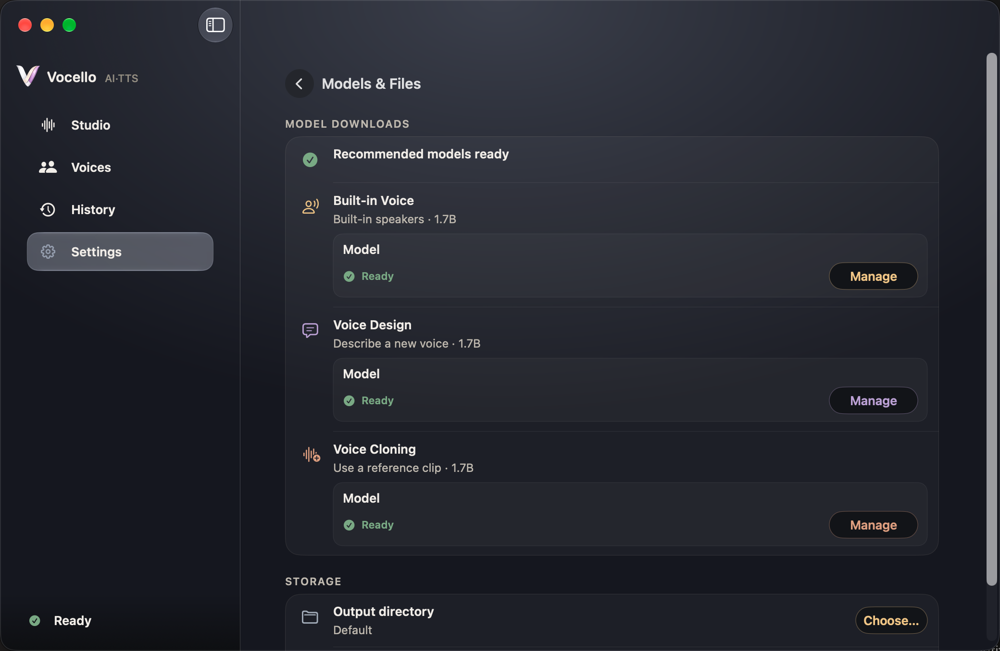

<details>
<summary><b>Upgrading, and older Macs</b></summary>

<br>

History, saved voices and settings carry over from any earlier version. From 3.1, choose **Vocello > Check for Updates** (your installed models stay ready with no new download). From 3.0, choose **Vocello > Check for Updates**; from 2.x, install the new DMG by hand once. Coming from 3.0 or 2.x, Vocello replaces the earlier models with the one model per mode, on its own on an unmetered network (about 4.7 GB for all three modes; **Not Now** stops it). The [release notes](docs/releases/v3.2.0.md) have the details.

Vocello was called QwenVoice before 2.2.0, and old repository links redirect here. Macs on macOS 15 can use the legacy [QwenVoice 1.2.3](https://github.com/PowerBeef/Vocello/releases/tag/v1.2.3).

</details>

> [!NOTE]
> Take quality is checked by machine, not by human listening. Automated checks catch gross failures (silence, a cut-off take, missing words, the wrong language), so a take can still carry a subtle defect, such as a swallowed syllable or a delivery that misses the requested style. Generate again for a different take. The [release notes](docs/releases/v3.2.0.md#evidence-and-limitations) list the known limitations.

## Under the hood

Vocello runs a 1.7-billion-parameter text-to-speech model natively on Apple Silicon: Swift 6 with strict concurrency, a first-party MLX runtime, and audio that streams with bounded memory. There is no Python, no server and no separate engine process.

<picture>
  <source media="(max-width: 700px)" srcset="docs/readme/architecture-narrow.svg">
  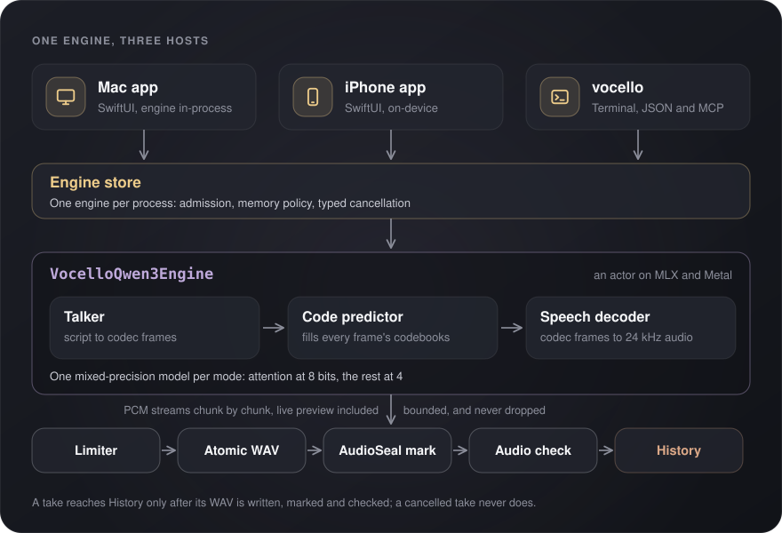
</picture>

One engine serves all three hosts. The talker turns your script into codec frames, the code predictor fills in each frame, and the speech decoder turns them into 24 kHz audio that streams, chunk by chunk, to the player and through a limiter, an atomic WAV writer, a watermark and an audio check. A take reaches History only when all of that has finished. → [Architecture](docs/ARCHITECTURE.md)

<picture>
  <source media="(max-width: 700px)" srcset="docs/readme/numbers-narrow.svg">
  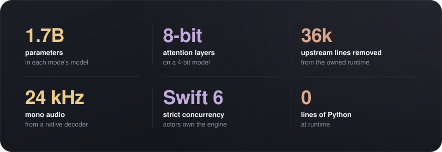
</picture>

<table>
<tr>
<td width="56" valign="top"></td>
<td><b>An owned runtime, not a Python wrapper.</b> <a href="Packages/VocelloQwen3Core/README.md"><code>VocelloQwen3Core</code></a> is derived from mlx-audio-swift v0.1.2 and narrowed to what Vocello ships: about 36,000 of its 49,000 upstream lines removed, every remaining file tracked with its change, and a facade that keeps raw MLX types out of the apps.</td>
</tr>
<tr>
<td valign="top"></td>
<td><b>One model per mode, tuned where it counts.</b> Each mode runs a single mixed-precision model: 4-bit weights, with the talker's attention layers at 8 bits, where extra precision bought the most for the least weight. It was chosen by automated screens whose decision rules were written down before their takes were generated. → <a href="docs/reference/hybrid-model.md">How the model was chosen</a></td>
</tr>
<tr>
<td valign="top"></td>
<td><b>Streaming that doesn't grow.</b> Audio crosses an actor-owned, frame-bounded channel that never drops audio and suspends the producer instead of buffering, so the audio in flight is bounded by the channel, not by the length of the script.</td>
</tr>
<tr>
<td valign="top"></td>
<td><b>Launch-bound, not compute-bound.</b> Fusing the code predictor's rotary embedding removed about 600 kernel launches per frame (26% faster warm), and compiling the per-frame predictor pass added another 8 to 11% with byte-identical output. → <a href="benchmarks/OPTIMIZATION.md">Optimization ledger</a></td>
</tr>
<tr>
<td valign="top"></td>
<td><b>Reproducible by construction.</b> Every request carries its own seed and sampler state. Cancellation is typed and awaited, so a cancelled take never reaches History, and MLX errors arrive as typed failures instead of aborting the process.</td>
</tr>
<tr>
<td valign="top"></td>
<td><b>Proof before merge.</b> Fixed-seed byte identity gates every scheduling change, published benchmarks are pass-only, privacy-checked records, and UI tests drive the real Mac app and a paired iPhone, never a Simulator.</td>
</tr>
</table>

### Build from source

You need full Xcode on an Apple Silicon Mac with macOS 26 or newer; [New Mac setup](docs/reference/development-workflow.md#new-mac-setup) lists the pinned tools.

```sh
git clone https://github.com/PowerBeef/Vocello.git
cd Vocello
./scripts/regenerate_project.sh
./scripts/build.sh build
```

`project.yml` generates the Xcode project, and the repository scripts are the build and test interface: `scripts/dev.sh check` runs the lint, contracts and tests your change touches. Start with [`CONTRIBUTING.md`](CONTRIBUTING.md).

→ [Architecture](docs/ARCHITECTURE.md) · [CLI reference](docs/reference/cli.md) · [Benchmarks](benchmarks/HISTORY.md) · [Testing runbook](docs/reference/testing-runbook.md) · [Release notes](docs/releases/) · [Roadmap](docs/ROADMAP.md)

## License and acknowledgements

Vocello is available under the [MIT License](LICENSE). It builds on [Qwen3-TTS](https://github.com/QwenLM/Qwen3-TTS), [MLX](https://github.com/ml-explore/mlx), [mlx-audio-swift](https://github.com/Blaizzy/mlx-audio-swift) and [GRDB.swift](https://github.com/groue/GRDB.swift). Third-party models and assets keep their own terms; see the [third-party attributions](Sources/Resources/third_party_attributions.json) and the runtime's [notices](Packages/VocelloQwen3Core/NOTICES.md).

<br>

<div align="center">

<br>
<sub>Vocello · private text to speech for your Mac and iPhone</sub>
</div>
