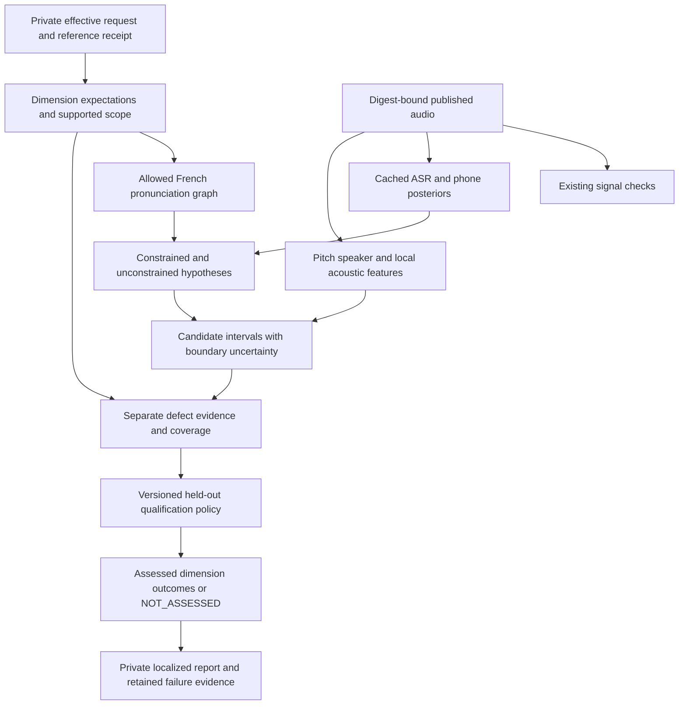

# Automatic detection of Vocello's perceptual audio failures

**Research date:** October 10, 2026. **Repository baseline:**
`1b834bd2f2f4d7300c06d90cd4507798f0069d64`.

This report investigates ways to detect the failures that motivated the quality overhaul: a Clone
voice with the wrong pitch/register, French Design speech with an unwanted Anglophone accent,
brief whispered/devoiced syllables, false starts, inserted vowels or inappropriate liaison, and
delivery that misses the requested emotion or intent. It complements the
[generation-flow investigation](2026-10-10-generation-quality-investigation.md), whose remediation
and validation addenda describe the current application and harness. This is a research and
engineering recommendation, not a new detector qualification or an acoustic experiment.

Reading map: [findings](#1-findings-that-should-drive-the-next-implementation),
[current harness](#4-what-vocello-already-has-and-why-simply-adding-more-models-is-insufficient),
[clone pitch](#5-clone-pitch-and-habitual-register), [identity](#6-speaker-identity-and-rhythm),
[French](#7-french-pronunciation-and-unwanted-anglophone-accent),
[local phonation](#8-local-whisper-breathiness-and-devoicing),
[disfluency](#9-false-starts-repetitions-insertions-and-liaison),
[judges/intent](#10-emotion-delivery-intent-and-learned-audio-judges),
[other metrics/APIs](#11-broad-naturalness-corpus-metrics-and-commercial-comparators),
[data rights](#12-data-sources-relevance-is-separate-from-permission),
[architecture](#13-recommended-offline-detector-architecture),
[qualification](#14-qualification-that-can-support-unattended-assessment),
[experiments](#15-prioritized-experiments-and-implementation-decisions).

## 1. Findings that should drive the next implementation

**Automatic routine screening is achievable for well-defined defect classes. A universal model
that reliably replaces listening for every aspect of every clip is not established by this search.**
The practical objective is to automate each supported assessment, retain localized evidence, and
abstain when the recording, language, requested style or detector is outside its qualified scope.

The best next investment is to extract more useful evidence from the models already installed,
then test a small number of complementary methods against real failures. Buying complexity first
would repeat the original mismatch between a sophisticated harness and the questions it answers.

| Failure | Most promising detection route | Main missing ingredient in Vocello |
| --- | --- | --- |
| Clone too high/low | Signed log-F0 comparison, voiced coverage, phonetic/style matching, independent periodicity witness | Qualified reference-relative tolerance and genuine failing pairs |
| Clone sounds like another person | Speech-qualified windowed speaker embeddings, reference distribution, separate register/rhythm checks | Same/different-speaker and perceptual clone-fidelity calibration |
| French sounds Anglophone | French pronunciation alternatives, broad and French phone posteriors, local vowel/rhotic cues, task-trained accent/prosody layer | Rights-cleared, variety-balanced native/L2/synthetic labels |
| One syllable unexpectedly whispered | Expected-phone windows plus periodicity, cepstral prominence, spectral and energy transitions | Local phonation labels and strong ending/breath/fricative controls |
| False start or repeated fragment | Verbatim phone alternatives, local acoustic repetition, intended-text comparison | Event-level training/qualification; fluent ASR can erase the event |
| Inserted vowel or over-linked liaison | Context-sensitive pronunciation graph plus competing insertion/deletion hypotheses | French post-lexical rules and boundary-aware acoustic evidence |
| Wrong emotion or delivery intent | Explicit request attributes, continuous acoustic trajectories, qualified classifiers and optional pairwise judges | Operational labels, text-bias controls and French validation |
| Broad release-to-release quality regression | Corpus-level multi-factor metrics and fixed diagnostic panels | Licensed evaluation data and deployment-matched calibration |

These routes are recommendations synthesized from the sources below. They are not reported
Vocello detection rates. In particular, the retained historical French take still produced zero
agreed local defect events in the last cache-only probe. That is a demonstrated blind spot, not
evidence that the perceived defects disappeared.

Three especially relevant external findings support this direction:

- French Blizzard evaluation found that targeted pronunciation and comparative tasks can reveal
  differences that generic transcription or MOS obscures. This report inspected the published
  abstract, not the full paywalled article. [Blizzard 2023 evaluation summary](https://www.sciencedirect.com/science/article/pii/S088523082400130X)
- A 2025 speaker-similarity study finds that ASV embeddings emphasize static voice characteristics
  and can miss dynamic identity cues such as rhythm; duration and recording conditions also affect
  scores. [Carbonneau et al., SSW 2025](https://www.isca-archive.org/ssw_2025/carbonneau25_ssw.pdf)
- A recent, still preliminary dimension-level evaluation tested MOS predictors and audio LLMs on
  860 English utterances with linguistic annotations. Neither class reliably covered the evaluated
  error dimensions, and prompting changed which errors were detected. It is useful negative
  evidence, not a French benchmark. [Beyond Naturalness, August 2026 preprint](https://arxiv.org/html/2608.09930)

## 2. Research method and strength of evidence

The search covered speech synthesis evaluation, second-language pronunciation assessment,
French phonetics, accent similarity, speaker verification, F0 estimation, voice-source analysis,
whisper detection, disfluency detection, emotion/style assessment, audio-language judges,
distributional metrics, commercial pronunciation APIs, corpus rights and statistical qualification.
Three read-only research agents examined disjoint French, clone/phonation and judge domains;
the lead reconciled their findings against current source and investigated evaluation/statistics.

Sources are original papers, author repositories, official model/dataset cards, official manuals
and vendor documentation. Search snippets were discovery leads; current cards and license files
took precedence over cached metadata. The sections below distinguish full-text inspection from
abstract-only findings, implementation availability from paper claims, and code rights from weight
or data rights. A public Hugging Face paper-search route was unavailable in this session; ordinary
web search and primary-source pages supplied the research. No authenticated write was needed.

Evidence should be read in four tiers:

| Tier | What it establishes | What it does not establish |
| --- | --- | --- |
| Current Vocello source/retained evidence | Existing inputs, measurements, policy and observed misses | General sensitivity to unseen defects |
| Published task-matched study | Feasibility on its actual languages, speakers and labels | A transferable threshold or local runtime result |
| Recent preprint or model-card evaluation | Promising method and stated scope | Independent replication, commercial suitability or qualification |
| Engineering proposal in this report | A concrete experiment or integration design | An implemented feature or successful detector |

No model was installed, no dataset was downloaded, no new audio was synthesized/scored, no audio
was uploaded to a service, and no phone or native execution occurred for this research. Memory,
latency and accuracy statements from authors are not measurements on this Mac. License observations
are artifact-selection evidence; adopting a new dependency still requires checking the exact pinned
files, upstream terms and intended use.

## 3. Define the error before choosing the metric

The same waveform can be acceptable for one request and wrong for another. Whisper is valid when
requested; an accent is valid when requested; a pitch change can express excitement. A detector
must assess the effective request, the relevant reference, and the sound actually produced.

Keep the following dimensions separate:

| Dimension | Question | Appropriate evidence |
| --- | --- | --- |
| Signal integrity | Is audio missing, clipped, discontinuous or malformed? | Existing Fast QC, sample/frame measurements |
| Content fidelity | Were the intended words/sounds produced without unwanted additions? | ASR, phone evidence, alignment alternatives |
| Language | Is the spoken language the requested language? | Language/ASR evidence with coverage |
| Pronunciation | Are particular sounds and transitions allowed in the target variety/context? | Phone/attribute posteriors and local acoustics |
| Accent compliance | Does the realization match the requested accent or supported French variety? | Language-specific segmental and prosodic evidence |
| Voice identity | Does timbre and habitual behavior resemble the reference speaker? | Embeddings plus register/rhythm/phonation |
| Register/intonation | Is habitual pitch appropriate, and is the contour appropriate for the phrase? | F0 distributions and content-aligned trajectories |
| Phonation | Is voiced/breathy/whispered/creaky behavior appropriate at this location? | Periodicity, cepstral/spectral features, local classifiers |
| Intent/style | Does delivery satisfy explicit requested attributes? | Structured request, acoustic trajectories, calibrated judges |
| Naturalness/preference | Is the result plausible or preferable among legitimate renderings? | Task-specific perceptual evaluation and qualified proxies |

French-language recognition does not answer French-native pronunciation. Speaker verification
does not answer register fidelity. A MOS predictor does not answer whether a request for calm
delivery became excited. Neither correct spelling nor successful generation proves those dimensions.

For this research, the default French target includes legitimate native varieties rather than
silently equating French with one Metropolitan accent. An explicit narrower accent request should
select the applicable reference profile. A brief that explicitly requests Anglophone French changes
the acceptance target. Do not infer nationality or label an ordinary regional realization defective.

## 4. What Vocello already has, and why simply adding more models is insufficient

The repository already runs two ASR families, two phone-recognition families, two pitch trackers
and ReDimNet2+ speaker embeddings in offline QC. Relevant implementation anchors are
[the registry](../../config/qc/models.json), [features](../../scripts/qc/features.py),
[phone comparison](../../scripts/qc/phones.py), [local forensics](../../scripts/qc/forensics.py),
and the [ZIPA runner](../../scripts/qc/runners/zipa.py).

Important details verified against the baseline:

1. ZIPA already caches continuous frame log-posteriors, vocabulary and frame timing. This is
   valuable evidence to reuse, not a missing subsystem to recreate.
2. `phones.py` already implements a segmentation-free CTC GOP-style calculation. The next task is
   to audit its normalization, expected alternatives and sensitivity to the reported errors, then
   add complementary contrasts. “Add GOP” alone would misdescribe current code.
3. Feature extraction uses ZIPA posteriors for GOP; the second phone role currently contributes
   decoded comparison without equivalent posterior use. Any extension must first verify what its
   runner exposes and preserve exact timing/preprocessing identities.
4. Local forensic agreement requires both recognizers to emit matching explicit operations at the
   corresponding expected position within the timing tolerance. This can suppress model-specific
   false positives, but also loses defects both recognizers normalize or categorize similarly.
5. Current local acoustic analysis is seeded from recognized vowel/sonorant windows. A missed
   or mislocalized phone can therefore remove the very interval needing acoustic inspection.
   Its simple periodicity range is 60–400 Hz; out-of-range voices require explicit treatment.
6. Installed speaker recognition is already `speaker.redimnet2-plus`. A recommendation to upgrade
   from an assumed older ReDimNet would be incorrect.
7. Signed clone-register and evidence-coverage fields now exist. Strict acceptance abstains on
   unqualified/stale coverage. The remaining problem is detector validity, not manufacturing PASS.

The first experiment should retain a richer hypothesis set: expected-phone candidates, broad
unconstrained candidates, French-constrained candidates, posterior uncertainty, local acoustic
novelty and single-witness suspicions. Preserve disagreement as evidence. Two model families are
not statistically independent simply because their names or architectures differ.

## 5. Clone pitch and habitual register

### 5.1 Measure register, contour, range and coverage separately

Recommended register feature for qualified voiced samples:

```text
signed register offset = 12 × (median(log2 F0_output) − median(log2 F0_reference))
```

Also retain the log-F0 quantiles, dispersion, output/reference voiced seconds, agreement fraction,
uncertain intervals and phonetic/style composition. Use a consistent voiced mask and explicitly
version aggregation. An estimator disagreement must not silently become a normal pitch value.

For matched text, align bounded phone/word intervals and compare absolute semitone offsets and
contour shape separately. Mean-normalizing both curves before comparison erases the register error
we want to detect. Unrestricted DTW can also hide timing defects by stretching across them.

For different text, exact contour correspondence is unavailable. Compare supported phonetic classes
or vowel-conditioned distributions, with language, style and phrase-position covariates. Treat a
single short reference as a weak estimate of a person's habitual register. Several independent
reference utterances allow a distribution and a better uncertainty estimate.

Do not adopt a universal two-semitone rejection rule. The previous short Clone observations and
octave/speed control demonstrate acquisition behavior, not a perceptual boundary. The synthetic
control altered duration and formants as well as pitch, so it cannot isolate pitch sensitivity.

### 5.2 Complementary estimators and their limits

| Candidate | Primary evidence | Recommendation |
| --- | --- | --- |
| Installed FCPE | Neural F0, voicing and decoder/range controls. Repository code is MIT, but the newer paper checkpoint card is CC BY-NC-SA 4.0; it differs from Vocello's older bundled artifact. [Repository](https://github.com/CNChTu/FCPE), [new checkpoint](https://huggingface.co/ChiTu/FCPE) | Keep the pinned installed artifact; record missing exact-artifact license evidence before considering replacements. |
| Installed SwiftF0 | Small ONNX estimator with pitch/confidence/loudness. Upstream warns about pitched background audio and search-range effects. MIT distribution. [Author repository](https://github.com/lars76/swift-f0) | Retain as the existing second tracker; qualify silence and extreme-register behavior. |
| WORLD DIO/Harvest | Deterministic F0, spectral envelope and aperiodicity; modified BSD code, no neural weights. [Author repository](https://github.com/mmorise/World) | Strong first challenger for an algorithmically different witness; actual Mac cost remains unmeasured. |
| librosa pYIN | F0, voiced flags and probabilities; transition/voicing assumptions are configurable. ISC code. [API](https://librosa.org/doc/0.11.0/generated/librosa.pyin.html), [license](https://github.com/librosa/librosa/blob/main/LICENSE.md) | Alternative DSP experiment; verify dependency availability and frame centering. |
| CREPE/torchcrepe | MIT code/converted distribution; periodicity and Viterbi decoding. Documentation warns confident pitch can appear in silence. [Port](https://github.com/maxrmorrison/torchcrepe), [original](https://github.com/marl/crepe) | Lower priority than one DSP witness; music-domain training and smoothing need speech-specific checks. |
| PESTO | Transposition-equivariant estimator with activations/confidence; package declares LGPL-3.0, separate checkpoint grant not established. [Author repository](https://github.com/SonyCSLParis/pesto) | Research challenger if installed trackers/DSP leave an important gap; no immediate dependency recommendation. |

Praat's manual distinguishes pitch analysis for intonation, voice analysis and periodicity, and
explains octave/voicing errors. This supports retaining independent signal evidence rather than
assuming two neural tracks establish truth. [Praat method guidance](https://praat.org/manual/how_to_choose_a_pitch_analysis_method.html)

### 5.3 The decisive controls

Use identity copies; pitch changes preserving duration/formants; formant changes preserving F0;
time changes preserving pitch; gain/EQ/codec controls; voiced/unvoiced transitions; and genuine
acted or generated register changes. All transformed derivatives of one recording belong to one
data split. Controls verify what a measurement responds to; genuine failures establish whether it
responds to the product problem.

An offset accompanied by low voiced coverage should produce a descriptive measurement with an
insufficient-evidence reason. It should not be converted to a confident clone-quality decision.

## 6. Speaker identity and rhythm

### 6.1 Preserve the installed encoder, change the question around it

The LAB260 model card describes ReDimNet2+ embeddings from 16-kHz audio and evaluation with
four-second windows. Weights are Apache-2.0 and inference code is MIT. Its example threshold and
distance-derived “confidence” do not establish calibrated Vocello acceptance probabilities.
[Exact model family](https://huggingface.co/lab260/redimnet2-plus),
[author inference code](https://github.com/lab260ru/redimnet2-plus)

Recommended analysis uses equal-duration, speech-qualified overlapping windows, with a minimum
sufficient-speech requirement learned from controls. Retain whole-clip similarity, lower-tail
window similarity, sustained local changes and reference variability. A brief identity drift can
be averaged away globally; extremely short windows can instead invent instability.

Separate three qualification targets:

- Same/different-speaker discrimination under matched conditions.
- Sensitivity to local identity drift within one clip.
- Perceptual clone fidelity, including register, rhythm and phonation.

A 2023 controlled experiment found that whisper and vocal-tract modifications strongly affected
ASV, with high-pitch mismatch also problematic. It involved six male English phoneticians and a
specific system, so its result is a confound warning rather than a transferable error rate.
[Hughes et al., Interspeech 2023](https://www.isca-archive.org/interspeech_2023/hughes23_interspeech.pdf)

### 6.2 Rhythm needs its own representation

Compare phone/class durations, pause placement, syllable timing and phrase-final lengthening.
For different text, compare conditional distributions only where enough matching units exist.
For matched text, keep boundary/alignment confidence and do not normalize away the timing behavior
under test. A published U3D implementation compares unit-duration distributions, but its code is
CC BY-NC-ND 4.0. The idea can guide an independently implemented experiment; that implementation
must not be vendored under an assumed permissive grant.
[Official U3D repository](https://github.com/ubisoft/ubisoft-laforge-spkrid)

An independent encoder such as SpeechBrain ECAPA is a plausible later challenger: its official
VoxCeleb checkpoint is Apache-2.0 and its card is English-labeled. It is not demonstrated French
Clone acceptance. Microsoft's exact WavLM-base-plus-sv card links to CC BY-SA 3.0 licensing; it must
not inherit MIT by association with another WavLM repository.
[ECAPA card](https://huggingface.co/speechbrain/spkrec-ecapa-voxceleb),
[WavLM speaker card](https://huggingface.co/microsoft/wavlm-base-plus-sv),
[linked license](https://github.com/microsoft/UniSpeech/blob/main/LICENSE)

Add an encoder only if it improves held-out defect detection after controlling gain, duration,
silence, channel, pitch, phonation and content. A better public verification ranking is insufficient.

## 7. French pronunciation and unwanted Anglophone accent

### 7.1 The relevant literature is narrower than model names suggest

| Primary study/resource | What was actually inspected and established | Consequence for Vocello |
| --- | --- | --- |
| Riou et al., JEP 2024 | Full paper: Japanese learners of French, `/y/` and `/ʒ/`, alignment/local-classifier alternatives; unadapted Allosaurus struggled with French distinctions including nasal vowels. [Paper](https://aclanthology.org/2024.jeptalnrecital-jep.37.pdf) | Error-specific classifiers and abstention are credible; these results do not qualify Anglophone French or synthesized speech. |
| Pellegrini et al., JEP 2016 | Abstract: French `/R/` and `/v/`, GOP versus spectral CNN, Japanese learners and artificial-error examples. [Paper page](https://aclanthology.org/2016.jeptalnrecital-jep.70/) | Lexical recognition and local pronunciation assessment are different tasks; released qualified weights were not verified. |
| Robertson et al., Interspeech 2016 | Full paper: beginner French including English-L1 speakers; ambiguous judgments and unstable generalization of tuned pronunciation thresholds. [Paper](https://www.isca-archive.org/interspeech_2016/robertson16_interspeech.pdf) | Especially relevant caution against a universal GOP cut. |
| Sam et al., Interspeech 2011 | Full paper: nonnative-French modulation/pitch/formant features; held-out English and Khmer speakers were usually misclassified after other L1 training. [Paper](https://www.isca-archive.org/interspeech_2011/sam11_interspeech.pdf) | “Nonnative French” training can miss exactly Anglophone French. L1 and channel transfer must be tested. |
| Zhong et al., Interspeech 2025 | Full paper: vowel-formant and DTW posteriorgram accent comparisons, tested on Edinburgh English VCTK. [Paper](https://www.isca-archive.org/interspeech_2025/zhong25c_interspeech.pdf) | Useful paired diagnostic design; no borrowed French thresholds or arbitrary-text DTW claims. |
| Shahin et al., 2023 | Full HTML: phonological-attribute MDD on English L2 speech. [Paper](https://arxiv.org/html/2311.07037) | Continuous articulatory attributes may expose distortions that categorical phones hide; French transfer is an experiment. |
| Wong and Chen, March 2026 | Full HTML: alignment-free learned GOP features, English/Tamil, still requiring scored training speech. [Paper](https://arxiv.org/html/2603.25150v1) | Possible alignment-robust branch, not a label-free French solution. |

### 7.2 Construct allowed pronunciations, then compare competing hypotheses

Recommended front end: versioned lexical pronunciations plus sentence-level post-lexical rules.
Represent obligatory/optional/forbidden liaison, enchaînement, schwa variants, lexical exceptions,
homographs, names, loan words and supported regional realizations. A single concatenated G2P
sequence is too restrictive for acceptance and too weak for diagnosing unwanted insertions.

A two-stage French pronunciation-learning study explicitly separates lexical G2P from post-lexical
liaison/enchaînement and context/style optionality. It is a synthesis front end, not an audio judge,
but it supports this representation choice. [Lee et al., 2024](https://arxiv.org/html/2410.05698v1)

Use three views of the same audio:

1. Broad multilingual recognition, retaining out-of-French alternatives and narrow IPA.
2. French phone recognition for intended segment location and posterior contrasts.
3. A constrained graph of allowed pronunciations, plus explicit targeted error alternatives.

Contrast the acoustic support for a valid path with alternatives such as a foreign rhotic, an
extra vowel or a repeated onset. Retain entropy, occupancy, path coverage and the time interval.
These are evidence features, not calibrated error probabilities. A poorly fitting valid path can
reflect alignment/model failure; it is not automatically a mispronunciation.

### 7.3 Candidate local cue families

| Target | Candidate measurements | Hard negatives/confounds |
| --- | --- | --- |
| Rhotic mismatch | Broad IPA alternatives, posterior ratios, local frication/periodicity, formant trajectory | Native French rhotic diversity, breathiness, boundary uncertainty |
| Rounded front vowels | Speaker/phone-normalized F1/F2 trajectory, posterior/SSL features | Anatomy, coarticulation, extraction error, variety |
| Nasal-vowel realization | Target identity, spectral nasality, appendix duration | Vowel/F0/phonation effects, legitimate variation |
| Unwanted diphthongization | Within-vowel formant movement, duration, posterior trajectory | Legitimate Canadian-French and contextual changes |
| Aspiration/voicing mismatch | Burst/voice-onset timing, noise interval, periodicity | Phrase position, emphasis, stop-boundary error |
| Epenthetic vowel | Extra-vowel hypothesis, voiced energy island, transition evidence | Legitimate schwa, breath, coarticulation |
| Liaison error | Context-approved graph and interval posterior support | Optionality, register, lexical exceptions |
| Global Anglophone prosody | Conditional vowel durations, reduction, prominence and phrase timing | Native varieties, expressiveness, script/channel leakage |

French nasal-vowel research distinguishes vowel quality, nasality and an excrescent nasal
consonant rather than one binary nasal error. Classic A1–P0/A1–P1 measures provide candidate spectral
features, with substantial acoustic confounds. The older acoustic study was inspected through its
abstract only. [Detey et al., 2014](https://www.isca-archive.org/interspeech_2014/detey14_interspeech.pdf),
[Chen, 1997 abstract](https://pubmed.ncbi.nlm.nih.gov/9348695/)

### 7.4 French-capable front ends and rejected shortcuts

| Candidate | Current first-party evidence | Use decision |
| --- | --- | --- |
| Cnam French phonemizer | MIT model card; approximately 94.4M-parameter VoxPopuli wav2vec2-base adaptation, 16-kHz IPA recognition. Read-speech PER is not synthetic defect recall. [Card](https://huggingface.co/Cnam-LMSSC/wav2vec2-french-phonemizer) | Best modest-sized new French posterior challenger after exact-artifact/dependency approval. |
| French WavLM-large phone model | MIT card; approximately 0.3B parameters, 20-ms frames, 35 French phone classes; G2P-derived targets and evaluation merging nasal categories. [Card](https://huggingface.co/imenba6/wavlm-large-fr-phoneme-recognition) | Compare only if needed. Inventory lacks English `/ɹ/` and French `/ɥ/`; expected `/ɥ/` requires a validated mapping or NOT_ASSESSED. Complementary locator, not exhaustive French/foreign-phone witness. |
| French MFA acoustic model | CC BY 4.0 card; alignment purpose deliberately accepts variation and excludes accurate pronunciation assessment. [Card](https://huggingface.co/MontrealCorpusTools/french_mfa) | Candidate boundaries with uncertainty, not accent acceptance. |
| CommonAccent | Published evaluated languages are English, Italian, German and Spanish. French preparation labels in code do not establish a released French detector. [Paper](https://www.isca-archive.org/interspeech_2023/zuluagagomez23_interspeech.pdf), [repository](https://github.com/JuanPZuluaga/accent-recog-slt2022) | Recipes may help training; current English evidence does not qualify French. |
| GenAID | Author code Apache-2.0; preparation uses Common Voice English; separate released-weight grant not verified. [Repository](https://github.com/jzmzhong/GenAID) | No French drop-in claim; embeddings need task-specific evaluation and rights review. |
| PhoneticXEUS | Current weight card explicitly updated to CC BY-NC-SA 4.0 despite stale Apache search metadata; repository notes a September self-conditioning inference fix. [Paper](https://arxiv.org/html/2603.29042v1), [repository](https://github.com/changelinglab/PhoneticXeus), [current card](https://huggingface.co/changelinglab/PhoneticXeus) | Exclude from default commercial QC; research relevance does not clear weight rights. |
| Allosaurus | GPL-3.0 code, broad/restricted inventories; separate weight rights not established. French-specific adverse evidence exists above. [Repository](https://github.com/xinjli/allosaurus) | Low priority; restricting inventory can hide foreign phones. |
| `sinhprous/accent-french` | Card name suggests French, but contents describe a Spanish six-accent classifier and inconsistent configuration. [Card](https://huggingface.co/sinhprous/accent-french) | Reject as evidence of French detection capability. |

A 2025 alignment pilot found different labeling/boundary behavior across MFA, WebMAUS and SPPAS
on two Chinese-L1 speakers' French words, including substantial outliers. It does not establish a
universal winner. Forced alignment can absorb an extra sound into an expected interval; agreement
with intended text is not proof of correct pronunciation.
[Zhou and Hutin, Interspeech 2025](https://www.isca-archive.org/interspeech_2025/zhou25b_interspeech.pdf)

FastTrack is an MIT Praat-plugin implementation that retains competing formant analyses and
smoothness-based selections. It is a plausible formant experiment, but automatic selection still
needs extraction-confidence checks. Praat and its Python binding have separate GPL obligations.
[FastTrack](https://github.com/santiagobarreda/FastTrack),
[Parselmouth](https://github.com/YannickJadoul/Parselmouth),
[Praat licensing](https://praat.org/manual/License.html)

### 7.5 A dedicated accent layer needs the actual population

Train/evaluate against multiple native French varieties, Anglophone French at several strengths,
legitimate bilingual voices and actual current-generator speech. Match channel, script, speaker,
duration and style as far as possible. Otherwise the classifier may learn microphone, corpus,
text or synthesis provenance rather than the requested pronunciation.

Use localized phonetic labels and accent resemblance, not nationality. Keep language confidence,
segmental pronunciation, prosodic resemblance and naturalness separate. A recognizer forced to
choose only French phones can make all speech look more French on paper without improving detection.

## 8. Local whisper, breathiness and devoicing

### 8.1 Search the intended interval even when recognition looks normal

For the reported brief ending defect, analyze expected vowels/sonorants and acoustic novelty
windows independently of whether a greedy decoder emitted an error. Retain boundary alternatives
and context on both sides. Start with descriptive evidence, such as reduced periodicity on an
expected voiced segment, before assigning a perceptual label.

Recommended local vector:

- Level relative to adjacent speech, not just absolute dBFS.
- Autocorrelation/periodicity, neural voiced probabilities and tracker disagreement.
- CPP/CPPS with fixed pitch-search, smoothing, trend and window settings.
- Aperiodicity/harmonicity and spectral-band/tilt features where meaningful.
- F0/formant reliability, duration, expected phone class and boundary uncertainty.
- Change relative to neighboring comparable segments and the reference style.

Praat defines cepstral peak prominence relative to a fitted background trend; analysis settings
affect the value. VoiceSauce documents harmonic/formant correction and warns that unreliable F0 or
formants invalidate derived measures. H1*–H2* should therefore be unavailable during untrackable
whisper, not computed from a guessed pitch. Neither CPP nor spectral tilt is a universal whisper
or naturalness threshold.
[Praat CPP manual](https://praat.org/manual/PowerCepstrum__Get_peak_prominence___.html),
[UCLA VoiceSauce parameters](https://www.phonetics.ucla.edu/voicesauce/documentation/parameters.html)

### 8.2 A learned local phonation classifier is plausible, with strict controls

A 2019 neural whisper detector examines class imbalance and microphone/distance conditions in
Japanese speech. It establishes a separate classification approach, not released qualified French
synthetic weights. A small local classifier over log-mel/SSL and interpretable measurements is a
reasonable later experiment once labels exist.
[Ashihara et al., Interspeech 2019](https://www.isca-archive.org/interspeech_2019/ashihara19_interspeech.pdf)

Hard negatives must include normal phrase-final weakening, breaths, fricatives, stop closures,
creak, quiet voiced speech, intended whisper, soft delivery, high/low pitch and compression/noise.
An ending-only detector that flags every quiet final syllable would have high apparent sensitivity
and poor usefulness. Missing F0 is expected during whisper and some ordinary consonants; it cannot
be interpreted without phone and intent context.

Do not generalize sustained-vowel jitter/shimmer settings to arbitrary running speech without
validation. Keep cycle-dependent measurements unavailable where reliable cycles do not exist.

## 9. False starts, repetitions, insertions and liaison

### 9.1 Preserve verbatim acoustic evidence

Research on six ASR systems shows transcription bias on real and synthetic disfluencies. A later
Whisper study distinguishes semantic from verbatim transcripts and revisits uncertain event labels.
These studies concern natural disfluent speech; they explain why fluent word consensus is an
insufficient detector rather than proving French synthetic recall.
[Lost in Transcription, NAACL 2024](https://aclanthology.org/2024.naacl-long.269/),
[J-j-j-just Stutter, Interspeech 2025](https://www.isca-archive.org/interspeech_2025/sridhar25_interspeech.pdf)

Use three complementary routes: unconstrained phone/CTC alternatives preserving repeated/incomplete
fragments; local acoustic self-similarity or SSL recurrence; and intended-text comparison with
legitimate repetition/hesitation permissions. A self-similar spectral fragment is a candidate, not
automatically a stutter. A forced aligner alone can stretch the intended word across unwanted audio.

Maintain event types such as partial-word restart, repeated syllable, repeated word, abnormal
prolongation, inserted hesitation and epenthetic vowel. These are unrequested synthesis artifacts
in this task, not clinical diagnoses. Distinguish optional liaison and schwa from forbidden or
unintended realizations through the French pronunciation graph.

### 9.2 Controls must resemble the hard case

Splicing a repeated syllable, partial onset, stretched vowel or pause provides a known event for
measurement testing. Also include cross-faded and naturally generated failures; a sharp splice
may be easier to detect than the original defect. Keep all derivatives of a source in the same
split and retain onset/offset label uncertainty.

Speaker partitioning substantially affects dysfluency evaluation, with a few speakers dominating
some corpora. Neighboring windows and their parent recordings must not leak across training and
test. [Bayerl et al., dataset partitioning study](https://arxiv.org/html/2206.03400)

Event precision/recall, false alarms per minute and localized overlap are more meaningful here
than a global word error rate or one quality score. Report clip-level misses too: a detector can
localize some events accurately while missing most defective clips.

## 10. Emotion, delivery intent and learned audio judges

### 10.1 Make the requested attributes explicit

Translate the effective brief into a reviewed set of applicable attributes: emotion, intensity,
pace, emphasis, whisper/softness, accent target and any intended reference-relative change. Keep
explicit user choices separate from inferred interpretation. A sentence's emotional meaning is
not sufficient truth for its desired performance: dry sarcasm, reassurance and restrained grief
can deliberately conflict with a simple happy/sad label.

Analyze full-clip and local trajectories. A clip may begin correctly and change delivery for one
word. Rate, F0 range, intensity, pause placement, voice quality and learned representations can
contribute, but their values need conditioning on content, speaker and language.

### 10.2 Learned judges: useful candidates, substantial boundaries

| Candidate/source | Verified scope and availability | Recommended role |
| --- | --- | --- |
| Distill-MOS | Official Microsoft material: MIT, English, 16-kHz utterance quality prediction. [Repository](https://github.com/microsoft/Distill-MOS) | Compact report-only artifact-screening challenger; no French accent/identity/intent claim. |
| UTMOSv2 | MIT code, pretrained access and VoiceMOS results. Documented training assets have mixed terms; this alone does not establish checkpoint restrictions either way. [Repository](https://github.com/sarulab-speech/UTMOSv2), [data provenance](https://github.com/sarulab-speech/UTMOSv2/blob/main/docs/datasets.md) | Naturalness comparator after exact-checkpoint review and local qualification. |
| SCOREQ | Separate natural/synthetic quality models and reference conditions; MIT code, checkpoint-specific grant not independently established. [Repository](https://github.com/alessandroragano/scoreq) | Test the correct domain model as an independent broad-quality signal. |
| SpeechBERTScore | MIT implementation of SSL reference comparisons; upstream model terms remain separate. [Author repository](https://github.com/Takaaki-Saeki/DiscreteSpeechMetrics) | Controlled same-text acoustic panels; arbitrary different-text Clone references are not pronunciation truth. Best-match pooling can obscure order/local errors. |
| SpeechJudge-GRM | Pairwise preference paper on English/Chinese/code-switching; released checkpoint CC BY-NC 4.0. Human-agreement filtering narrows important evaluation portions. [Paper](https://arxiv.org/html/2511.07931v1), [weights](https://huggingface.co/RMSnow/SpeechJudge-GRM) | Research method reference; no default commercial adoption or French-error qualification. |
| AnyAudio-Judge | Atomic instruction criteria; author declares Apache-2.0 code/weights, English/Chinese evidence. Smaller 7B and larger variants have different release/training scopes. [Repository](https://github.com/CuCl-2/AnyAudio-Judge), [7B card](https://huggingface.co/cucl2/AnyAudio-Judge-7B) | Optional specific-criterion pilot after artifact/upstream review. Do not transfer larger or reinforcement-trained headline results to another released checkpoint. |
| Qwen2.5-Omni-7B | Apache-2.0 card, local Transformers path, reported French ASR. No verified Mac runtime or French diagnostic qualification. [Card](https://huggingface.co/Qwen/Qwen2.5-Omni-7B) | Generic local baseline if a large-judge experiment becomes justified. French comprehension is not accent expertise. |
| emotion2vec+ large | Approximately 300M parameters, nine categories and frame/utterance representations; custom `model-license` grant unresolved in inspected files. [Card](https://huggingface.co/emotion2vec/emotion2vec_plus_large) | Hold adoption pending exact rights. Frame embeddings are not calibrated frame-level emotion decisions. |
| Localizable SQA | MIT code for frame-quality learning from utterance labels; inspected evaluation/checkpoint workflow incomplete. [Repository](https://github.com/fgnt/local_sqa) | Research direction for localized degradation, not a ready French phonetic detector. |
| SQuId | Official multilingual naturalness research; inspected material does not supply a downloadable inference checkpoint. [Google research](https://research.google/blog/evaluating-speech-synthesis-in-many-languages-with-squid/) | Feasibility reference; no available local dependency assumed. |
| Audio Flamingo 3 | Official card: NVIDIA OneWay Noncommercial, English, Linux/NVIDIA-oriented. [Card](https://huggingface.co/nvidia/audio-flamingo-3) | Research-only lead; poor default commercial/Mac fit. |

NISQA is another clear rights distinction: MIT code, but all provided general, MOS-only and TTS
weights are CC BY-NC-SA 4.0. A repository code license cannot clear those assets.
[Official NISQA repository](https://github.com/gabrielmittag/NISQA)

The SpeechJudge dataset is approximately 211 GB, gated, noncommercial and English/Chinese rather
than French. Its treatment of disagreement is informative; downloading a large preference corpus
would not directly supply the missing local French labels.
[Official SpeechJudge data card](https://huggingface.co/datasets/RMSnow/SpeechJudge-Data)

### 10.3 Borrow evaluation structure before borrowing a model

MINTBench separates content, instruction following and perceptual quality across ten languages,
including a smaller French subset. Accent/Special categories bypass WER and the main judge is a
proprietary Gemini preview model. Its French WER routing threshold derives from benchmark systems,
not a production quality standard; human agreement is evaluated on a selected WER-passing subset.
It is a useful taxonomy/protocol source with limited end-to-end failure evidence.
[MINTBench full paper](https://arxiv.org/html/2604.17958v1)

TTS-PRISM offers a rich pronunciation/prosody/paralinguistic rubric, with Apache-2.0 model/code.
The inspected evaluation is Mandarin-focused and tooling is Linux/CUDA-oriented. The rubric helps
structure reports; its model is not established as a French or Mac-ready diagnostic.
[TTS-PRISM card](https://huggingface.co/xiaomi-research/TTS-PRISM-7B)

AudioJudge's EACL 2026 abstract discusses lexical/paralinguistic evaluation and position/verbosity
bias. Its MIT wrapper uses cloud services; it does not provide an offline model. System-ranking
correlation cannot establish recall for one whispered word.
[Primary paper page](https://aclanthology.org/2026.eacl-long.168/),
[author wrapper](https://github.com/Woodygan/AudioJudge)

ParaPairAudioBench tests paired paralinguistic judgments, ties, transcript conditions and swapped
orders. SpeakerSleuth's ACL abstract reports weak localization and lexical-context dominance in
speaker-consistency judgments. Their exact data/code rights were not fully established. These
sources motivate strong controls rather than confidence in a judge's detailed explanation.
[ParaPairAudioBench](https://github.com/jsujeon/ParaPairAudioBench),
[SpeakerSleuth primary abstract](https://aclanthology.org/2026.acl-long.944/)

### 10.4 Test whether a judge actually uses the relevant sound

Recommended qualification controls:

1. Hold words constant while changing pitch, phonation, identity or delivery.
2. Hold the waveform constant while changing the supplied transcript or expectation.
3. Include contradictory emotional wording/delivery, silence and mismatched audio.
4. Compare audio-only and text-conditioned variants; measure whether text overrides audible evidence.
5. Counterbalance A/B order, include identical-audio ties and retain order disagreement.
6. Compare complete clips with overlapping context-preserving windows; measure localization accuracy.
7. Test valid-range gain and leading-silence/padding controls separately from pitch-preserving
   time stretching: pace/rhythm scores should respond when stretching changes the intended delivery.
   Also test compression, prompt paraphrases and unsupported requests.

Use manually reviewed atomic criteria for the first pilot rather than another large model to
generate the rubric. A judge's yes-probability, narrative confidence or timestamp is not calibrated
correctness. Its explanation is a hypothesis until tested against localized labels.

EmoBox supplies multilingual/cross-corpus emotion evaluation designs including French corpora,
but individual corpora have different terms and acted human speech does not qualify generated
French. QualiSpeech offers English multi-aspect/local descriptions under CC BY-NC-SA 4.0. Both are
useful design references with dataset-specific rights and population limitations.
[EmoBox](https://github.com/emo-box/EmoBox),
[QualiSpeech card](https://huggingface.co/datasets/Muglec/QualiSpeech)

Large learned judges should initially produce report-only findings outside the app runtime.
Select one only after it adds measurable detection value beyond the installed baseline and
interpretable features. Neither persuasive explanations nor repeated agreement with itself
establish independence or qualification.

## 11. Broad naturalness, corpus metrics and commercial comparators

### 11.1 Use distributional metrics at their intended scale

TTSDS2 compares multi-factor speech distributions rather than judging a single take. Its study
reports better cross-domain correlation across tested English listening domains and a multilingual
extension; those are distinct evidence scopes. Authors explicitly exclude individual-sample use.
The MIT implementation is a possible checkpoint-level research tool, not a per-take acceptance
gate or a selector for the best of several seeds.
[TTSDS2 paper](https://arxiv.org/html/2506.19441),
[author implementation](https://github.com/ttsds/ttsds)

Its Daisy data pipeline illustrates a rights trap: MIT pipeline code does not grant rights to
third-party recordings. The authors' legal document frames their collected material as research/
noncommercial evaluation with restrictions and a fair-use position. It is not an unrestricted
commercial voice corpus for Vocello.
[Daisy legal statement](https://github.com/ttsds/daisy/blob/main/LEGAL.md)

TTScore proposes text-conditioned likelihoods over content and prosody tokens, with phoneme-level
pooling. The inspected study is based on English training/evaluation; normalized prosody tokens
do not establish absolute clone-register fidelity. Despite the paper's implementation link,
the official repository currently contains an availability-soon notice rather than released code
and checkpoints. Treat it as a design/watchlist source, not an installable solution.
[TTScore paper](https://arxiv.org/html/2509.20485v1),
[current author repository](https://github.com/rsmlgen/TTScore)

A September 2026 preprint compares reference-free metrics across artifact-rich and clean modern
TTS. Scores discriminate obvious degradations more readily than preference between clean clips;
single-score optimization can reward-hack. Its domain-calibrated composites still have limits.
This supports evaluating genuine defect classes and keeping independent held-out assessment,
not declaring every MOS model useless or copying its results to French.
[Limits of reference-free metrics](https://arxiv.org/html/2609.13150v1)

### 11.2 Classical full-reference quality metrics answer another question

PESQ/POLQA-style comparisons require suitable corresponding reference/degraded signals and target
transmission/listening quality. An arbitrary Clone enrollment recording and a new sentence are not
that pair. ITU's current catalog records P.862 as withdrawn in January 2024 and points to P.863;
older guides should not be treated as current status. These standards do not establish accent,
speaker or request-intent compliance.
[ITU P.862 status](https://www.itu.int/rec/T-REC-P.862/e),
[ITU P.863](https://www.itu.int/rec/T-REC-P.863/)

### 11.3 Cloud APIs can be optional comparators, not the default architecture

Azure pronunciation assessment currently lists `fr-FR` and `fr-CA`. Scripted assessment can expose
phoneme/word accuracy, completeness and miscue evidence. Its documented prosody assessment is
English-US only; French support does not imply French prosody scoring. Continuous assessment over
30 seconds has different miscue handling. It uses a distinct pronunciation-assessment recognition
path, not simply the standard STT output.
[Supported assessment locales](https://learn.microsoft.com/en-us/azure/ai-services/speech-service/language-support?tabs=pronunciation-assessment),
[assessment documentation](https://learn.microsoft.com/en-us/azure/ai-services/speech-service/how-to-pronunciation-assessment)

SpeechSuper documents French scripted assessment, but richer table features such as linking and
repetition are explicitly English-scoped in the inspected documentation; its SDK support table
does not establish an offline French SDK. Do not extrapolate the generic product list into a
French liaison detector. [Official SpeechSuper documentation](https://docs.speechsuper.com/)

If later authorized, such APIs could supply an external comparison on a small rights-cleared
panel. Vendor scores would still require local validation. This report proposes no upload,
subscription or default cloud dependency. Vocello's local in-process MLX generation architecture
and offline QC evidence ownership remain appropriate.

## 12. Data sources: relevance is separate from permission

The most important dataset is a private, rights-cleared collection of exact Vocello failures and
matched successful takes. Public resources can help define labels and controls, but many are
noncommercial, access-restricted, English-only or insufficiently representative.

| Resource | Useful coverage | Verified boundary |
| --- | --- | --- |
| EARS | 107 speakers; matched styles including whisper/high/low pitch and emotions | Official code/data CC BY-NC 4.0; acted human styles are not synthetic defect labels. [Repository](https://github.com/facebookresearch/ears_dataset) |
| Expresso | Expressive English read/dialogue speech including whisper | CC BY-NC 4.0; original speaker diversity and French transfer are limited. [Meta project](https://speechbot.github.io/expresso/) |
| SEP-28k | Repetition, prolongation, block, interjection and pause event taxonomy | Annotations CC BY-NC 4.0; podcast audio remains copyrighted; scripts have separate Apple terms. [Apple repository](https://github.com/apple-aiml-research/ml-stuttering-events-dataset) |
| FluencyBank | Natural disfluent speech | Password/consortium access and corpus-specific terms; no unrestricted installation. [Access page](https://talkbank.org/fluency/) |
| CHAINS | Matched English speakers/content in whisper/fast styles | LDC User Agreement; not a blanket open commercial grant. [LDC catalog](https://catalog.ldc.upenn.edu/LDC2008S09) |
| NNAC–French | Learner/native articulatory and acoustic French, including several native varieties | Research access described; exact commercial use/redistribution rights and usable Anglophone subset size not established. [Project](https://nnacorpus.fit.princeton.edu/), [scope](https://nnacorpus.fit.princeton.edu/about) |
| PFC/IPFC | Native French varieties and learner French | Official page limits reuse to noncommercial scientific/pedagogical purposes; current access is constrained. Individual subset terms matter. [Official project](https://www.projet-pfc.net/) |
| IFCASL | French/German L1/L2, corrected realizations and prosodic annotations | Scientific-use consent described; paper license is not a commercial corpus grant. German-L1 French does not supply Anglophone coverage. [LREC paper](https://aclanthology.org/L16-1212.pdf) |
| Ubisoft French homographs | 35 homographs with native-annotated sentence examples | Exact author `License.md` is CC BY-NC-ND 4.0; no separate code grant identified. Useful lexical-context reference, not unrestricted commercial QA data. [Repository](https://github.com/ubisoft/ubisoft-laforge-french-homograph-dataset), [license](https://github.com/ubisoft/ubisoft-laforge-french-homograph-dataset/blob/main/License.md) |
| Silencio French accents sample | Potential licensable accent-data procurement lead | Public card: 32 clips/20 speakers, mostly L2, self-reported labels, unverified prompt text, CC BY-NC 4.0; commercial benchmarking explicitly needs another license. [Dataset card](https://huggingface.co/datasets/SilencioNetwork/french-accents-speech) |

A corpus license, speaker consent, recording rights, annotation license and checkpoint license are
different artifacts. Preserve provenance and rights at the file/revision level. Research-only
access cannot silently become a commercial-product QC dependency. No procurement or download is
authorized by this report.

## 13. Recommended offline detector architecture

The following is a proposed extension of the existing harness, not a second execution framework.



### 13.1 Extend evidence, preserve existing contracts

Retain cached posterior files and original narrow phones, candidate paths, expected intervals,
continuous cue values and model/scorer identities. Keep any broad folding as a separate view;
otherwise a useful rhotic/vowel distinction can disappear before scoring.

Each event should carry its defect family, start/end and uncertainty, expected context, supporting
and contradicting witnesses, raw feature references, request applicability, coverage status and
qualification identity. A raw log-likelihood or z-score should be labeled as such. It becomes an
error probability only after appropriate calibration and validation.

Use stable descriptive outcomes before qualification: suspicious, conflicting, unsupported or
insufficient coverage. The existing assessment layer must continue distinguishing execution,
coverage and qualification. Unqualified dimensions remain NOT_ASSESSED; a qualified defect in one
dimension remains visible even if another dimension is unassessed.

### 13.2 Preserve performance and privacy boundaries

Begin with cache-only analysis of a small panel and one new complementary method at a time.
Run local acoustic refinements only on candidate intervals plus coverage-control windows, while
retaining a mechanism to discover intervals the recognizers missed. Measure end-to-end acquisition
and scoring cost, not just neural inference. Bound model residency and serialize heavy execution.

Offline Python QC may use its approved ONNX/PyTorch analysis dependencies; that does not change
the shipping MLX-only generation runtime. Moving a detector into Swift/iOS would require a separate
cost, privacy, licensing, accuracy and cancellation/lifecycle design. No phone is needed for the
first research/qualification phases.

Preserve raw audio, prompts, transcripts, references and labels under ignored private evidence.
Git should hold policies, code, aggregate metrics and digests. Do not feed model-generated label
explanations into trusted instructions or publish them as observations from a human listener.

### 13.3 Detection is not remediation

A detector finding does not identify the generator cause. Retained request/completion receipts
and fixed-codec replay remain useful for isolating input, conditioning, sampling, decoder history,
postprocessing and playback effects. Compare production-path captures when attributing behavior;
a diagnostic reencoding experiment cannot establish production parity by itself.

Do not automatically pitch-shift clones or regenerate until a qualified detector and intervention
study show the requested fidelity improves without damaging timbre, pronunciation or expression.
Repeated seed search can optimize the detector's blind spots. All rejected takes and rerun reasons
must remain retained, and the regeneration/selection policy itself must be evaluated.

## 14. Qualification that can support unattended assessment

### 14.1 Build a protected real-failure panel

Collect exact reference/output/request pairs for current Clone failures and Design briefs/settings
for current French failures. Keep generator/model/code identities, seeds, raw/published processing
stage, codec/sample rate and any relevant cancellation/retry state. For each local event retain
timestamp uncertainty and labels describing what is heard, rather than only a whole-clip score.

Use the historical reported French events as regression requirements. They can be an initial
diagnostic set, but repeatedly tuning on them turns them into development examples; final claims
need a different protected panel. Existing synthetic octave controls remain measurement controls.

Recommended label axes: defect family/severity, intended versus unintended style, localized event,
French variety, reference adequacy, audible ambiguity and label confidence/disagreement. Reliable
existing annotations can contribute. Targeted expert adjudication is needed where truth is absent;
this is qualification work, not a requirement to listen to every future generated clip.

### 14.2 Split by the sources of leakage

Keep speakers, source recordings, neighboring windows, transformed derivatives, repeated texts and
closely related generator versions grouped appropriately. Use speaker/reference-disjoint held-out
evaluation and challenge sets for new scripts, voices, styles, durations and generator checkpoints.
Freeze feature/scorer/model/policy identities before final evaluation.

Synthetic positives establish response to the injected operation. They cannot alone establish
recall for naturally generated artifacts. Native-variety hard negatives are mandatory for French;
otherwise a detector may merely penalize the varieties least represented in training.

### 14.3 Measure the decision we intend to make

| Measure | Why it matters |
| --- | --- |
| Per-family event precision/recall | Prevents strong gross-error performance hiding missed local defects |
| Clip-level defect misses | Measures whether an unacceptable clip escapes screening |
| False alarms per minute and per clean clip | Quantifies operational interruption cost |
| Interval overlap/onset tolerance | Tests localization with declared annotation uncertainty |
| Risk versus coverage/abstention | Shows reliability only on the subset actually assessed |
| False positives by French variety/style/range | Detects regional/style bias and missing scope |
| Calibration and reliability curves | Tests whether declared probabilities match frequencies |
| Cost and failure coverage | Captures time/memory, runner failures and unavailable measurements |

Declare the target separately for false negatives among defective clips, false positives among
valid clips, and bad clips among automatically accepted clips. These use different denominators.
AUROC alone does not choose an acceptable operating point, especially with rare failures.

Use speaker/reference/utterance-cluster uncertainty estimates, not an independent sample count
made from thousands of correlated audio frames. Any subgroup acceptance claim needs adequate
subgroup evidence; a pooled result cannot establish every variety or style.

### 14.4 What “zero misses” can and cannot establish

For a frozen policy and independent deployment-matched Bernoulli trials, observing zero bad cases
in `n` automatically accepted clips gives a one-sided 95% exact binomial upper bound
`1 − 0.05^(1/n)`. At `n = 299` this is approximately 1%. This illustrative calculation concerns
bad-among-accepted risk, not recall among known defects. Clustering, label error, selection bias,
policy tuning on the same cases and multiple subgroup claims invalidate that simple interpretation.
[NIST exact binomial confidence limits](https://itl.nist.gov/div898/software/dataplot/refman2/auxillar/exacbino.htm)

Learn-then-Test offers a framework for calibrating postprocessing choices with finite-sample error
control under its assumptions. Conformal Risk Control addresses expected monotone losses; it does
not automatically guarantee conditional accepted-clip risk or correctness of each clip. Either
requires a properly defined loss, calibration design and distribution assumptions. These are
potential later policy tools, not substitutes for labels or protection against arbitrary domain
shift. [Learn-then-Test](https://arxiv.org/abs/2110.01052),
[Conformal Risk Control](https://research.google/pubs/conformal-risk-control/)

### 14.5 Promotion criterion

Promote a detector dimension only when the frozen held-out results meet a predeclared operational
tolerance, localization/coverage requirements and subgroup checks. Bind that evidence to exact
model, feature, runner and policy identities. A model or normalization change invalidates the old
claim until requalified. Unsupported styles/languages return NOT_ASSESSED.

Keep Fast QC gates distinct from offline QC v2. Automated routine screening can eventually reduce
listening substantially; the present report does not change the maintainer's release-quality gate
or establish a qualified substitute for it.

## 15. Prioritized experiments and implementation decisions

These are ordered work packages inside existing QC follow-ups, not a new task ledger. No schedule
or accuracy estimate is claimed before measuring the data and installed dependencies.

| Order | Experiment | Uses | Decision/output |
| --- | --- | --- | --- |
| 1 | Reproduce the known blind spots with full localized evidence | Existing retained failures, receipts, cached posteriors, installed trackers/encoder | Explain exactly where expected-phone coverage, decoding/folding or agreement loses each event |
| 2 | Competing French pronunciation paths | Existing G2P/ZIPA evidence plus reviewed optionality/error graph | Compare valid versus insertion/substitution/restart hypotheses; keep uncertainty |
| 3 | Local phonation sensitivity | Expected windows, existing DSP, voiced probabilities, CPP/aperiodicity where available | Determine whether reduced periodicity is measurable on the reported event without flagging valid endings |
| 4 | Clone register/identity control panel | Installed FCPE/SwiftF0/ReDimNet2+, paired recordings and isolated transformations | Separate pitch, timbre, rhythm and channel effects; establish coverage requirements |
| 5 | One independent signal witness | WORLD/Harvest or pYIN/Praat after dependency review if absent | Measure incremental error discovery versus time/memory, rather than accumulating tracker votes |
| 6 | One French phone/posterior challenger | Cnam first; French WavLM only if justified | Test added recall/localization on held-out Anglophone-French and synthetic errors, with native-variety false positives |
| 7 | Task-trained local attribute/accent layer | Rights-cleared balanced French/TTS labels | Evaluate whether it detects residual high-ASR-agreement failures beyond interpretable features |
| 8 | Style/judge challenger and corpus trend metric | Cleared candidate models, frozen rubric/panel | Test independent benefit with text/order/duration controls; keep per-take and corpus use separate |
| 9 | Frozen unattended decision policy | Qualified dimensions and protected evaluation | Publish privacy-safe aggregate evidence, supported scope and abstention behavior |
| 10 | Product intervention study | Qualified detector plus controlled generation experiments | Decide whether warning, regeneration or generator repair improves actual requested quality |

**Immediate no-download work:** audit current posterior/GOP/forensic behavior and add diagnostic
views over installed evidence. Do not replace the current encoder, add a giant audio LLM, change
shipping decoder behavior or copy thresholds from learner-speech papers as a first move.

**First likely new dependencies:** one independent DSP method and one modest French phone head,
each tested separately. Their availability and license scope must be verified at pinned revisions;
new installs/downloads require specific authorization. A model card's claimed accuracy does not
justify skipping the comparison against the current installed baseline.

**Later work:** train a small local classifier only after obtaining useful labels. The project
needs task-matched evidence more urgently than another general-purpose quality score.

## 16. Reconciliation with current work and unresolved questions

- **QC-06 remains in flight:** owns the perceived failures, causal investigation and useful detector
  qualification. This research supplies specific methods, rejected shortcuts and ordered experiments.
- **QC-04 remains planned:** lane wiring and acquisition do not complete qualified required coverage.
- **QC-08 remains planned:** silence/loudness/fade work is separate from native accent, local phonation
  and Clone fidelity. It must retain its own calibration and lineage requirements.
- **RF-14 remains planned:** this research does not alter the recorded release decision or listening
  evidence. A future acceptance-policy change needs its own supported decision.
- **Phone-dependent work remains deferred.** Initial evidence analysis, detector development and Mac
  offline qualification do not need the phone.

Open inputs are exact recent failing pairs, the intended French accent scope for narrower requests,
rights-cleared labels and operational false-positive/false-negative tolerances. Research can proceed
with broad native-variety support and existing historical examples; the missing inputs limit final
qualification and causal attribution, not this report's method comparison.

The next useful result is a table of actual reported events versus raw evidence from competing
methods, followed by a frozen held-out evaluation. The required outcome is reliable, explainable
screening of those failure families with honest abstention and measured coverage of the reported
perceptual failures.

## 17. Research delivery verification

The report contains 101 distinct external source links across 20 host domains, including multiple
papers, cards and license pages for the same project; this is a link count, not 101 independent
studies. Independent read-only review checked the French and judge/statistical sections. It led
to explicit treatment of the French WavLM `/ɥ/` inventory gap and the distinction between harmless
padding controls and time stretching that changes delivery.

Routed `scripts/dev.sh check` passed contracts, privacy, roadmap validation and **2,082 selected
Python tests plus 2,502 subtests**, with one existing skip. The source tree stayed fixed during
that run. The final inventory clarification and validation prose received a separate contract
check without rerunning Python. Relative file links resolve; a structural comparison confirms
all roadmap statuses, gates, dependencies and unblock conditions remain unchanged. No native
build or acoustic experiment was needed for these documentation changes.

Raw validation output remains ignored under `build/private/qc/automatic-quality-research-20261010/`.
Startup hook delivery was observed; `doctor` cannot confirm persisted project hook trust. Research
availability and recommendations do not change the current NOT_ASSESSED or release boundaries.
