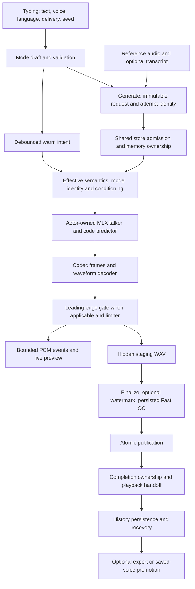
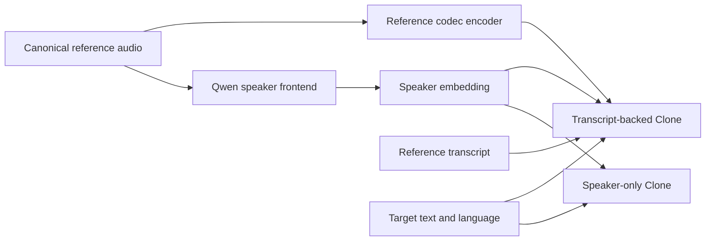

# Generation quality: causes, detection gaps and a measurable path forward

**Source checkpoint:** `566306f5ef16aa90c35c581aae3bfb1b18a43ab7`. **Investigation date:** October 10, 2026.

This report answers two separate questions: why Vocello can produce a wrong-register clone or
nonnative-sounding French despite valid settings, and how to detect those failures automatically.
It traces the complete request and audio lifecycle, reconciles the supplied historical reports,
and proposes experiments that distinguish application defects from model limitations.

It is an investigation and implementation proposal. No generation behavior, detector, threshold,
model, dependency, release requirement or quality claim was changed by this audit.

## Reading map

1. [Conclusions and priorities](#1-conclusions-and-priorities)
2. [Evidence and limitations](#2-evidence-and-limitations)
3. [What the earlier reports establish](#3-what-the-earlier-reports-establish)
4. [Complete generation lifecycle](#4-complete-generation-lifecycle)
5. [Clone conditioning and runtime](#5-clone-conditioning-and-runtime)
6. [Streaming, publication and completion](#6-streaming-publication-and-completion)
7. [Why the current harness misses these defects](#7-why-the-current-harness-misses-these-defects)
8. [Automatic detection design](#8-automatic-detection-design)
9. [Causal experiments](#9-causal-experiments)
10. [Validation and engineering sequence](#10-validation-and-engineering-sequence)
11. [Roadmap reconciliation](#11-roadmap-reconciliation)
12. [Source index and research](#12-source-index-and-research)

## 1. Conclusions and priorities

### 1.1 The quality overhaul did not finish the task that motivated it

The current system is substantially better at preserving evidence, running repeatable analyses,
rejecting gross signal corruption and comparing measured features with human recordings. Those
improvements do not establish the ability to reject an intelligible but Anglophone-sounding French
voice, a clone with the wrong habitual pitch, or a short whispered syllable in an otherwise healthy
file. The current offline QC v2 diagnostic scope explicitly excludes accent and naturalness. Clone pitch and
speaker measurements exist, but their current thresholds cannot produce a qualified clone-fidelity
flag. [S19–S23]

The central mismatch is the question being answered. A measurement inside the distribution of
human speech can still be wrong for this request. A real human can whisper, hesitate, speak French
with an English accent, or use a high register. None of that proves the output matches a request
for fluent French narration in a specific reference voice. Conversely, unusual speech can be exactly
what an expressive request intended.

**Recommended direction:** retain the existing signal and evidence safeguards; add explicit
request-relative dimensions and coverage-aware verdicts. Avoid another collection of models whose
outputs collapse into one ambiguous quality number.

### 1.2 Findings ranked by engineering priority

Priority means order of investigation or remediation, not a claim of reproduced user harm.

| ID | Priority | Finding | Evidence class | Consequence |
| --- | --- | --- | --- | --- |
| GQ-01 | P1 | Clone-lane can return PASS without any pitch or speaker measurements. | Reproduced current scoring behavior. | An unassessed dimension can be mistaken for accepted clone quality. |
| GQ-02 | P1 | A synthetic feature row with a 12-semitone reference-register offset produces no pitch flag. | Reproduced policy behavior, not generated audio. | Existing feature extraction is insufficient without qualified cuts and verdict semantics. |
| GQ-03 | P1 | Current French language checks do not assess French accent; the old accent detector was removed. | Source and history verified. | Recognizable French with English phonology can pass. |
| GQ-04 | P1 | One shipped French Voice Design starter requests a slight British accent. | Source verified; user's actual brief unknown. | The language selection and chosen suggestion can encode different language/accent expectations. |
| GQ-05 | P1 | One-off Clone can start before optional reference transcription completes. | Source verified; acoustic consequence not reproduced. | Early and later takes can use different conditioning routes without a clear visible choice. |
| GQ-06 | P1 | Clone streaming and quality-first use different waveform-decoder reference history. | Source verified; acoustic effect unmeasured. | A controlled decoder parity experiment is needed before treating the switch as delivery-only. |
| GQ-07 | P2 | History retains a seed but not a complete effective request/model/reference receipt. | Schema and finalization verified. | A bad take is difficult to reconstruct or attribute reliably. |
| GQ-08 | P2 | Studio ASR has weaker stale-operation protection than saved-voice enrollment. | Structural gap; no stale result reproduced. | Same-path replacement or A→B→A selection deserves deterministic race coverage. |
| GQ-09 | P2 | Generated Design audio can become a Clone reference paired with the intended script without new recognition. | Source verified. | Incorrect words, accent or register can become persistent reference conditioning. |
| GQ-10 | P2 | Reference format conversion is not acoustic reference qualification; peak/RMS inspect at most 30 seconds. | Source verified. | Mixed speakers, changing register or later corruption can escape existing warnings. |
| GQ-11 | P2 | macOS and iOS one-off transcript normalization differ. | Source verified; quality impact unmeasured. | Equivalent-looking drafts need not produce equivalent tokens or conditioning identities. |
| GQ-12 | P2 | Small, enriched confirmation samples do not establish product-wide failure prevalence or defect-specific precision. | Sampling and scoring verified. | The historical approximately one-third figure must remain a description of heard samples. |
| GQ-13 | P2 | Ordinary successful generation assesses signal integrity, not reference fidelity, native pronunciation or intent. | Completion paths verified. | Completion means synthesis/publication succeeded, not that every requested quality attribute was met. |
| GQ-14 | P3 | Preview and final published audio have different downstream processing histories. | Source verified. | Investigation must distinguish live preview, final playback and export. |

The first three are direct explanations for **detection failure**. GQ-04 through GQ-06 are strong
candidates for explaining **generation differences**, but cannot yet be assigned as the cause of
the user's particular Clone or Design examples.

### 1.3 What is realistically automatable

A machine can measure reference-relative pitch, content loss, gross insertion, acoustic dropout,
voicing discontinuity and speaker mismatch without a person listening to every result. French
pronunciation and accent compliance can also be assessed, but require a dedicated, qualified
language/variety-sensitive model or feature system. The current language classifier is not that
system. Emotion and intent need an even more explicit task definition and uncertainty policy.

The operating goal should be **no human listening required for each production assessment**.
Qualification still needs trustworthy truth: existing labeled corpora, previously confirmed real
failures, objectively verified perturbations and, where necessary, limited offline expert labeling.
If no further human labels are acceptable, the supported claims must remain narrower; an objective
pitch detector can be qualified more directly than a universal judgment of naturalness or sincerity.
The system must be able to say **not assessed** or **uncertain**, rather than manufacture confidence.

## 2. Evidence and limitations

### 2.1 Work performed

The lead and three read-only reviewers inspected UI drafts, request construction, the shared store,
owned MLX/Qwen implementation, codec streaming, publication, playback, History, CLI, long-form,
QC features, scoring, calibration and retained results. Applicable Axiom SwiftUI, concurrency,
media and data guidance and the installed `swift-mlx` skill informed the ownership and lifecycle
review. They supply engineering guidance, not acoustic ground truth.

Both supplied PDFs were extracted and read, with representative pages visually checked:

- **D1:** *Voice Clip Emotion & Intent Analysis — fr-0101 Dylan*, nine pages, October 1 analysis.
- **D2:** *Vocello Audio QC v1 & v2*, sixteen pages, describing the October 1 state at `8a2f22c1`
  and subsequent corrections within that report.

Current evidence was compared with those historical claims instead of assuming their implementation
or future plans still describe the repository. The current QC run and the retained Dylan take were
inspected. Two pure scoring-policy reproductions were run. Existing cached pitch outputs were
checked against both the audio identity and current runner identity before interpretation.

Private extracted text, reproduction code/results and capability inventory remain under the ignored
`build/private/qc/generation-audit-20261010/`. Raw audio, transcripts, references, labels and personal
paths are not copied into this report or Git. The named Dylan fixture was already part of tracked
project discussion; only diagnostic aggregates are repeated here.

### 2.2 What was not performed

No new synthesis, model inference, model installation, benchmark matrix, native build, phone or
Simulator run, new human listening, release action or external publication was performed. The
policy reproductions exercise actual current scoring functions with synthetic feature values;
they do not establish that a real octave-shifted waveform will be measured correctly.

The exact recent wrong-pitch Clone reference/output pair and problematic French Design request
were not supplied with this audit. The attached documents and retained Dylan example support the
detection investigation, but Dylan is a Built-in example, not a reproduction of those two recent
cases. Their causal attribution remains open pending a private request/audio bundle.

Earlier green deterministic suites and CI remain useful engineering evidence. They are not newly
executed here and do not establish acoustic correctness. This report's documentation checks are
recorded in the development checkpoint separately.

### 2.3 Evidence vocabulary

- **Verified source behavior:** executable code shows a route, rule, field or omission.
- **Reproduced policy behavior:** current pure scoring functions demonstrate a concrete decision.
- **Retained observation:** an existing run provides measurements; its original source and identities
  remain part of its meaning.
- **Previously heard defect:** the maintainer's recorded judgment, not a fresh listening claim.
- **Causal hypothesis:** plausible mechanism requiring a controlled intervention.
- **Proposed detector:** design requiring qualification before product or release enforcement.

These labels matter especially when a sound is recognizable to ASR but unacceptable to a listener.
A recognizer output is an observation from a model, not proof that every expected phone occurred.

## 3. What the earlier reports establish

### 3.1 The emotion report is informative but does not certify quality

D1 describes a roughly 5.44-second Dylan recording as largely neutral/calm, with relatively low
arousal and a descending final pitch. Its multiple models and cropped-window comparisons provide
useful hypotheses about delivery. They do not settle native accent, voice identity, word integrity
or whether the request was followed.

Several interpretation limits are material:

- Its strongest emotion2vec/CaFE results have possible training-data contamination. A held-out
  speaker in a downstream probe does not undo prior representation training on that corpus.
- A French leave-one-speaker-out probe trained on English-derived features is stronger evidence
  than an unadapted English emotion label, but remains within an acted corpus with repeated
  sentences. Transfer to synthetic speech must be tested separately.
- The smaller WavLM/Whisper evaluations have different sample sizes; their percentages cannot
  simply be averaged as interchangeable estimates.
- A weighted approximately 80% neutral result is not a calibrated posterior probability.
  The models may share training distributions and correlated errors.
- Negative semantic content does not require sad delivery. A calm reading can be appropriate;
  intent must come from the actual request, not an analyst's inference from text sentiment.
- Consistency across crops is useful robustness evidence, not independent ground truth.

Recent primary research reports substantial human-to-synthetic emotion-recognition transfer
problems; another recent preprint demonstrates that audio-language systems can lose useful
paralinguistic information while preserving content. These support careful qualification of judges,
not a conclusion that emotion detection is impossible. [R2, R3]

D1's CaFE/openSMILE route also has licensing constraints. CaFE's noncommercial terms are reported
in the supplied document; its primary metadata was not independently retrieved successfully in
this audit. openSMILE's own documentation distinguishes research use from commercial licensing.
No recommendation here authorizes adding either to the shipped product. [R8]

### 3.2 The QC report contains important corrections

D2 captures a much larger original v2 ambition than the present system: accent, naturalness,
alignment, emotion-like review and model judges were discussed alongside objective signal checks.
A later simplification removed several of those branches. The current smaller system must be
assessed on what it actually runs.

The document also corrects earlier diagnoses of the Dylan example. Those corrections must survive
any new remediation:

- The earlier approximately 1.16-second “silence” included a whispered syllable. Whispered audio is
  not silence, and a later quiet interval contains a brief voiced event.
- Muting a region and observing that ASR still recovered the text did not prove the region lacked
  speech. Recognizers can reconstruct plausible words from context.
- ZIPA's “spelling pronunciation” interpretation was withdrawn after evidence of recognizer bias
  on native French.
- A very short trailing interval alone does not establish a cut-off word. Word coverage, phonetic
  alignment, EOS and waveform context are separate evidence.
- The earlier pitch-shift injection was itself faulty. Qualifying a detector on a mislabeled
  perturbation measures neither its intended sensitivity nor its true false-negative rate.

The three retained maintainer-confirmed defects are a whispered syllable, a short false start and
an over-linked liaison with an inserted vowel. Their precise acoustic interpretation should be
localized, rather than replaced by the old invalid silence or spelling diagnosis. [S25]

### 3.3 The current Dylan counterexample

The current retained `qc-takes-20261005-214936-eb0a` analysis contains the same audio digest as the
retained Dylan WAV and reports **no flags** for that take. Selected measurements:

| Observation | Retained value | Interpretation |
| --- | --- | --- |
| Minimum ASR edit error | 0 | At least one recognizer recovered the intended content. |
| ASR phone errors A / B | 0 / 0.025 | The minimum-family combination suppresses the disagreement. |
| Language mismatch / script mismatch | 0.000014 / 0 | Consistent with recognizable French, not proof of native pronunciation. |
| Longest quiet-frame interval | 0.835 s, 3.400–4.235 s | Different from the earlier incorrectly labeled full silent interval. |
| Brief voiced event | 3.920–3.980 s | A local event can coexist with a generally quiet span. |
| Phone insertion / deletion | 0.025 / 0 | Small global error can hide a perceptually important local insertion. |
| Repeated-syllable runs | 0 | No detected repeat is not proof of no false start. |
| Last-word phone coverage | 1 | Does not support declaring a missing final word from tail length alone. |
| Longest low-GOP run | 12 phones | Descriptive pronunciation uncertainty, not a calibrated defect verdict. |
| Integrated loudness | −26.432 LUFS | A level measurement, not a pronunciation diagnosis. |
| Clipping / clicks | 0 / 0 | Gross waveform integrity can coexist with severe local speech defects. |
| Ending decay / speech-to-file-end interval | 0.020 / 0.060 s | Two different tail definitions; neither alone proves truncation. |

The human-reference percentiles for pause, phoneme and cutoff are approximately 90.54, 77 and
93.40 respectively, below their extreme-tail cuts. This directly explains the diagnostic miss:
recoverable text, largely healthy waveform and non-extreme human-relative features do not encode
the maintainer's local defect judgment.

Historical FCPE and SwiftF0 caches match this audio identity, but **neither runner identity matches
the current runner**. Recomputing only the combination of their retained outputs gives about
110.8 Hz median agreed F0, 248 agreeing 10-ms frames, 262 jointly voiced frames and 94.7% agreement
among jointly voiced frames. This is historical descriptive context, broadly consistent with D1's
approximately 112 Hz, not a current qualified pitch assessment. The agreement covers about 2.48
seconds; a high conditional agreement percentage must not be mistaken for whole-file coverage.
No current pitch inference was performed.

The named Dylan algorithm tests use synthetic audio or fake recognizers. They verify the intended
quiet-span/excerpt logic; they do not demonstrate detection of the actual whispered syllable,
false start or liaison defect. [S24]

## 4. Complete generation lifecycle

### 4.1 Ownership and data flow

The warm path prepares compatible state; it does not own the final request or qualify its output.
The expensive semantic QC harness is currently an offline path, not a stage between ordinary
short-form generation and History. [S01–S18]

### 4.2 Typing and draft state

Custom/Built-in drafts contain speaker, text, speech language, delivery and an optional pinned seed.
Design adds the voice description. Clone contains selected saved/reference identity, transcript,
target text, language and seed. Interface language is separate from generated speech language.
Changing UI language affects labels and suggestions, not an implicit rewrite of target language.
[S01, S02]

The editor validates speakable content and a weighted single-take budget of 900, with a 30,000
editor maximum and 500-character brief/delivery limits. Longer scripts route into long-form.
These prevent unbounded or empty requests; they do not make prose pronounceable, detect ambiguous
names or establish intended accent. Punctuation-only content is rejected. [S03]

Reference draft replacement/deletion invalidates associated metadata, and saved-voice hydration
uses authoritative stored metadata. These recent safeguards should be retained. The remaining
issue is not that all reference changes are unsafe; it is that one-off ASR has a weaker operation
identity than the enrollment flow.

### 4.3 Suggestions can encode a conflicting expectation

`VoiceDesignBriefCatalog.swift` lines 142–148 deliberately retain a slight British accent in the
first French starter. The placeholder is not automatically submitted: the user must select or enter
a description. Therefore this is a concrete **suggestion/content risk**, not evidence of a hidden
prompt injected into every French request. [S02]

Selecting French controls the model's language token. It does not remove an accent clause from a
voice description. A multilingual voice speaking French with a British-influenced accent can satisfy
those two inputs simultaneously, while violating the user's expectation of native French.

Recommended product policy: defaults should be accent-neutral, or explicitly specify the intended
French variety when that is the product promise. Language and accent/dialect should be separate
concepts. Authored briefs must not be silently rewritten; conflicting explicit instructions should
be visible. Do not assume metropolitan French is the desired target when the user may want Québec
French or another accepted variety.

### 4.4 Delivery composition and multilingual instructions

Localized delivery controls retain canonical English instructions behind the displayed translation.
Non-neutral Design composition adds the English labels `Voice character` and `Delivery`; neutral
delivery is omitted. French target text, a French description and an English delivery instruction
can therefore coexist. [S02, S04]

That behavior is not automatically wrong: multilingual models often accept English descriptions.
But it is not acoustically neutral by definition. An experiment must hold persona, target text,
seed and model fixed while varying only instruction language or composition. Translating a brief
while also adding “native French,” changing age and changing emotional tone would not isolate the
cause.

### 4.5 Warmup during editing

The Mac warm coordinator tracks mode, model, reference, description, delivery and language identity.
It uses short debounces, including approximately 800 ms for Design and 500 ms for Clone, cancels
stale intents and distinguishes pending from dispatched work. Auto language is resolved from the
actual script before canonical warm text is used. Existing French warm-parity tests cover this
important cache boundary. [S05]

Warmup is a latency optimization. A hit does not mean the reference is high quality, the brief is
consistent or the eventual take will sound correct. Source identity and lifecycle tests protect
reuse, not perceptual acceptance.

### 4.6 Generate, snapshot and optional transcription

Mac request factories capture the effective draft before suspension. iOS builds immutable plans in
mode-specific task closures, and the current Clone path rechecks cancellation/attempt ownership
after priming. This audit did not find evidence that an already captured Mac request mutates when
ASR completes. [S06, S07]

The important difference is **between requests**. One-off Clone's eligibility checks do not require
reference ASR to finish or be reviewed. An early tap can snapshot an empty transcript; a later tap
can snapshot recognized text. Those select speaker-only and transcript-backed conditioning,
respectively. Both are valid runtime modes, but they have different information and possible quality.

Saved-voice enrollment already has a suitable typed policy: pending, ready, failed, manual edits,
operation generations and explicit audio-only confirmation. Reuse that policy in one-off Studio
rather than adding a second boolean. Let the user explicitly choose audio-only or wait for/review
text, and record the resulting mode in the request receipt. [S08]

Mac ASR checks cancellation, selected path and an empty field; iOS checks path/empty field but does
not retain an equivalent operation-generation guard. Same-path replacement, A→B→A selection and
clearing text during recognition are precise test cases. Different-path selection already receives
protection; calling the entire flow indiscriminately racy would overstate the evidence.

### 4.7 Store admission and generation ownership

`TTSEngineStore.generate` checks support, consent, busy ownership and memory admission; it then
revalidates after suspension, starts request-specific monitoring and forwards generation-specific
events. Memory relief and cancellation retain ownership until the relevant barrier/unload finishes.
The store does not silently substitute Speed for Quality to recover memory. [S09]

These are important correctness properties. Overlapping request state, stale callbacks and premature
model release can produce severe bugs, but this investigation does not establish them as the cause
of the reported accent or register issues. Preserve the current shared store and actor boundaries.

### 4.8 Effective text, language and instructions

`GenerationSemantics` resolves text and language from compatible inputs. Explicit supported French
takes precedence over Auto detection. Auto uses script information and confidence-gated language
recognition. If detection fails, Built-in/Custom falls back to English; Design/Clone can remain
Auto for short or ambiguous text. A Clone reference's language does not override
the requested target language. English diction reinforcement is gated to English output, so it is
not a demonstrated source of unwanted English reinforcement in explicit French. [S04]

Custom uses speaker and supported delivery controls. Design uses voice description plus delivery.
Clone uses reference transcript when available and does not accept arbitrary Design-style delivery
as a substitute for reference conditioning. The resolved language reaches a codec language embedding;
instructions remain a separate text conditioning sequence. The model can therefore receive French
and a requested English accent at the same time. [S10, S11]

### 4.9 Model selection and limits of its contract

All six shipped catalog variants are **1.7B**: three Qwen families, each in Speed 4-bit and Quality
8-bit forms. Speed is not a 0.6B variant. Artifact receipts bind immutable revisions and required
components; runtime profiles validate family/capability, sample rate and tokenizer type. Quantized
modules are selected using checkpoint metadata rather than indiscriminately quantizing everything.
[S10, S11]

Those checks establish which implementation and weights ran. They cannot establish that the weights
produce the desired accent or preserve pitch on a particular reference.

The official Qwen documentation lists Dylan as Chinese/Beijing and recommends each built-in's native
language for best quality; none of the nine built-ins is a native French voice. French support at
the model level is not a per-speaker guarantee of native French pronunciation. This matters for the
Dylan counterexample, but does not explain an unrelated Design take by itself. [R1]

## 5. Clone conditioning and runtime

### 5.1 Format normalization is not reference qualification

Audio preparation reads the first audio track and converts to mono 24 kHz PCM16. The default
resource limits include 250 MiB and 120 seconds with bounded load/decode time. It does not select
a clean excerpt, separate speakers, denoise, remove reverb, normalize loudness or choose a stable
register. The full normalized reference is passed into conditioning. [S12]

Existing warnings include duration, unreadable/noncanonical format, very low RMS and near-clipping
peaks. Peak/RMS inspection reads at most 30 seconds even if the permitted reference is longer.
A later speaker change or damaged tail is outside that particular check. This is a verified coverage
boundary, not evidence that the user's reference contains those problems. [S13]

Before blaming a model, measure the source and normalized file's rates, sample counts, durations,
channel behavior and spectra. An actual sample-rate interpretation error produces coupled duration
and pitch changes:

`pitch shift in semitones = 12 × log2(playback-rate ratio)`; `duration ratio = 1 / playback-rate ratio`.

A register shift without the corresponding duration ratio is less consistent with a simple timebase
mistake. Current format checks make an obvious 44.1/24 kHz mix-up unlikely in the inspected path.
Stereo phase cancellation or separate speakers in different channels still require source-specific
inspection; AVFoundation downmixing is not quality-driven channel selection.

### 5.2 Two distinct information budgets

Without a transcript, Clone uses the speaker embedding alone. With a transcript, it also provides
reference text and encoded reference audio through in-context learning. Official Qwen guidance
likewise distinguishes these routes and warns of potentially lower quality in speaker-only mode.
The richer route can preserve more reference information, but an inaccurate transcript can make
its text/audio conditioning inconsistent. [S13, S14, R1]

Neither route provides a numeric F0 target, an allowed semitone deviation or a closed-loop pitch
constraint. Speaker identity and register are correlated but distinct. An embedding can recognize
a speaker despite a register change, which is useful for speaker verification but insufficient for
faithful cloning.

### 5.3 Current repairs that must not be misdiagnosed as open bugs

The Qwen speaker frontend now uses the appropriate 24 kHz magnitude/log-mel construction: FFT
1,024, hop 256, reflection padding 384, 128 Slaney-normalized bands and natural log with floor
`1e-5`. It is explicitly separated from the generic Whisper-style power/log10 helper. Golden-cell
tests compare against an independent construction. The repair entered in `2047d485`. [S14]

Current conditioning identity includes the feature/runtime version, immutable model identity and
full reference content SHA-256. Incompatible earlier features cannot legitimately survive as a
cache hit. Target language is deliberately supplied per generation rather than duplicated into a
reusable reference artifact. The ICL reference/target word boundary has also been repaired.

Current code applies temperature before probability truncation, isolates request RNG, and rejects
maximum-token completion as successful publication. These former issues should not be reopened as
current causes without new evidence. [S11, S13–S15]

One local preprocessing choice remains worth a controlled characterization: 500 ms of silence is
appended before ICL reference codec encoding, while the speaker encoder sees the unpadded audio.
Its version is included in conditioning identity. This is not sufficient evidence of a bug or a
reason to remove it immediately.

### 5.4 Transcript parity between platforms

Mac one-off Clone uses `TranscriptNormalization.conditioningLine`; iOS passes draft text to a shared
resolver that trims edges but preserves internal whitespace. The ICL tokenizer neutralizes chat
control tokens but does not perform that same internal whitespace canonicalization. Consequently,
multiline or irregular text can produce different tokens/cache identities across platforms. [S06,
S07, S13, S14]

Unify the contract in a shared preparation seam and test exact normalized bytes/token inputs.
Do not infer that this difference caused a pitch or French-accent failure: that remains unmeasured.
A migration must preserve original user text for display while recording effective conditioning
text locally and versioning any change that affects cache or generation identity.

### 5.5 Sampling and stopping

Nominal policy uses talker temperature 0.9, top-k 50, top-p 1.0 and repetition penalty 1.05. Balanced
uses temperature/top-p 0.8/0.95; Consistent uses 0.7/0.9. Subtalker sampling inherits the relevant
settings unless a gated diagnostic override is used. Thus Consistent changes acoustic codebook
sampling as well as first-codebook sampling. It is not a mathematical guarantee of pitch stability.
[S15]

Each request has an effective seed and isolated MLX random state. A seed alone is not a complete
reproduction recipe: prompt tokens, reference, model revision, precision, conditioning mode,
sampling algorithm, execution style and postprocessing also matter.

The production maximum is 2,048 codec frames, approximately 163.84 seconds at 12.5 frames/second.
The product rejects cap termination rather than publishing it as a normal completed take. Valid EOS
can nevertheless occur before every word has been realized. Repetition penalty applies to generated
code IDs, not recognized word repetitions; it cannot guarantee absence of speech false starts or
stutters. [S14–S16]

### 5.6 Decoder history: the strongest runtime isolation experiment

In transcript-backed Clone, the streaming route resets the waveform decoder and decodes generated
codec frames without prepending reference codes. Quality-first combines reference and generated
codec frames, decodes them, then removes the exact reference sample window. Both use ICL talker
conditioning, but the waveform decoder starts from different history. [S14]

Possible effects include onset timbre, first-word articulation, early voicing and early F0. A local
cold-start effect may decay; it cannot be assumed to explain a sustained whole-clip register shift.
A normal “same seed, stream versus no-stream” test also changes enough execution behavior that it
would not isolate this mechanism.

The decisive test is to retain one exact generated codec trace and decode it three ways: zero
history, reference-primed streaming with discarded reference PCM, and combined quality-first.
Then compare primed streaming with quality-first across partition schedules. Keep talker sampling
out of the experiment. Existing tiny-decoder partition/reset tests are valuable, but do not prove
this shipped-weight reference-history equivalence. [S17]

## 6. Streaming, publication and completion

### 6.1 Autoregression and bounded event delivery

The talker predicts the first codebook token, the code predictor predicts remaining codebooks, and
the next autoregressive input combines codec and text embeddings. The decoder produces mono 24 kHz
samples. Lazy MLX audio is materialized inside the owning execution task before an event sink can
suspend; a final synchronization boundary preserves ownership of the tail. [S14]

The shared store drains generation-specific bounded events. Playback validates sample rate, frame
count, byte count and contiguous offsets. A discontinuity disables live preview and records a
failure instead of silently accepting an invalid stream. Reviewed player code uses the supplied
sample rate and contains no deliberate pitch-shift path. [S09, S18]

If the file itself has the wrong pitch, first investigate conditioning/generation. If the file is
correct but preview sounds wrong, compare the exact preview format and playback path. Do not infer
a playback bug from a perceptual complaint alone.

### 6.2 Raw audio, processed PCM and published WAV are distinct observation points

Clone has a leading-edge gate using 20 ms windows, three consecutive active windows, a threshold
of 0.001 and up to 80 ms pre-roll. It trims an initial quiet edge, not interior pauses. The stateful
limiter uses an amplitude ceiling of 0.965 and maximum single-sample step of 0.42, replaces nonfinite
samples with zero and converts to PCM16. [S16]

These operations can affect transients and envelopes when activated. They do not implement an
explicit pitch shift. Nevertheless, onset diagnostics should compare pre-gate float output with
post-gate PCM so a trimmed symptom is not mistaken for absence of the upstream behavior.

Processed PCM feeds preview and staged WAV. Finalization can then watermark the staged file before
persisted-byte Fast QC and atomic publication. Live preview can already have been heard before
that later transformation and final check. A final failure prevents publication but cannot retract
what streamed earlier. Record preview versus final playback when reproducing a complaint.

### 6.3 Finalization, cancellation and persistence

The shared executor arbitrates cancellation and finalization ownership. A materialized result lost
to cancellation is cleaned once; after finalization is claimed, cancellation is refused so an
accepted output does not become a cancelled History take. The native barrier remains authoritative
even when audible preview stops promptly. Failure/cancellation hooks abort preview and clean
materialized files best effort. [S07, S09, S16]

Successful hooks hand off playback, enqueue/persist History and publish the inline player. History
recovery distinguishes durable persistence from a session-only recovery state. This is sound
separation: synthesis completion need not imply persistence succeeded. Optional iOS export remains
behind the established export authority. [S18]

No ordinary short-form completion hook invokes native-accent analysis, reference-pitch comparison,
speaker verification or emotion recognition. The cadence notice reflects Fast QC. The separate
`GenerationOutputVerifier` is a diagnostics/benchmark helper, and transcript-derived language scores
cannot certify phonetic accent.

### 6.4 History currently cannot reconstruct a complete request

History records text, mode, tier, voice/display description, emotion, audio metadata, association
and seed. It does not retain the complete selected/resolved language, variation, exact model
artifact, reference digest/transcript route or request correlation identity. Pinning a seed restores
a seed into a current draft; it does not restore all causal inputs. [S18]

Extend existing CLI/request receipt machinery instead of inventing a second identity scheme.
Proposed versioned local receipt:

| Group | Fields required for useful attribution |
| --- | --- |
| Request | Correlation ID, mode, original and effective input references, selected and resolved language, explicit accent/variety target if any, delivery/brief composition version. |
| Sampling | Effective seed, all talker/subtalker controls, sampler version, streaming/quality-first mode and codec partition policy. |
| Model | Family, variant, immutable artifact/tokenizer/codec identities, runtime/preprocessing versions. |
| Clone | Original/normalized reference digests, reference provenance, transcript digest/source/review state, conditioning mode, normalization version. |
| Output | Stage identities, published audio digest, sample rate/frame count, finish reason, Fast QC version/results, assessment coverage. |
| Environment | App/runtime source identity and relevant hardware/backend data; avoid unnecessary personal information. |

Keep raw text, reference and transcripts local/private. Public diagnostics should expose allowlisted
summaries or opaque identities under the existing privacy policy. A receipt improves diagnosis; it
does not justify recording private prompts in Git.

### 6.5 Saving generated Design voices can preserve the original defect

Design completion can create a reusable voice candidate from generated audio and the **intended
script** as transcript. Enrollment treats an existing supplied transcript as existing text, not fresh
ASR confirmation. If Design omitted or altered speech, the pair can be inaccurate. If it created
the wrong accent/register, Clone may faithfully preserve the wrong reference. [S06–S08]

Before promoting generated audio, perform content agreement and reference eligibility checks;
retain origin as generated/verified or generated/unverified. Separate “this voice is liked” from
“this audio/text pair is verified.” Automatic content checks can reduce this risk without claiming
that ASR guarantees every phone or subjective voice attribute.

### 6.6 Long-form and CLI have different comparison boundaries

Long-form resolves Auto language from the whole script, uses deterministic segment sub-seeds,
generates sequentially and revalidates retained segment QC on resume. Segment and joined output
receive signal checks. Assembly trims bounded edge silence, applies short fades and bounded RMS
gain at 24 kHz. It does not pitch-shift or verify cross-segment identity. Independent Design segments
can vary in voice/prosody even if every segment is individually valid. [S26]

Add cross-segment register/identity/delivery analysis, and evaluate a stable verified Design-to-Clone
reference when continuity matters. A joined-file global score can hide a single wrong segment.

CLI streams events by default but does not play them live. A raw reference uses an explicit
`--transcript`; it does not opportunistically read a neighboring text file. Missing text emits an
x-vector-only note. The app's best-effort ASR makes otherwise similar CLI/app requests potentially
different. Match conditioning before comparing outputs. CLI JSON already records selected/final
language and reference/transcript identities that can seed the History receipt design. [S27]

## 7. Why the current harness misses these defects

### 7.1 Three assurance layers must remain distinct

| Layer | Current question | Valid conclusion | Invalid conclusion |
| --- | --- | --- | --- |
| Runtime/lifecycle | Did the owned operation finish safely and publish a valid result? | Ownership, cancellation, artifact integrity and completion rules held. | The voice sounds correct. |
| Fast QC | Is the persisted signal grossly corrupt or outside conservative waveform limits? | No detected gated signal failure. | Native French, faithful clone or correct emotion. |
| QC v2 diagnostics | Which measured features are unusual under the current calibration? | Named observations and report-only comparisons. | An empty flag list proves quality or release suitability. |

Fast QC handles empty/nonfinite/near-silent output, clipping, clicks, dropout, DC offset, onset and
duration-related conditions. Warnings are accepted. Its conservative thresholds explicitly do not
claim naturalness. Observational metrics are not all verdict inputs. [S16, S19]

QC-08's proposed frame-relative silence, ending and loudness work remains useful, but gain and fades
cannot repair English-influenced French vowels, a false start or a mismatched reference register.
Output shaping and defect detection need separate acceptance evidence.

### 7.2 Current model roles do not imply current coverage

The configured roles use Qwen3-ASR, Whisper, two phone-recognition families, G2P/Panphon, FCPE,
SwiftF0 and ReDimNet. The latest retained 957-take QC run contains 479 English and 478 French takes:
359 Built-in, 278 Design and 320 Clone. All have ASR/G2P/phone outputs, but **none has pitchA,
pitchB or speaker outputs**. Its summary is 164 warn, 388 report-only and 405 unflagged, with zero
fail and zero errors. The scoring identity matches the frozen thresholds. [S20–S23]

No retained current QC run inspected was a clone-lane or voice-reliability run; all nine retained
feature-run directories lacked pitch/speaker features. Old pitch caches elsewhere do not fill that
current evidence gap, especially when their runner identities differ.

The presence of Clone takes in `qc-takes` therefore does not establish Clone **fidelity** testing.
Lane names, take modes and available installed models are different from actual applicable model
outputs and qualified detector coverage.

### 7.3 Reproduced PASS semantics

Two read-only experiments invoked actual `score_run` and `gate` using benign synthetic signal,
pause, engine and level features. The file-reading boundary of `gate` was mocked to the computed
result; inference and waveform measurement were not mocked because neither was run.

| Case | Added clone evidence | Result |
| --- | --- | --- |
| A | No pitch or speaker features. | Zero flags, zero errors, clone-lane `pass`, exit 0. |
| B | Absolute reference-register offset 12 semitones for one take, zero for a comparison take. | Uncalibrated within-run pitch z-score 1.0 for the outlier, no cut or pitch flag, zero errors, `pass`, exit 0. |

Mechanism: clone pitch/identity threshold entries are report-only with no language cuts; the scorer
discards those fitted entries. Their detector definitions contain no provisional rule, so no cut is
available to emit a flag. Missing detector inputs become errors only when the detector already has
a non-report-only level. Runner failures can be recorded while collection continues; gate verdicts
do not independently require clone coverage. [S20, S21]

Completely empty evidence can fail because other qualified detectors need inputs. The finding is
specifically **missing or unqualified clone-fidelity coverage can yield PASS**, not a universal claim
that every missing analysis passes. Existing report-only design should remain honest; the remedy
is not to silently promote unqualified thresholds into hard failures.

### 7.4 Language detection is not accent detection

The wrong-language detector uses the smaller mismatch between ASR families and a transcript-script
check. French and English both map to Latin script. A fluent recognizer can recover French words
from heavily Anglophone pronunciation; near-zero WER and a French language posterior are compatible
with the user's complaint. [S21, S22]

The current broad phone normalizer merges French /ʁ/ and English /ɹ/ into `r`, and drops stress,
length and tone information. These choices can be reasonable for tolerant content scoring, but
would erase evidence in a pronunciation/accent pathway. Keep the robust content normalization and
create a separate narrow representation; do not break content metrics just to repurpose them.

Commit `24e8b715` removed the explicit accent branch, alignment, MOS/naturalness, tonal-collapse and
LLM judges. The documented reason was a leaner scope and disappointing judge trials. That explains
the present coverage boundary; it does not prove accent detection is impossible. [S25]

### 7.5 Calibration population and sampling limitations

Human-control calibration uses 1,600 recordings across eight languages. French has 200 clips from
66 speakers, separated into 101 calibration and 99 check clips with disjoint groups of 33 speakers.
Speaker separation is good practice. The unresolved issue is construct validity: generic human
read speech is not a paired reference-clone fidelity dataset, nor a request-labeled accent corpus.
[S23]

French content-phoneme false alarms are 2/99 (2.02%, upper bound 7.11%); wrong-language false alarms
are 3/99 (3.03%, upper bound 8.60%). They do not meet current warn qualification and remain
report-only. Nominal percentile selection also does not ensure exactly 1% empirical false alarms
when quantile ties occur. Trust actual holdout rates.

The 39 confirmations contain 34 decisive judgments and five uncertain ones. Among decisive answers,
11/34 were unusable; flagged takes contributed 9/29, unflagged 2/5. The queue deliberately enriches
high scores and agreement buckets, prioritizes languages, excludes clones and supplies no usable
inclusion probabilities. These data show no convincing flag enrichment in that small reviewed set.
They do not estimate overall product failure prevalence, clone acceptance, reliable recall or a
precise random-output failure rate. [S23]

Current confirmation precision can credit any objectionable take to its triggering detector. A
pause flag can receive credit when the actual complaint is accent. Future automation needs
**defect-class and time-span truth**, not only one binary usable/unusable label.

## 8. Automatic detection design

### 8.1 Verdict contract before more models

Represent three independent dimensions:

1. **Execution:** completed, failed, interrupted or incomplete.
2. **Coverage:** measured and qualified, measured but uncalibrated, unavailable, insufficient audio,
   unsupported, or not applicable.
3. **Defect decision:** accepted, rejected or uncertain, per requested attribute.

A Clone assessment should declare whether reference identity, register and content were actually
assessed. An accent assessment must name the target variety and supported calibration. A lane can
complete successfully while returning **quality not assessed**. Preserve existing automation exit
contracts through a deliberate versioned migration, with tests for every missing/uncalibrated path.

Do not turn uncertainty into a product failure by default, and do not turn it into acceptance.
The UI/report should explain the unsupported dimension. Release acceptance can require qualified
coverage for specific dimensions without pretending that the offline diagnostic harness already
has that authority.

### 8.2 Clone pitch/register: implement first using installed components

Use FCPE and SwiftF0 on both the normalized reference and generated audio. Retain their raw
confidence and voiced masks; combine only appropriately aligned, credible frames. Existing code's
50-cent agreement criterion is a useful starting measurement rule, not an acceptance tolerance.

Measure separately:

- signed register difference: median log-F0 of generated speech minus reference;
- absolute deviation for ranking, while preserving direction for explanation;
- robust lower/upper voiced quantiles and pitch-range change;
- time-local sustained shifts and onset-versus-later differences;
- jointly voiced duration, speech coverage, tracker agreement and octave disagreement;
- reference adequacy, including multiple speakers, creak, whisper and too little voiced material.

Use semitones or cents rather than absolute Hz differences. A 20 Hz error has different perceptual
meaning near 80 Hz and near 300 Hz. Do not count interpolated silent frames as measured pitch, and
do not report high agreement without its denominator and supported duration.

The existing within-take sustained-shift measure is relative to that take's median, so a uniformly
wrong register may look internally stable. Reference-relative comparison is essential. Conversely,
reference and target often contain different words; forcing unrelated contours through DTW can
create misleading similarity. Compare distributions unless linguistically matched spans exist.

Calibrate on same-speaker recordings across different texts, sessions, delivery and languages,
including natural register variation. Use different-speaker and naturally failed clone pairs as
negative cases. Evaluate physically verified shifts as controlled sensitivity tests, but do not
rely on injected shifts alone. A pitch shifter may alter timbre and create easy artifacts unrelated
to natural model drift.

Uncertainty should use utterance/segment or speaker-level resampling, not treat thousands of highly
correlated pitch frames as independent samples. Choose tolerances using held-out acceptance costs;
**no universal two-semitone gate is justified by this audit**. A +12-semitone synthetic policy test
exposes missing decision logic, not a calibrated product threshold.

### 8.3 Speaker identity is a separate assessment

Retain reference-to-output embedding similarity, worst-window similarity and within-take drift.
Calibrate using same-speaker cross-text/cross-channel positives and plausible different-speaker
negatives. Short windows, noise, emotion and accent can move embeddings; a cosine value has no
universal accept/reject interpretation.

Combine identity and register as separate reported axes. A voice may preserve speaker identity but
use the wrong pitch, or match pitch while sounding like a different speaker. Never average them
so a strong score on one hides a severe failure on the other. A file too short for a meaningful
local identity window should be insufficient coverage, not implicitly perfect stability.

### 8.4 French pronunciation and accent compliance

Define the target first: French language alone, a requested French variety, or French intentionally
spoken with another accent. The detector should assess the audible instruction match, not infer
speaker ethnicity or enforce one variety as intrinsically correct.

A useful pathway has several complementary parts:

1. **Eligible phone contexts:** derive expected pronunciations with accepted variants and retain
   uncertainty for names, borrowings and ambiguous text.
2. **Narrow acoustic/phone evidence:** preserve rhotic distinctions, vowel quality/rounding, nasal
   realization, vowel duration and relevant prosodic information discarded by broad content scoring.
3. **Local alternatives:** compare expected versus plausible English-influenced realizations using
   phone posteriors or calibrated pronunciation scores, rather than only decoded transcripts.
4. **French boundary rules:** assess schwa and liaison in the actual grammatical/word context,
   allowing legitimate regional/style variation while identifying inappropriate inserted segments.
5. **Prosody:** consider phrase rhythm, prominence and duration patterns over enough speech; one
   rhotic or one stressed word cannot determine an entire accent.
6. **Qualified fusion:** use disagreement between witnesses as evidence/uncertainty. Requiring the
   minimum error from every family can erase a real problem whenever one recognizer repairs it.

French pronunciation research demonstrates that phone-level and prosodic features can discriminate
specific learner deviations. It does not provide an immediately validated, commercial, Anglophone-
French TTS gate. An existing French learner corpus from another first-language population cannot
be assumed to represent this user's target failure. [R4, R5]

Begin with a constrained claim such as “evidence of these French pronunciation deviations on eligible
contexts,” then qualify an accent-level conclusion on matched native-variety and nonnative controls.
Include Québec and other supported varieties if they are in product scope; split speakers, texts
and recording sessions across training/calibration/test. Prevent microphone, dataset or recording
quality from becoming an accidental accent classifier.

### 8.5 Whispered syllables, false starts and liaison insertion

These need time-local evidence, not one clip-wide score.

**Unexpected whispered/devoiced vowel:** align eligible vowel spans; inspect local voicing,
relative energy, periodicity/HNR or CPP, spectral tilt and transitions into/out of the span. Expected
unvoiced consonants, breathy voices and explicitly requested whisper must not be flagged as the same
error. F0 trackers become unavailable on whisper; missing F0 is a clue to investigate, not itself
proof of corruption.

**False start or fragment:** retain phone posterior fragments, local insertions/restarts and acoustic
onsets near boundaries even if the global ASR transcript is correct. Verify that the recognizer does
not hallucinate those same fragments on noise or silence. Use cropped excerpts with sufficient
context; muted-whole-clip ASR is not a valid localization proof.

**Over-linked liaison/inserted vowel:** score the actual boundary's allowed realizations and inspect
the extra acoustic segment. Global optional-schwa normalization can hide this defect. Allow multiple
legitimate realizations without licensing every inserted vowel.

**Ending/cutoff:** combine engine termination, expected last-word coverage and alignment confidence.
Short tail, final falling pitch and early EOS are different signals. A fade can improve presentation
but cannot restore a missing phoneme.

For each detector, require positive and negative real examples of the named defect, predicted spans
and a minimum evidence requirement. “Something sounds bad somewhere” labels are insufficient for
qualifying localization or a named explanation.

### 8.6 Delivery, emotion and intent

Normalize a request into measurable dimensions where possible: speaking rate, intensity, register,
pitch range, breathiness/texture, affect and explicit accent. Preserve user-authored nuance rather
than translating every description into a fixed emotion class.

Existing paired-seed delivery gates can test a directional effect: for example, whether an energetic
instruction changes rate/range relative to neutral. That is not proof of convincing excitement,
sincerity or narrative appropriateness. Existing prosody heuristic success likewise does not imply
calibrated quality when `calibrationStatus` is unqualified. [S28]

Use task-specific learned judges only after testing them on synthetic French and the requested
styles, including contradictory text/emotion and identical text with different audio delivery. If
a judge answers from text sentiment rather than sound, it is not qualified for this purpose.
Retain uncertainty for subtle irony or intent not objectively specified by the request. The supplied
emotion ensemble is an exploratory feature source, not a ready-made acceptance oracle.

### 8.7 Naturalness models and new tools

SQuId and UTMOS-family work show that learned naturalness prediction is a legitimate research
approach. Their reported datasets and benchmarks do not establish this product's French-accent,
clone-register or instruction-following accuracy. A MOS predictor could be an additional ranking
witness after local qualification; it must not replace those specific dimensions. [R6, R7]

Start with installed pitch/speaker/phone infrastructure and better contracts. Consider new alignment,
pronunciation or naturalness tools only after a small evaluation defines the missing capability,
license, model size, memory footprint, latency and offline operation. Reintroducing all removed
models would repeat the earlier scope problem. No new dependency or model is authorized by this
report, and no cloud speech upload is proposed.

### 8.8 Runtime integration and remediation policy

Keep lightweight deterministic signal gates on the critical path. Run expensive semantic assessment
as an explicit post-generation or benchmark phase, potentially asynchronously with clear status.
A full 1.7B ASR plus multiple acoustic models may be inappropriate alongside generation on a
memory-constrained device; measure peak residency and serialize work under the existing policies.
Mac qualification does not establish iPhone feasibility.

Automatic remediation needs separate validation:

- Candidate selection may reject an outlier only after its detector is qualified.
- Bound retry count, retain the original failed output/receipt, and record every new seed.
- Avoid optimizing generation against the exact evaluator used as the final acceptance oracle.
- Do not apply blanket pitch shifting: register correction can damage formants, identity, prosody
  or artifacts while leaving the actual cause untouched.
- Do not silently replace a chosen take or rewrite its reference transcript.
- Preserve a user's ability to inspect/export an uncertain result under a clear policy; uncertainty
  and objectively invalid audio should not be conflated.

## 9. Causal experiments

### 9.1 First obtain a complete private failure bundle

For each recent complaint retain original reference, normalized reference, generated final WAV,
exact target/brief/delivery, selected language, actual conditioning mode, model revision/variant,
seed/variation and whether the complaint concerns preview or final playback. Record missing fields
explicitly instead of reconstructing them from memory. History's current limitations may make exact
replay impossible for an old clip; that is a reason to add receipts, not to invent provenance.

### 9.2 Small experiments with discriminating outcomes

| Order | Experiment | Hold fixed | What a result would establish |
| --- | --- | --- | --- |
| 1 | Verify source→normalized→output timebase and channels. | Original files; no generation required. | Distinguishes sample-rate/duration mistakes from register changes. |
| 2 | Speaker-only versus reviewed transcript-backed Clone. | Reference, target, model, seed, execution and sampling. | Estimates conditioning-route effect; does not conflate ASR timing with randomness. |
| 3 | Whole reference versus a clean same-speaker excerpt with matching transcript. | Target, model and seed policy. | Tests reference suitability; excerpt selection must be recorded and not cherry-picked. |
| 4 | Identical generated codec trace: zero-history versus reference-primed versus combined decode. | Codec tokens, reference tokens, decoder weights and partition schedules. | Isolates decoder acoustic-history effect without talker randomness. |
| 5 | Actual French brief versus accent-neutral/explicit-variety clause. | French token, persona, delivery, text and paired seeds. | Tests accent conflict; changing multiple persona attributes would confound it. |
| 6 | Equivalent French/English instructions and wrapper/no-wrapper. | Meaning, target and sampling. | Tests instruction-language/composition effects, separately from explicit accent. |
| 7 | Consistent/Balanced/Expressive. | Conditioning and multiple paired seeds. | Measures distributional effects; record talker and subtalker controls. |
| 8 | Speed 4-bit versus Quality 8-bit. | Family, references, scripts and paired seed set. | Measures precision-related failure rates; same seed does not equal identical logits. |
| 9 | Streaming versus quality-first beyond Clone. | Request/model; separate conditioning differences. | Measures full execution-mode effect without pretending all prompt layouts are identical. |
| 10 | Raw float→limited PCM→watermarked WAV. | One exact generated trace/output. | Localizes publication-stage changes in onset, spectrum or measured quality. |
| 11 | Upstream implementation parity at intermediate tensors. | Token IDs, mel inputs, weights and forced token sequence. | Finds implementation divergence before comparing stochastic end-to-end outputs. |

Use a small discovery cohort, then confirm the chosen hypothesis on held-out speakers/scripts/seeds.
Do not run the full factorial immediately. A codec replay and two well-controlled conditioning arms
may eliminate several explanations more efficiently than hundreds of unrelated takes.

### 9.3 Measurement discipline

Source-bound lanes run on clean committed checkpoints, with known workers joined, host-wide native
serialization, installed assets and required memory/optimization receipts. Retain failures and
explain every rerun under a new identity. Source or scoring changes produce new measurement/
threshold identities under existing policy. An exploratory loaded-host run is not a publishable
performance baseline.

Measure onset and steady-state separately for the decoder experiment. For acoustic comparisons
record content, identity, register, local pronunciation, duration and signal integrity together so
an apparent improvement in one cannot hide regression in another. Report effect sizes and
uncertainty by language/mode, not only pooled averages.

## 10. Validation and engineering sequence

### 10.1 Stage A: honest evidence and reproducible requests

Implement coverage-aware outcomes and expected-model completeness first. Add deterministic tests
for missing pitch, missing speaker, failed runner, stale identity, uncalibrated language, short
reference, measured-but-uncertain output and a fully qualified synthetic fixture. Preserve existing
report-only behavior while removing any implication that an unassessed dimension passed.

Unify one-off Clone readiness with typed enrollment state, add stale-operation/content-identity
tests, align transcript normalization, and persist a versioned request receipt. Make French starter
expectations explicit. These are small product/workflow changes that reduce ambiguity before any
new acoustic model is adopted. They still need ordinary native review/tests when implemented.

### 10.2 Stage B: qualify the existing clone measurements

Build a paired reference/output corpus with real same-speaker variability and actual failed clones.
Execute the current installed pitch and speaker models in the appropriate lane. Qualify signed
register and identity separately, with coverage and abstention. Complete the codec-history replay
before attributing streaming differences to generic model instability.

Acceptance requires a declared domain, held-out per-class confusion matrix, precision/recall,
false acceptance, false rejection, coverage and confidence intervals. Do not choose a threshold on
the test split and then call that split independent. Include short/noisy/whispered references that
must abstain, not just clean easy examples.

### 10.3 Stage C: targeted French defect challenge set

Create a sealed challenge set for the reported accent and local defects, using existing retained
cases and appropriately licensed external labels. Include normal French variants, intentionally
requested nonnative accent, expressive/whisper instructions and difficult liaison contexts as
negative controls. Split by speaker, script and session; include unseen generated voices and model
variants. Synthetic perturbations supplement natural failures rather than replacing them.

Qualify local phone/phonation detectors before promoting an overall accent verdict. Track uncertainty
and localization accuracy. If no qualified detector exists for a class, report unsupported rather
than presenting ASR correctness as a surrogate.

### 10.4 Stage D: optional automatic selection and delivery assessment

Only after Stage B/C qualification should bounded regeneration or candidate ranking be evaluated.
Use an independent holdout evaluator and retain the full candidate distribution. Measure whether
selection actually reduces the named defect without worsening identity, content, latency or memory.
Emotion/naturalness models follow the same process; their value must exceed their cost and failure
risk on the supported product domain.

### 10.5 Verification matrix

| Behavior | Existing evidence | Additional acceptance needed |
| --- | --- | --- |
| Language selection and request assembly | `GenerationSemanticsLanguageTests`, Mac request factory and French warm parity tests. | iOS/Mac shared input parity; actual French phonetic/accent assessment. |
| Clone reference lifecycle | Draft, confidence, publication race and enrollment tests. | One-off readiness and operation-generation races; actual reference suitability. |
| Cancellation/store ownership | Store, runner, executor, barrier and memory tests. | Concrete production adapter integration remains in DA-13; acoustic analysis is separate. |
| Qwen frontend and decoder mechanics | Golden mel cells; tiny decoder partition/reset tests. | Shipped-weight reference-history replay and end-to-end reference fidelity. |
| Fast QC/atomic publication | Signal contracts, output adapter and WAV publication tests. | Local phonetic defects; pre/post-stage comparison; QC-08 qualification before version change. |
| Pitch extraction | Tracker schemas, combination helpers and retained historical results. | Current exact identities, voiced coverage, paired clone calibration and useful thresholds. |
| French content/language | Two ASR families, phone features and held-out human controls. | Accent-sensitive representation and French defect-specific truth. |
| Emotion/delivery | Paired effect heuristics and D1 exploratory analysis. | Synthetic French target-domain validation, text-shortcut tests and abstention. |
| History replay | Seed migration/roundtrip and persistence recovery. | Complete versioned request reconstruction and privacy-safe receipt migration. |
| iOS runtime quality | Shared source and generic compilation can establish compatibility. | Physical-device audio/memory/background evidence remains deferred. |

No native build is required merely to validate this report. Implementation will require the routed
Swift/Python/contracts checks and the smallest relevant actual-model lane; deterministic green tests
must never be presented as proof of perceptual acceptance.

## 11. Roadmap reconciliation

Use existing items rather than opening a second task ledger:

- **QC-04:** owns real lane qualification and wiring. Add coverage-aware verdicts and explicit
  expected model inputs; installed roles or Clone rows alone do not close it.
- **QC-06:** owns reference-register, Design compliance and the Dylan defect classes. Attach the
  conditioning/readiness, French starter, reference promotion, decoder-history and targeted detector
  experiments to this existing investigation. Its older register statistics are historical leads,
  not measurements rerun in this audit.
- **QC-08:** remains the scoped Fast QC silence/finishing proposal. It cannot close accent or identity
  acceptance and requires a new qualified algorithm/lineage version when implemented.
- **RF-14:** remains a release-quality decision. Correct the population wording to the reviewed
  sample; do not erase the existing approval/listening requirement or claim a validated automatic
  substitute now. Replacing that requirement later needs an explicit qualified acceptance decision.
- **DA-13:** retains the concrete production-generation adapter integration gap and related native
  coverage. New model-level tests should use its existing architecture rather than create a second
  test engine. Phone-dependent obligations remain deferred.

No unfinished item is marked complete. This investigation provides source-grounded next steps and
reproduced decision gaps; it does not complete detector qualification or release acceptance.

## 12. Source index and research

Line numbers refer to the source checkpoint above and can move after implementation. Links target
authoritative files; named symbols and line anchors below identify the reviewed seams.

### 12.1 Repository sources

| ID | Source and reviewed locations |
| --- | --- |
| S01 | [GenerationDrafts](../../Sources/iOSSupport/Models/GenerationDrafts.swift):67–85,96–250, shared values and reference invalidation. |
| S02 | [VoiceDesignBriefCatalog](../../Sources/SharedSupport/Services/VoiceDesignBriefCatalog.swift):35,53–88,142–148, localized display and French starter. |
| S03 | [GenerationTextLimitPolicy](../../Sources/SharedSupport/Services/GenerationTextLimitPolicy.swift):8–25,73–105. |
| S04 | [GenerationSemantics](../../Sources/QwenVoiceCore/GenerationSemantics.swift):531–559,624–694,802–870,1145–1176; [PromptLanguageDetector](../../Sources/QwenVoiceCore/PromptLanguageDetector.swift); [EmotionPreset](../../Sources/QwenVoiceCore/EmotionPreset.swift):176–210. |
| S05 | [MacGenerationWarmupCoordinator](../../Sources/Services/MacGenerationWarmupCoordinator.swift):5–49,79–121,148–207; [warm-language tests](../../Tests/VocelloCoreTests/ClonePrimingAndWarmLanguageTests.swift). |
| S06 | [MacVoiceDesignScreen](../../Sources/Views/Studio/MacVoiceDesignScreen.swift):306–312,365–409; [MacVoiceCloningScreen](../../Sources/Views/Studio/MacVoiceCloningScreen.swift):101–109,822–847,942–983; [request factory](../../Sources/Services/MacStudioGenerationRequestFactory.swift). |
| S07 | [iOS mode views](../../Sources/iOS/IOSGenerationModeViews.swift):1309–1360,1568–1578,2011–2026,2068–2127; [shared executor](../../Sources/iOSSupport/Services/IOSSingleTakeGenerationExecutor.swift):43–70,116–159; [Mac runner](../../Sources/Services/MacStudioSingleTakeRunner.swift). |
| S08 | [ReferenceTranscriptionReviewState](../../Sources/SharedSupport/Services/ReferenceTranscriptionReviewState.swift):9–177; [MacSavedVoiceSheet](../../Sources/Views/Voices/MacSavedVoiceSheet.swift):99–106,628–639. |
| S09 | [TTSEngineStore](../../Sources/iOS/TTSEngineStore.swift):195–222,361–440; [StudioGenerationCoordinator](../../Sources/iOS/Studio/StudioGenerationCoordinator.swift):107–153. |
| S10 | [Model contract](../../Sources/Resources/qwenvoice_contract.json), [artifact receipts](../../config/model-artifact-receipts.json), [runtime profile](../../Sources/QwenVoiceCore/Qwen3TTSRuntimeProfile.swift):307–377. |
| S11 | [NativeEngineRuntime](../../Sources/QwenVoiceCore/NativeEngineRuntime.swift):800–818,926–941,1134–1238,1347–1413; [owned Engine](../../Packages/VocelloQwen3Core/Sources/VocelloQwen3Core/Engine.swift):1430–1515. |
| S12 | [AudioPreparation](../../Sources/QwenVoiceCore/AudioPreparation.swift):103–125,200–202,284–324,455–495. |
| S13 | [NativeCloneSupport](../../Sources/QwenVoiceCore/NativeCloneSupport.swift):174–205,278–357,607–630,696–795,823–827,876–894,1021–1050; [SemanticTypes](../../Sources/QwenVoiceCore/SemanticTypes.swift):549–578. |
| S14 | [Qwen3TTS](../../Packages/VocelloQwen3Core/Sources/MLXAudioTTS/Models/Qwen3TTS/Qwen3TTS.swift):600–612,1513–1657,2145–2189,3016–3059,3733–3740,3767–3800,3802–3980,4086–4157,4330–4349,4464–4473,4563–4756,5199–5207,5671–5684,5761–5778; [speaker mel frontend](../../Packages/VocelloQwen3Core/Sources/MLXAudioTTS/Models/Qwen3TTS/Qwen3TTSSpeakerMelFrontend.swift). |
| S15 | [Backend sampling defaults](../../Sources/QwenVoiceBackendCore/QwenVoiceBackendCore.swift):12–42; [UnsafeSpeechGenerationModel](../../Sources/QwenVoiceCore/UnsafeSpeechGenerationModel.swift):59–105; [generation RNG](../../Packages/VocelloQwen3Core/Sources/MLXAudioTTS/Generation.swift):66–94. |
| S16 | [GenerationOutputAdapter](../../Sources/QwenVoiceCore/GenerationOutputAdapter.swift):431–450,848–1047,1123–1278,1529–1545,1736–1939,1968–1987,2102–2179,3020–3052,3187–3241. |
| S17 | [Speaker frontend tests](../../Packages/VocelloQwen3Core/Tests/Qwen3RuntimeTests/Qwen3SpeakerMelFrontendTests.swift); [decoder partition tests](../../Packages/VocelloQwen3Core/Tests/Qwen3RuntimeTests/Qwen3DecoderPartitionTests.swift). |
| S18 | [AudioPlayerViewModel](../../Sources/SharedSupport/ViewModels/AudioPlayerViewModel.swift):1464–1501,1814–1834; [Mac completion hooks](../../Sources/Services/MacStudioSingleTakeGenerationHooks.swift); [iOS completion hooks](../../Sources/iOS/Studio/IOSSingleTakeGenerationExecutionHooks.swift); [GenerationPersistence](../../Sources/SharedSupport/Services/GenerationPersistence.swift); [History model](../../Sources/iOSSupport/Models/Generation.swift):5–23,60–78; [GenerationOutputVerifier](../../Sources/SharedSupport/Services/GenerationOutputVerifier.swift). |
| S19 | [AudioQualityGate](../../Sources/SharedSupport/Services/AudioQualityGate.swift):56–82; [Python signal QC](../../scripts/lib/audio_qc.py); [current QC reference](../reference/qc.md). |
| S20 | [Lane scoring and gate](../../scripts/qc/lanes.py):108–146,255–373; [thresholds](../../config/qc/thresholds-v1.json). |
| S21 | [Detector configuration](../../config/qc/detectors.json):92–112; [detector implementation](../../scripts/qc/detectors.py):447–455; [phone normalization](../../scripts/qc/phones.py):115–160. |
| S22 | [Features](../../scripts/qc/features.py):682–732,1028–1147; [pitch helpers](../../scripts/qc/pitch.py):138 onward; [fidelity report](../../scripts/qc/fidelity.py); [FCPE](../../scripts/qc/runners/fcpe.py); [SwiftF0](../../scripts/qc/runners/swiftf0.py). |
| S23 | [Calibration](../../scripts/qc/calibrate.py):7–19,502–515; [confirmation sampling](../../scripts/qc/confirm.py):85–155,180–209; [tracked evaluation](../../benchmarks/qc/eval-v1.json). |
| S24 | [QC detector tests](../../scripts/tests/test_qc_detectors.py):101 onward,460–500. |
| S25 | [Development checkpoint/history](../development-progress.md), October 1–6 QC entries; removal commit `24e8b715400620c33ee5d5f0b2f7b25c0d43fde1`; [previous workflow audit](2026-10-10-codex-workflow-audit.md). |
| S26 | [Long-form project](../../Sources/iOS/Studio/IOSLongFormProject.swift):170–194,322–364; [LongFormAssembly](../../Sources/QwenVoiceCore/LongFormAssembly.swift):15–49. |
| S27 | [GenerateCommand](../../Sources/VocelloCLI/GenerateCommand.swift):62–68,144–168,194–202,253–283,540–559. |
| S28 | [Prosody gate](../../scripts/prosody_quality_gate.py):21–29; [delivery gate](../../scripts/delivery_quality_gate.py):42–79. |

### 12.2 Primary external references

- **R1:** [Qwen3-TTS official repository](https://github.com/QwenLM/Qwen3-TTS) and
  [technical report](https://arxiv.org/html/2601.15621v1). These establish supported conditioning,
  built-in voice metadata and the distinction between speaker-only and transcript-backed cloning.
  Their multilingual benchmarks are not this application's accent or per-take fidelity certification.
- **R2:** [Synthetic speech emotion-recognition domain shift](https://aclanthology.org/2026.acl-long.372/),
  ACL 2026. Relevant to validating human-trained emotion models on synthetic output.
- **R3:** [Heard but Not Heeded](https://arxiv.org/abs/2609.00727), 2026 preprint. Relevant to
  paralinguistic information loss and text shortcuts in audio-language systems; not treated as a
  peer-reviewed universal judgment of every model.
- **R4:** [French learner pronunciation assessment](https://www.isca-archive.org/interspeech_2016/laborde16_interspeech.html),
  Interspeech 2016. Supports task-specific phonetic assessment; its learner population and contrasts
  do not transfer automatically to Anglophone French TTS.
- **R5:** [Non-native French accent analysis](https://www.icphs2007.de/conference/Papers/1242/1242.pdf),
  ICPhS 2007. Supports combined phonemic/prosodic investigation rather than language identification
  alone.
- **R6:** [SQuId](https://arxiv.org/abs/2210.06324). Evidence for learned multilingual naturalness
  prediction, with domain qualification still required here.
- **R7:** [UTMOSv2 official implementation](https://github.com/sarulab-speech/UTMOSv2). Candidate
  research tooling, not a recommended unqualified production dependency.
- **R8:** [openSMILE licensing documentation](https://github.com/audeering/opensmile/blob/master/doc/sphinx/about.rst).
  Check commercial rights and exact components before adoption.
- **R9:** [SwiftF0](https://github.com/lars76/swift-f0), [FCPE](https://github.com/CNChTu/FCPE),
  [ZIPA](https://github.com/lingjzhu/zipa/blob/main/README.md), and
  [XLSR phone model](https://huggingface.co/facebook/wav2vec2-xlsr-53-espeak-cv-ft).
  Exact pinned runner/checkpoint identities in the repository take precedence over evolving upstream
  APIs. In particular, FCPE checkpoint licensing is not interchangeable across releases.
