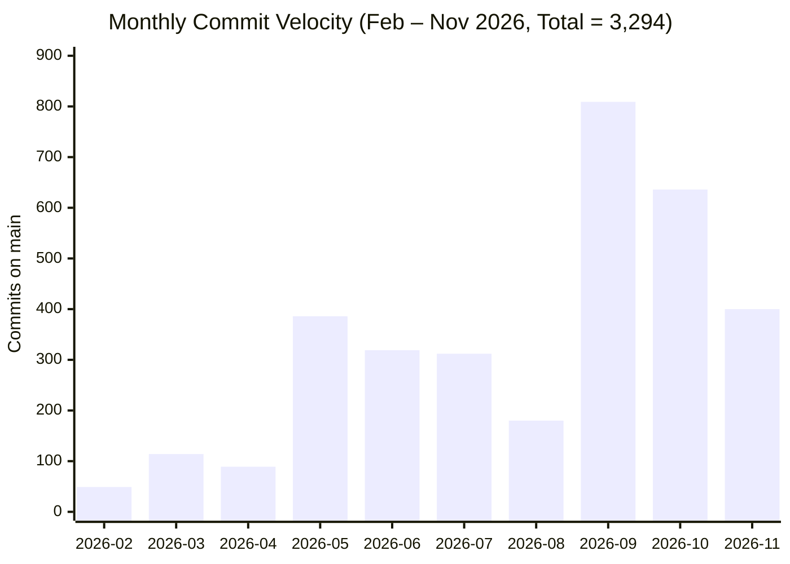
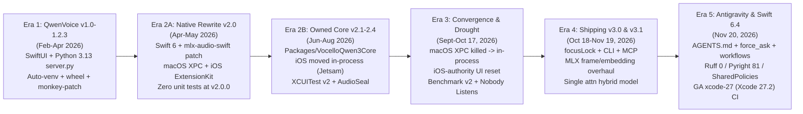

# Vocello Development History & Institutional Memory (`v1.0.0` → `v3.1.0` / `dea8ec6e`, Historical Snapshot)

> [!NOTE]
> **Historical snapshot (frozen at `dea8ec6e`, 2026-11-20):** After this snapshot was written, the
> maintainer pivoted iOS submission from `3.1.0` to **`3.2.0`** (no further 3.1 TestFlight builds
> after `v3.1.0-ios.3`). Between Nov 21 and Nov 25, Pack B (`RF-68` MLX `CompileCache` leak fix /
> GPU `seenMask` / `captureIntrospection` gating, `RF-69` engine/store hardening), `RF-72`
> (calibrated offline multimodal audio QC complement), `RF-70` (closed retaining shipped `attn`
> unchanged for 3.2, `RF-54` declined), and `RF-73` (App Store 3.2.0 readiness: 8 GB+ iPads,
> `QVOICE_DEVICE_DIAGNOSTICS` binary hygiene, 10-language impersonation guardrails, inline clone
> consent, Terms/Privacy updates) all landed on `main` ahead of Phase 4 (`RF-71` Mac/CLI 3.2.0 and
> `v3.2.0-ios.N`). For live status see `docs/development-progress.md` and `config/roadmap.json`.

> [!IMPORTANT]
> **Purpose & Authority:** This document is a point-in-time forensic reconstruction of Vocello's first nine months of engineering history—**3,294 commits**, **38 signed/annotated tags**, **411 validated benchmark records**, **34+ technical audits**, and **481 tracked roadmap items** (`347` closed, `134` open at the snapshot) from initial commit `083bdbd6` (`2026-02-21`) through `dea8ec6e` (`2026-11-20`). Every metric, failure root cause, harness switch, and architectural pivot below was verified directly from Git objects, release notes, and retained audit ledgers so that hard-won lessons are never repeated.

---

## 1. Executive Overview & Quantitative Arc

Vocello began on **February 21, 2026** as **QwenVoice**—a 58-file macOS 14 SwiftUI wrapper around a first-boot Python `.venv` and an `mlx-audio` JSON-RPC subprocess—built as a first flagship software project. Over the next nine months, it survived **four major "development hell" stalls**, **21 coding-harness transitions across 7 agent tools**, **two complete runtime rewrites**, **two full UI resets**, and **12 iOS TestFlight candidate tags**, emerging on **November 20, 2026** as a **2,048-file, zero-cloud, in-process Swift 6.4 + MLX monorepo** shipping notarized macOS + CLI `v3.1.0`, an owned Qwen3-TTS runtime ([VocelloQwen3Core](../../Packages/VocelloQwen3Core/Package.swift)), a custom `attn` 4-bit/8-bit hybrid quantization recipe ([hybrid-model.md](hybrid-model.md)), a 39-validator contract gate ([contract_gate.py](../../scripts/lib/contract_gate.py)), and the `v3.1.0-ios.3` iPhone TestFlight candidate (subsequently superseded by the Nov 21–25 3.2.0 pivot noted above).

### 1.1 Monthly Commit Velocity (`3,294` Commits)

> [!NOTE]
> **The Velocity Paradox:** Notice that **September 2026 (`809` commits, peaking at `195` commits in a single day on Sept 25)** had the highest commit count in project history—yet shipped **zero public releases** during an **83-day release drought** (`v2.4.0` on Aug 1 → `v3.0.0` on Oct 23). High AI-assisted commit volume without scope locks (`focusLock`) amplified lateral churn rather than shipping velocity.

### 1.2 Codebase & Verification Scale Across Major Tags

| Milestone / Tag | Date (2026) | Tracked Files | Swift Files | Python Files | Test Files (Swift + Py) | CI Workflows | Runtime Architecture |
| --- | --- | ---: | ---: | ---: | ---: | ---: | --- |
| **`v1.0.0`** (`c89b6ebc`) | Feb 21 | 58 | 39 | 1 | 11 | 0 | macOS SwiftUI + bundled Python 3.13 `server.py` JSON-RPC |
| **`v1.1.7`** (`288b2aa4`) | Mar 06 | 138 | 55 | 8 | 21 | 2 | Dual-UI macOS 15/26 + shared JSON contract + `URLSession` HF |
| **`v1.2.3`** (`80c23067`) | Apr 01 | 183 | 71 | 25 | 29 | 3 | Final Python era (`mlx-audio 0.4.2` + 738-LOC speed monkey-patch) |
| **`v2.0.0`** (`bdb18d07`) | May 20 | 481 | 314 | 0 | **0** | 1 | **Native Swift 6 + MLX rewrite** (macOS XPC + iOS ExtensionKit; **tests wiped to 0!**) |
| **`v2.2.2`** (`a5313b9a`) | Jul 25 | 1,019 | 335 | 107 | 107 | 3 | Owned `VocelloQwen3Core` + in-process iOS + first TestFlight upload (build 21) |
| **`v2.4.0`** (`ed04a28a`) | Aug 01 | 1,117 | 347 | 121 | 121 | 3 | 8-bit text embeddings + compiled predictor + R1 delivery presets |
| **`v3.0.0`** (`946c469f`) | Oct 23 | 1,903 | 618 | 315 | 334 | 8 | **In-process Mac+iOS+CLI** + `VocelloDesktopCore`/`VocelloCLICore` + `focusLock` |
| **`v3.1.0`** (`65530ffd`) | Nov 16 | 2,037 | 649 | 333 | 359 | 8 | Core MLX overhaul + single `attn` hybrid model + 7-lane tag promotion |
| **`dea8ec6e`** *(snapshot head)* | Nov 20 | 2,048 | 650 | 342 | 362 | 8 | Antigravity + Gemini 4 harness + `VocelloSharedPolicies` + GA `xcode-27` (`27.2`) |

### 1.3 Five-Era Architectural Evolution

---

## 2. Complete Release & Candidate Ledger (`38` Tags + Withdrawn `rc.1`)

Every tagged release and candidate in repository history, what it shipped, and what broke or superseded it:

### 2.1 Era 1 & Era 2 Releases (`v1.0.0` → `v2.4.0`)

| Tag | Date | Commit | Outcome & Root Cause of Follow-Up |
| --- | --- | --- | --- |
| **`v1.0.0`** | 2026-02-21 | `c89b6ebc` | Initial DMG pipeline (`Qwen Voice.app` + Python 3.13 + `server.py` JSON-RPC). Broken on Python 3.12 dev setups (`audioop-lts`). |
| **`v1.0.1`** | 2026-02-21 | `e4e8d3c6` | Same-day fix for Python 3.12 first-boot `pip install` (`2e0ab5c6`); still pulled `mlx-audio` live from GitHub (`d51269f8` vendored wheel next day). |
| **`v1.0.2`** | 2026-02-23 | `18fc3e82` | App icon + hardened first-boot venv flow. |
| **`v1.1.0`** | 2026-02-26 | `6c0dfcd8` | Liquid-glass UI, native `URLSession` `HuggingFaceDownloader`, sidebar player, 10-bug sweep. Introduced silent GRDB raw-SQL History regression. |
| **`v1.1.1`** | 2026-03-01 | `ea337aca` | Emergency fix: reverted `DatabaseService` from broken raw SQL `init(row:)` to type-safe GRDB `Codable` fetch; fixed `enroll_voice` tuple crash. |
| **`v1.1.2`** | 2026-03-03 | `c58e826e` | **Broken release:** Post-build injection of `python/` & `ffmpeg` invalidated bundle signature; Xcode flattened `server.py`; `.pyc` writes failed in signed bundle. |
| **`v1.1.3`** | 2026-03-03 | `7da82994` | **Partial hotfix (13h later):** Re-signed post-injection + `PYTHONDONTWRITEBYTECODE=1`, but `Bundle.main.path` missed `python3.13` symlink and fell back to dev `.venv`. |
| **`v1.1.4`** | 2026-03-03 | `dc64d424` | **Third release in 14 hours:** Fixed bundled Python executable probing and removed space from `"Qwen Voice.app"` → `QwenVoice.app`. |
| **`v1.1.5`** | 2026-03-04 | `b736912d` | Raised floor macOS `14 → 15`; added `benchmark_generation.py`. |
| **`v1.1.6`** | 2026-03-04 | `e47d4dfc` | Dual-UI matrix (`QW_UI_LIQUID` macOS 26 vs `QW_UI_LEGACY_GLASS` macOS 15); hotfixed missing `--repo` in `gh release`. |
| **`v1.1.7`** | 2026-03-06 | `288b2aa4` | Shared `qwenvoice_contract.json`, `BatchGenerationRunner`, 8 GB warm-latency fixes. |
| **`v1.2`** | 2026-03-25 | `bd1f72de` | `mlx-audio 0.4.1` streaming, `prewarm` RPC, Swift 6 mode (`8ee8dca6`). |
| **`v1.2.1`** | 2026-03-29 | `ac97c74f` | **Rebuilt in-place (build 13):** Packaged Voice Cloning crashed (`unexpected keyword argument 'instruct'`) after partial Mar 27 cleanup (`aa3509f2`). |
| **`v1.2.2`** | 2026-03-29 | `7f0da863` | Same-evening fix: `.sha256` sidecars baked in `build/` path prefix (`5693b2a4`), breaking `shasum -c` in `~/Downloads`; fixed slow first-clone priming. |
| **`v1.2.3`** | 2026-04-01 | `80c23067` | Final Python release: `mlx-audio 0.4.2`, Developer ID signing + notarization after 12-commit entitlement/`spctl` gauntlet. |
| *(withdrawn)* `v2.0.0-rc.1` | 2026-05-06 | `ee3587c2` | **Rolled back (`11f77332`):** Nested `.xpc` signed ad-hoc (`bfc3ce09`), mutable unpinned HF revisions, and missing iOS generation cancellation (`b8b9fd28`). |
| **`v2.0.0-beta.1`** | 2026-05-11 | `d8c0b1ae` | First public native Swift/MLX Vocello beta (macOS 26 + XPC + Speed 4-bit / Quality 8-bit catalog). |
| **`v2.0.0`** | 2026-05-20 | `bdb18d07` | Stable native macOS 26 release with streaming preview (`f6aa8e34`) and CI notary (`33f1850c`), **but shipped with 0 test files in Git**. |
| **`v2.1.0`** | 2026-06-12 | `c60dd081` | Qwen3-only specialization, fused CodePredictor RoPE (`+26%`, >1.0× realtime on 8 GB M2), in-process iOS (`7822a8a1`), `VocelloCLI`, 10-language transcription, standing Mac XCUITest smoke. |
| **`v2.2.0`** | 2026-07-25 | `96fed333` | Owned `VocelloQwen3Core`, Long-Form v4, shared speech-tokenizer links (`−680 MB`/model), repo renamed `PowerBeef/Vocello`. **Rejected by App Store Connect (`90057`, `90717`).** |
| **`v2.2.1`** | 2026-07-25 | `dd6848a5` | Hoisted `MARKETING_VERSION` to project scope (fixing ASC `90057`) + opaque iOS icon (`90717`), **but broke `verify_ios_release_artifacts.py`** (which read target scope only). |
| **`v2.2.2`** | 2026-07-25 | `a5313b9a` | Fixed project-scope inheritance in `verify_ios_release_artifacts.py`; **first iOS TestFlight build uploaded (build 21)**. Later found 5 GB clone-prime RAM spike (`3bb70053`). |
| **`v2.3.0`** | 2026-07-31 | `4e335c94` | TestFlight build 22: 8-bit text embeddings (`−280 MB`), compiled predictor (`+8–11%`), Wi-Fi-only iOS downloads, clone-prime spike fixed. |
| **`v2.4.0`** | 2026-08-01 | `4a5a905f` | TestFlight build 23: R1 delivery preset rewrites, real instructed `Neutral`, iPhone segment regeneration, `mlx-swift 0.31.6`. Followed by **83-day release drought**. |

### 2.2 Era 4 & Era 5 Releases and the 12-Tag iOS Candidate Gauntlet (`v3.0.0` → `v3.1.0-ios.3`)

| Tag | Date | Build | Pipeline / ASC Status | Exact Bug, Gate, or Decision That Killed or Superseded It |
| --- | --- | :---: | --- | --- |
| **`v3.0.0`** (`946c469f` → `e7a8e2ae`) | Oct 23 | 24 | **SHIPPED (Mac DMG + CLI `.pkg`)** | First tag attempt (`41a147f6`) failed detached-`HEAD` `git symbolic-ref` in `dev.sh status`. Pre-tag iOS archive (`40055267495`) failed IPA scan on 26 `mlx-c` `__FILE__` build paths (`13e9d05d`). Enacted `focusLock`. |
| **`v3.0.0-ios.1`** (`4303f937`) | Oct 24 | 24 | **FAILED IPA scan** | Binary imported `dlsym`/`dladdr` (used by Apple `metal-cpp`/MLX; `dlopen` absent) and export stripping altered executable digest (`50c347a8`). |
| **`v3.0.0-ios.2`** (`50c347a8`) | Oct 24 | 24 | **FAILED `release_evidence.py`** | `verify_ios_release_artifacts.py` JSON schema had evolved in Sept while `release_evidence.py` expected the old shape—hidden by a hand-written test fixture (`054b5e4a`). |
| **`v3.0.0-ios.3`** (`26995f71`) | Oct 24 | 24 | **VALID (TestFlight Internal)** | Passed `RF-15` black-box journeys once iPhone Mirroring was quit (`fa94e489`). Superseded by cellular download opt-in (`RF-35`) & 10-locale strings (`RF-36`). |
| **`v3.0.0-ios.4`** (`3f1d2bda`) | Oct 24 | 25 | **VALID (Beta Approved)** | `RF-35` cellular toggle pushed `pro_clone` progress bar under the tab dock, failing `model-download` (`177434c3`/`398709b8`). |
| **`v3.0.0-ios.5`** (`e0feaf2c`) | Oct 26 | 26 | **VALID (First Public Beta)** | `iphone-performance-gaming-tier` caused iOS to treat Vocello as a game and show the **Game Mode banner on every launch** (`RF-37`: `LSSupportsGameMode = NO`, `26b303ed`, dropping iPhone 17 Pro RAM limit `8,192 → 6,144 MB`). |
| **`v3.0.0-ios.6`** (`d37583a3`) | Oct 28 | 27 | **VALID (Public Beta)** | Local Mac updated to **Xcode 27.2**, which refused to open `QwenVoice.xcodeproj` at build 27's tag without `createIntermediateGroups: true` (`0f203210`), blocking exact-tag `RF-17` local promotion runs. |
| **`v3.0.0-ios.7`** (`ccf3b269`) | Oct 30 | 28 | **TIMED OUT (`archive-ios`)** | Hit 45-min archive step / 60-min job cap on cold runner; **build 28 permanently burned** before upload. |
| **`v3.0.0-ios.8`** (`a60dd204`) | Oct 30 | 29 | **VALID (Attached to ASC 3.0)** | Superseded Nov 7–10 by Guideline 4.2.3(ii) 2 GB cellular/Wi-Fi confirmation alert (`RF-41`), **M-series / A17 Pro iPad gaming-tier install dead-end** (`RF-42`, `b5d793e9`), and 7-day `RF-17` record expiry. |
| **`v3.0.0-ios.9`** (`14c51659`) | Nov 10 | 30 | **VALID (Attached to ASC 3.0)** | Raised `archive-ios` cap (`80 min` actual!). Hours later (`8cb98059`), maintainer abolished due dates and ordered Core Overhaul (`RF-44..48`) + Quality Remediation (`RF-50..60`); iOS 3.0 cancelled Nov 14. |
| **`v3.1.0`** (`65530ffd` → `693f13d1`) | Nov 16 | 31 | **SHIPPED (Mac DMG + CLI `.pkg`)** | Single `attn` hybrid model, automatic 3.0→3.1 model update, **first-ever end-to-end 7-lane quality promotion on tag checkout**, published Nov 17 07:17 UTC (`44036811898`). |
| **`v3.1.0-ios.1`** (`c5b30287`) | Nov 17 | 31 | **BLOCKED (`security.yml`)** | Same-day Vite dev-dependency `picomatch` ReDoS advisory (`GHSA-fc5q-39xc-vjpf`, no upstream patch) failed un-scoped `npm audit` before `archive-ios` (`165bd1c7` added time-boxed `npm-audit-exceptions.json`). |
| **`v3.1.0-ios.2`** (`165bd1c7`) | Nov 17 | 31 | **ABANDONED (`security.yml`)** | GitHub macOS arm64 queue **abandoned** Swift CodeQL (`result: "abandoned"`), exposing that `CI required` & `Security required` used deny-lists (`failure`/`cancelled`) that **falsely passed on `abandoned`** (`source-authority` caught it!). |
| **`v3.1.0-ios.3`** (`a551aa4b`) | Nov 18 | 31 | **VALID (Final 3.1 Candidate; Superseded by 3.2.0)** | Replaced `CI required` & `Security required` deny-lists with strict `jq` allow-lists (`success`). Final 3.1.0 TestFlight candidate as of the Nov 20 snapshot; later superseded by the 3.2.0 pivot (`RF-68`..`RF-73`). |

---

## 3. Deep Chronicle of the Five Eras

### 3.1 Era 1 (`2026-02-21` – `2026-04-16`): *QwenVoice* and the Limits of Embedded Python
- **Initial architecture (`083bdbd6`):** `PythonBridge.swift` launched `Resources/backend/server.py` (576 LOC) over stdin/stdout JSON-RPC 2.0 pipes; `PythonEnvironmentManager.swift` bootstrapped a `.venv` on first launch and ran `pip install -r requirements.txt`; `huggingface-cli` downloaded weights; GRDB 7.10.0 stored History.
- **Why embedded Python failed as a product foundation:**
  1. **Bootstrap & dependency fragility:** Launch day broke immediately when `findSystemPython()` selected Python 3.12 while `audioop-lts` required Python 3.13 (`2e0ab5c6`). Pulling `mlx-audio` from a GitHub commit URL forced committing binary `.whl` files (`d51269f8`) and maintaining a 738-LOC runtime monkey-patch (`qwenvoice_speed_patch.py`, `8f117813`) that crashed in `v1.2.1` when `instruct` kwargs drifted (`ac97c74f`).
  2. **Code-signing & notarization hostility:** Injecting standalone Python 3.13 + `ffmpeg` + `.so`/`.metallib` binaries bloated DMGs, broke code seals whenever Python wrote `.pyc` bytecode inside `Contents/Resources/` (`v1.1.2`→`v1.1.4`), and required a 12-commit entitlement/`spctl` rescue (`v1.2.3`).
  3. **Zero iOS path:** Apple's iOS sandbox and App Store Review forbid embedded Python venvs and `ffmpeg` subprocesses.

### 3.2 Era 2 (`2026-04-17` – `2026-08-31`): Native Swift 6 + MLX, the Vocello Rebrand & Owned Runtime
- **The 48-Hour Native Rewrite (`0ac20665`..`228d3cde`, Apr 17–18) & Its Hidden Debt:** Codex replaced `server.py` and `PythonBridge` completely (`61832887`) with Swift 6 + `mlx-swift 0.30.6` + `third_party_patches/mlx-audio-swift`, isolating macOS inference inside `QwenVoiceEngineService.xpc` (`228d3cde`) and merging the standalone **Vocello** iPhone app (`47acb75e`, Apr 19). **Critical misstep:** during the sprint to `v2.0.0` (`bdb18d07`, May 20), **every legacy test suite was retired without replacement (`test_files = 0` at `v2.0.0`)**, leaving the summer of 2026 vulnerable to regressions until deterministic and XCUITest harnesses were rebuilt.
- **Rebrand Compatibility Discipline ([product-identity-compatibility.md](../decisions/product-identity-compatibility.md)):** An uncoordinated Apr 19–21 partial rebrand briefly showed `"Vocello"` in Finder while Dock showed `QwenVoice.app` and `README.md` advertised unreleased v2.0 over public `v1.2.3` (`17ed536c`). To avoid orphaning 7–16 GB of user models, SQLite history, Saved Voices, and signing identities, internal storage (`~/Library/Application Support/QwenVoice/`), bundle IDs (`com.qwenvoice.*`, later `com.patricedery.vocello`), module names (`QwenVoiceCore`, `QVoiceiOS`), and `QWENVOICE_*`/`QVOICE_*` env vars were permanently frozen.
- **iOS ExtensionKit Jetsam Death (`7822a8a1`, Jun 1):** Mirroring macOS XPC, iOS initially ran MLX inside `VocelloEngineExtension` (`ExternalExtension_NonUI`). On physical iPhone 17 Pro, every load died with `"connection was interrupted"`: **iOS ignores `com.apple.developer.kernel.increased-memory-limit` on non-UI extensions**, Jetsam-killing the ~2.3 GB 4-bit load immediately. Moving the engine **in-process** inside the main app (`7822a8a1`) and deleting `VocelloEngineExtension` (`aed617c5`) unlocked real multi-GB Metal headroom on iPhone 15 Pro+ (8 GB floor; 0.6B models were rejected Jul 2 `42aa64e7` because Voice Design requires 1.7B).
- **Promoting `Packages/VocelloQwen3Core` (`ae732686`, Jul 15) & 14-Phase Actor Convergence (`a4bb4834`..`025380bb`):** After stripping ~40K LOC of non-Qwen3 codecs (`a2b5f15`) and cataloging **127 fork deltas** (`05bd2b6d`), the patch folder was promoted to an owned monorepo package ([owned-qwen3-runtime-monorepo.md](../decisions/owned-qwen3-runtime-monorepo.md)) behind `FACADE_API_BASELINE.json`, unified onto one `VocelloQwen3Engine` actor with a bounded suspending `[Float]` channel, request-local RNG, Long-Form v4 streaming (`d144117e`), Background-Assets rejection in favor of a SHA-pinned bundled catalog + single background `URLSession` ([model-delivery-background-assets.md](../decisions/model-delivery-background-assets.md)), and `MLXAudioMark` EU AI Act Article 50 watermarking (`2729ce4a`).

### 3.3 Era 3 (`2026-09-01` – `2026-10-17`): Architecture Convergence, Audit Storms & the Audio QC Crisis
- **Killing macOS XPC (`96709242` → `628887c7`, Sept 14–15):** Controlled Metal traces proved XPC IPC cost only ~3% (whereas WindowServer Liquid Glass compositing cost ~23%, solved by `generationPerformanceGate`), while XPC doubled lifecycle code across platforms. Deleting all 3 XPC modules and hosting `MLXTTSEngine` in-process on macOS over the **same `Sources/iOS/TTSEngineStore.swift` compiled by path** unified Mac, iPhone, and CLI onto one runtime topology (2.4–2.9 GB peak `phys_footprint` on 8 GB memory qualification `b1cb1ebc`).
- **The Sept 18–22 UI Reset ([macos-ios-ui-reset-2026-09.md](macos-ios-ui-reset-2026-09.md)):** Initial Mac ports accumulated 38 text styles, 14 control heights, and ~200 off-grid literals. Declaring the approved iOS 3.0 build (`ca5a10cd`) as single visual authority replaced drifting desktop layouts with shared composition (`c66c5b79`, 13/13 smoke PASS).
- **Hardening Concurrency, Persistence & Memory Lifecycles (Sept 12–Oct 16):**
  - Promoted `macos-tsan` to blocking push CI (`7f09a7a6`, Sept 14).
  - Fixed prewarm cancellation slot leak that permanently deadlocked generation (`CORE-01`, `cf12b994`, Sept 22).
  - Added UIKit foreground-exit `.shutdown` cancellation barriers (`PA-15`, `83552028`, Sept 22) + `.finalizing` attempt phase (`A1-01`, `64ad6677`, Oct 6, preventing "Generation stopped" takes from landing in History).
  - Fixed **`0xDEAD10CC` App Group SQLite lock termination** (`IOS-11`, `59648b82`, Sept 24) via `IOSHistoryDatabaseSuspensionState` + `GenerationHistoryOutbox` reconciliation on foreground return.
  - Closed background Metal C++ `std::runtime_error` aborts (`BG-01` + `CONV-21`, `06d44245`, `57196483`, Oct 16) via foreground GPU permits, `VocelloQwen3MLXErrorScope`, and repinning to `mlx-swift 0.32.3`.
- **Breaking Out of the Drought (`2026-10-12` & `2026-10-13`):** Enacted programmatic `focusLock` (`d1c5fb7b`) and the landmark **"Nobody Listens for 3.x"** decision (`3a348656`: automated pre-registered machine screens catch gross failures; subtle perceptual defects ship as documented limitations rather than blocking on a 500-clip human-labeling lab).

### 3.4 Era 4 (`2026-10-18` – `2026-11-19`): Workflow Modernization, CLI Rebirth, Core Overhaul & `3.0` → `3.1`
- **Oct 18–20 Workflow & Swift 6 Upgrade (`DW-01..04`):** Reverse-import Python test selection + parallel path-scoped `contract_gate.py` cut roadmap-only checks from **75 s to 19.7 s** (`585cfbe8`); trimmed [development-progress.md](../development-progress.md) `187 KB → 12 KB` and `docs/reference/` `49 → 32` files; scoped `-Onone` to owned targets so MLX C++ stayed `-O` in tests (`a2147383`); enabled `MemberImportVisibility`, `InferIsolatedConformances`, `SWIFT_STRICT_MEMORY_SAFETY`, and `NonisolatedNonsendingByDefault` (`a2147383`..`50af9a6d`); migrated view models to `@Observable` and `NSLock → Mutex`; extracted `VocelloCLICore` (`cd4843eb`).
- **Oct 21–23 CLI Rebirth & `v3.0.0` Launch:** Built `VocelloCLICore` (`CommandSpec`, golden JSON/NDJSON schemas, typed exit codes), `VocelloDesktopCore` (shared headless Mac store, `EngineHostLease`), `vocello mcp` (17-tool stdio JSON-RPC server), Sparkle EdDSA auto-updates (`RF-23`), and notarized `.dmg` + `.pkg` (`v3.0.0`, `e7a8e2ae`).
- **Nov 10–14 Abolishing Dates, MLX Core Overhaul (`RF-44..48`) & Single `attn` Hybrid Model (`RF-50..60`):**
  - Removed all roadmap due dates ("gates, not dates", `8cb98059`).
  - **Bit-identical MLX Overhaul (`0c081a9b`..`fd019b81`):** Fixed AudioSeal 320-sample crop bit-flips (`c6a80dcb`), fused talker projections + compiled all 15 code-predictor steps into **1 graph/frame** (`+13%` host-bound, 52/52 bit-identical iPhone PCM, split 6,800-LOC `Qwen3TTS.swift` into 8 files, `76fa18e7`), switched 151,936-row 8-bit text embeddings to row-wise `safetensors` reads (**−315 MB Mac / −316 MB iPhone MLX peak**, `2ba30b2e`), added pace-aware live-preview startup (**first audio 0.44–0.8 s sooner, 0 underruns**, `af8ca492`), and added Guideline 2.4.2 inter-segment thermal pauses (`fd019b81`).
  - **Self-Tested Quality Screens & `attn` Hybrid (`d7d18eda`..`dbe59080`):** Built [quality_screen.py](../../scripts/quality_screen.py) requiring every screen to run against itself first (`RF-57`), shipped streamed clone decoder speech priming (**+0.056 speaker similarity**, `<=1 ms` cached restore, `1a308d7e`), Fast QC v10 pre-watermark silence measurement + 3 s runaway watchdog (`654c921e`), retired the `Variation` selector (`RF-58`), and built the **`attn` hybrid model** (4-bit weights + 8-bit talker `self_attn` across 28 layers, `+176 MB`, rescuing East Asian long-form from `11/32` to near-8-bit `65/72` overall at `0.303` M6 RTF), replacing Speed/Quality with one seamless auto-updating model per mode (`RF-59`, catalog `6 → 3`).
  - Cancelled iOS 3.0 on Nov 14 to unify on **3.1.0**, fixed the 873 ms paged-History keystroke stall (`873 → 72–86 ms`), shipped **Vocello 3.1.0** for Mac + CLI on Nov 17 with all 7 promotion lanes green on the tag checkout, retired GUI computer-use / iPhone Mirroring (`42a8789b`), and cut `v3.1.0-ios.1..3`.

### 3.5 Era 5 (`2026-11-20`): Antigravity + Gemini 4 Takeover & Toolchain Convergence
- Adapted repository governance from Claude Code to **Antigravity** ([AGENTS.md](../../AGENTS.md), [.agents/hooks.json](../../.agents/hooks.json), [agy_hook_adapter.py](../../scripts/hooks/agy_hook_adapter.py), `.agents/plugins/vocello/`, `RF-67`), adding uncacheable `"force_ask"` gates, `PostInvocation` drift reminders, `Stop` whitespace checks, and `.agents/workflows/` multi-agent pipelines (`swift_adversarial_review.py` catching real Swift/security defects on all 3 Swift waves).
- Burned **Ruff `44 → 0`** and **Pyright `789 → 81`** across 72 Python files with **zero suppressions** (`f466500e`, `08c70744`, `aa97fb2e`), hardened `VocelloQwen3Core` (`6.2` tools, 4/5 warnings-as-errors, SwiftLint + `no_if_debug`, parameterized Swift Testing suite, `cc305197`), made `HuggingFaceDownloader` fail closed on missing SHA-256 digests (`BKL-79`, `1251fcc4`), added `--kind metal` Instruments profiling (`2aea00c9`), extracted multiplatform static framework **`VocelloSharedPolicies`** (`91f5eae6`), eliminated XCUITest snapshot walks in `delivery-menu` (**`84.168 → 55.426 ms/s` median across 3 canonical runs**, enforced at `72.5 ms/s`, closing `BKL-77`, `4974d4e9`), and cut over [toolchain.json](../../config/toolchain.json) and all 6 macOS GitHub workflows to **GA `xcode-27` (`Xcode 27.2 / Swift 6.4.2`)** (`dea8ec6e`, push CI `44859698205` & release rehearsal `44859698137` both 100% green).

---

## 4. Anatomy of the Four "Development Hell" Phases (Postmortems)

> [!WARNING]
> Every prolonged delay in Vocello's history came from **process, governance, or measurement compounding**—never from a single unsolvable Swift or MLX bug. Understanding the exact mechanism of each stall prevents re-entering them.

### 4.1 Dev Hell #1: Unchecked Generated Redesign & Withdrawn `v2.0.0-rc.1` (`2026-04-24` – `2026-05-08`)
- **What happened:** Immediately after the 48-hour native Swift rewrite (with test count at `0`), a sweeping generated Liquid Glass redesign (`f55fc049`, Apr 24) replaced the Mac layout with oversized hero chrome, inspector panes, and speculative on-appear model prewarms that pushed the 8 GB M2 dev Mac into swap thrashing—forcing an immediate −1,179-LOC revert (`6b6c803b`, Apr 25). Twelve days later, `v2.0.0-rc.1` (`ee3587c2`) had to be rolled back (`11f77332`) when post-tag review discovered ad-hoc-signed nested `.xpc` helpers (`bfc3ce09`), mutable unpinned Hugging Face revisions, and zero iOS active-generation cancellation (`b8b9fd28`).
- **Root cause:** Executing a ground-up language/runtime rewrite while deleting the test suite (`test_files: 29 → 0`) and relying on visual eyeball checks instead of pre-tag signing/immutability contracts.

### 4.2 Dev Hell #2: "Post-Fable Fragmentation" & Simulator Illusions (`2026-06-13` – `2026-07-01`)
- **Metrics:** **199 commits in 19 days**, **69 fix/revert commits (~35% waste)**, **7 agent-guide switches in 14 days**, **0 public releases** (captured in historical postmortem `a7f18d98:docs/post-mortem/2026-06-post-fable-development-hell.md`).
- **Trigger:** Around June 12 (right after `v2.1.0`), Anthropic suspended worldwide access to **Claude Fable 5** under U.S. export-control policy. Searching for a replacement workflow triggered rapid thrashing across Opus 4.8 → **Kimi Code CLI** (`e02b2173`) → Claude Code → **Cursor** (`b2cfabab`) + `AGENT_HANDOFF.md` (`db345dd`).
- **Compounding loops:**
  1. **The Simulator Mirage:** Refusing to accept that MLX Metal cannot execute faithfully on the iOS Simulator, agents built a ~2,400-LOC `IOSSimulatorTTSEngine` (`2743b07`..`ae6927a`, Jun 24–25), deleted it the same day (`0f9b2a1b`), re-built `FakeTTSEngine` + Simulator CI three days later (`1b6572d`, Jun 28) with 3 broken UDID patches (`e0ace288`..`96e1b5eb`), and finally deleted all Simulator/fake routes on July 1 (`47932604`).
  2. **Feature Ping-Pong:** HTTP pause/resume model downloads were implemented and reverted **three times** across iOS and macOS (`6a49a8b` → `4792562` → `dcc6990` → `69f0dd2` → `39485bc`); custom-tone pickers churned 15+ commits before revert (`e66f63c`).
  3. **Aborted Forge Migration:** On July 1, the primary forge was migrated to GitLab with GitHub Actions disabled (`5f89d8ab`), then triple-reverted the same afternoon (`aa63ccb8`, `073777fc`, `4a4d86eb`).

### 4.3 Dev Hell #3: The 83-Day Release Drought & Tooling-Over-Product Inversion (`2026-08-02` – `2026-10-23`)
- **Metrics:** **1,514 commits** between `v2.4.0` and `v3.0.0` (`809` in Sept alone). Between Sept 4 (when `release-first-3-0-2026-09` opened) and Oct 12, **fewer than 60 of 975 commits touched a release item** ([release-first-execution-2026-09.md](release-first-execution-2026-09.md)). By Sept 22 (`2026-09-22-project-audit.md`, archived in git history), **verification/governance code (`~125K LOC` across 159 scripts + 51 JSON contracts) equaled the entire product codebase (`~125K LOC`)**, reference docs peaked at **65 files** (`917856c3`), and `development-progress.md` hit **187 KB (~47K tokens/session)**.
- **Four structural causes:**
  1. **Unprotected `primaryPlan`:** The active roadmap plan was hijacked **4 times** across 12 newly opened audit/QC plans, parking the release every time.
  2. **Self-Invalidating SHA-Bound Device Campaigns:** Pre-Oct 12 release gates required an exact-commit **201-take physical-iPhone campaign** (`RF-11`); a single bugfix commit invalidated all 201 takes, voiding the first freeze **85 commits later**.
  3. **The Audio QC Rabbit Hole (`Sept 25 – Oct 12`):** Six months of trying to build an automated "human ear" culminated in QC v1 Stage 0 (12 shadow judges + synthetic defect injectors + **53 GB of corpora**, deleted Oct 1 `c44d0205`) and QC v2 (`45421df2`), where 39 blind ear confirmations (`0b38f0f5`) proved **31% flag precision** (9/29) while autoregressive `Qwen3-ASR-1.7B` hallucinated clean words over stutters (`fr-0101--dylan` drew 0 flags despite 3 severe audible defects), all over a ground-truth set of only **40 labeled clips**.
  4. **Unasked Maintainer Decisions:** Business/policy questions (Paid Apps/DSA `RF-02`, privacy answers, acceptable defect bar `RF-14`) sat unasked while agents opened new audits whenever the iPhone was offline.
- **How it ended:** The **Oct 12 `focusLock`** (`d1c5fb7b`, enforced by `roadmap.py validate`) + the **Oct 13 "Nobody Listens for 3.x" rule** (`3a348656`).

### 4.4 Dev Hell #4: The 12-Tag iOS Candidate Gauntlet (`2026-10-24` – `2026-11-18`)
- **Metrics:** `v3.0.0-ios.1`..`ios.9` + `v3.1.0-ios.1`..`ios.3` (**12 candidate tags** across 25 days before reaching `v3.1.0-ios.3`).
- **Why so many candidates burned:**
  - **Release-only environment mismatches (`ios.1`, `ios.2`, `ios.7`, `3.1-ios.1`, `3.1-ios.2`):** `mlx-c` `__FILE__` build paths (`13e9d05d`), `metal-cpp` `dlsym` symbols (`50c347a8`), hand-written fixture hiding JSON schema drift between `verify_ios_release_artifacts.py` and `release_evidence.py` (`054b5e4a`), 60-min GitHub Actions archive timeout burning build 28 (`d75e48b7`, actual archive needed 80 min), un-scoped website `picomatch` dev-dependency `npm audit` blocking iOS archiving (`165bd1c7`), and GitHub runner `"abandoned"` jobs slipping past deny-list gates (`a551aa4b`).
  - **Apple capability & OS side effects (`ios.5`, `ios.6`, `ios.8`):** `iphone-performance-gaming-tier` triggering iOS **Game Mode** (`26b303ed` `LSSupportsGameMode=NO`) *and* letting **13 M-series / A17 Pro iPads** install the iPhone app into an English-only dead end (`b5d793e9`, `RF-42`); Xcode 27.2 refusing parentless file groups (`0f203210`).
  - **Strategic quality bar upgrade (`ios.9` → `3.1`):** Deliberate maintainer call on Nov 10–14 (`8cb98059`, `9236f175`) to pause submission, abolish target dates, and ship the bit-identical MLX overhaul + `attn` hybrid model in unified **3.1.0** rather than ship known East Asian / clone defects in 3.0.

---

## 5. The Coding Harness & AI Model Odyssey (`21` Transitions Across `7` Tools)

### 5.1 Chronological Harness & MCP Transition Ledger

| # | Date (2026) | Commit | Transition | What Worked vs. What Broke |
| ---: | --- | --- | --- | --- |
| 1 | Feb 21 | `083bdbd6` | **Claude Code** (`CLAUDE.md`) | Fast v1.0 bootstrap; added `GEMINI.md` Feb 25 (`54f3b430`, deleted Mar 17). |
| 2 | Mar 01 | `109ed618` | **+ OpenAI Codex** (`AGENTS.md`, `.agents/`, `.codex/`) | Multi-guide drift across `CLAUDE.md`, `AGENTS.md`, `GEMINI.md` forced 853-LOC doc purges (`602807ba`); Codex executed Apr 17–20 native Swift rewrite (`47acb75e`). |
| 3 | May 01–05 | `18ee36fe`, `7ce7b886` | **Claude Code only** (`.claude/`, `qa.sh`, `context7`) | Deleted `AGENTS.md`; briefly flipped back May 8 (`b8b9fd28`) and restored May 12 (`51053000`); `/ultraplan` banned May 18 (`3379711d`). |
| 4 | May 19–21 | `ccc0117e` → `6894d84b` | **Gemini CLI → Antigravity CLI (`agy`)** audio harness | Built to judge TTS audio; retired after 48h (and permanently Jun 14 `f73ef48a`) due to subprocess hangs and non-deterministic flips on byte-identical WAVs. |
| 5 | May 22 | `492b7e26` | **Codex** (`AGENTS.md`) | Short 5-day swing before computer-use experiments. |
| 6 | May 27 | `86d78230`, `9fd507ef` | **Cursor** (`.cursor/rules/*.mdc`) + `computer-use` MCP | Vision-driven `uitest.sh` + iPhone Mirroring caused severe "computer use confusion". |
| 7 | May 28–29 | `ce89fb94`, `6d1cca4` | **Claude Code only** | Nuked Cursor/Codex remnants within 24h (`e22e7a38`) and deleted `uitest.sh` + 20 docs (`6d1cca4`); Fable 5 shipped `v2.1.0` (`c60dd081`). |
| 8 | Jun 15 | `2224f23e`, `e02b2173` | **Kimi Code CLI** + `AGENTS.md` + `mac-control` MCP | Post-Fable-5 scramble; deleted `CLAUDE.md`. |
| 9 | Jun 22–25 | `bb886b4f`, `fafc1471` | **Claude Code** (`CLAUDE.md`) | Retired `AGENTS.md` and `AGENT_HANDOFF.md` (`db345dd`)—lasted 3 days. |
| 10 | Jun 28–Jul 05 | `b2cfabab`, `54eb4ebc` | **Cursor** + `XcodeBuildMCP` + `Peekaboo` + `mirroir-mcp` | `XcodeBuildMCP` added/removed/re-added in 24h (`375244ed`→`3b044bab`→`8a4205a9`); `npx`→Node chains triggered repeated macOS TCC prompts; pixel coords broke across window sizes. |
| 11 | Jul 11 | `9bb20be7`, `a9428624` | **Codex Takeover #1** | Deleted `Peekaboo`/`mirroir` pixel tables; established native **XCUITest** (#58) and promoted `VocelloQwen3Core` (`ae732686`). |
| 12 | Jul 20 | `0d4eac8b` | **Cursor** brief sync | Lasted 48 hours before `.cursor/` was retired (`5c051fcc`). |
| 13 | Jul 22 | `5c051fcc`, `9762a57a` | **Claude Code** (Fable 5 Window 2) | Added T1 commit hook gate; survived 8-hour XCUITest deletion/revert (`75cd0288`→`45af00f1`); shipped `v2.2.0`–`v2.4.0`. |
| 14 | Aug 19 | `f6404cec` | **Codex Takeover #2** (`.codex/hooks.json`, `.agents/rules/`) | Deleted `CLAUDE.md`; hit Codex sandbox `Operation not permitted` Clang module-cache failures (`mac-test-20260819-021117`). |
| 15 | Sept 11 | `152273a4`, `462ca1f9` | **Claude Code** (`CCA-01..12`) | Built `policy_guard.sh`, `generated_file_guard.sh`, `session_start.sh`, `dev.sh`. |
| 16 | Sept 18 | `ca5a10cd` | **Dual Claude + Codex** | Codex `0.154.0` marked all 5 project hooks **`untrusted` (inert)** until manually clicked. |
| 17 | Sept 20 | `bb82e209` | **Codex-only** | Lasted 48 hours. |
| 18 | Sept 22 | `91e521ff`, `fe50f658` | **Claude Code Takeover** | Added `.claude/worktrees/` parallel agents + host-wide `native-build.lock`. |
| 19 | Oct 10 | `dc17631b` | **Codex Workflow Takeover** (`2026-10-10-codex-workflow-audit.md`, archived in git history) | Added `project_generation.py` signature, `active_workers.py` leases, `select_python.py`; lasted 48 hours, leaving 11 dead `~/.codex/worktrees` & 25 unmerged branches (`TK-10`). |
| 20 | Oct 12 | `14ad9393`, `8139af14` | **Claude Code Takeover #2** (`2026-10-12-claude-code-takeover-audit.md`, archived in git history) | **39-day stable run:** `agent_guard.py` subagent screening, fixed `.mobilebuildmcp/config.yaml` (`4c4a051d`), retired computer-use (`42a8789b`), shipped `v3.0.0` & `v3.1.0`. |
| 21 | Nov 20 | `8e2c0497`..`dea8ec6e` | **Google Antigravity + Gemini 4** (`RF-67`) | Unified `AGENTS.md` + `.agents/hooks.json` (`force_ask`, `PostInvocation`, `Stop`) + `.agents/plugins/vocello/` + `.agents/workflows/` (`run_workflow` adversarial Swift review & 3-worker `share`-worktree burndowns). |

### 5.2 Frontier AI Model Progression in Git Trailers

| Model Family | Active Window (2026) | Trailered Commits | Signature Contribution & Failure Mode |
| --- | --- | ---: | --- |
| **Claude Opus 4.6 / Sonnet 4.6** | Feb 21 – Mar 23 | 70 | Rapid `v1.0`–`v1.2` feature buildout; prone to packaging/bundle path oversights. |
| **OpenAI Codex** *(un-trailered)* | Mar–Apr, Jul, Aug, Oct 10 | ~500+ | Executed Apr native Swift rewrite, Jul `VocelloQwen3Core` monorepo & Oct 10 tooling; deleted tests at `v2.0` and left orphaned worktrees (`TK-10`). |
| **Claude Opus 4.7 (1M)** + Design | Apr 21 – May 21 | 200+ | Streaming upsampler parity (`f6aa8e34`), `v2.0.0` launch, iOS 4-tab rebuild. |
| **Claude Opus 4.8 / 4.8 (1M)** | May 28 – Jun 14 | 159 | In-process iOS move (`7822a8a1`), `VocelloCLI` v1; struggled during post-Fable Simulator loops. |
| **Claude Fable 5** | Jun 09–12, Jul 22–Aug 15 | 338 | High-velocity `v2.1.0` RoPE fusion & `v2.2.0`–`v2.4.0` shipping; export-control suspension triggered June Dev Hell. |
| **Claude Opus 5 / Fable 5.1** | Aug 02 – Oct 06 | 213 | Sept XPC removal (`628887c7`), iOS-authority UI reset (`c66c5b79`), TSan CI gate; susceptible to audit/doc sprawl without `focusLock`. |
| **Claude Opus 5.5 / 5.5 (1M)** | Sept 22 – Nov 17 | 1,258 | Workhorse of Sept 25 Benchmark Audit (195 commits/day), `focusLock`, CLI v3, `v3.0.0`, and `v3.1.0` promotion. |
| **Claude Fable 5.2 / Sonnet 5.5** | Nov 09 – Nov 16 | 218 | Nov 10 Apple Silicon MLX Core Overhaul (`RF-44..48`) and `attn` hybrid model (`RF-55`). |
| **Gemini 4 (Carbon / Neon / Hydrogen)** | Nov 20 – present | 23+ | 3-tier Antigravity orchestration (`force_ask`, `swift_adversarial_review.py`, Ruff `44→0`, Pyright `789→81`, `VocelloSharedPolicies`, `BKL-77` −34% hitch fix, GA `xcode-27` cutover). |

### 5.3 Mechanical Traps Discovered Across Harness Switches
1. **macOS `/usr/bin/python3` 3.9 Hook Crashes (`TK-11`):** Lifecycle hooks run under system Python 3.9 unless shimmed; Python 3.10 `str | None` without `from __future__ import annotations` silently crashed `SessionStart` at import.
2. **Personal Local Overrides Defeating Tracked Policy (`U-01..03`):** An untracked `.claude/settings.local.json` silently permitted `git push *` and loaded 222 global skills (~100K chars, truncating prompts)—solved in Antigravity via uncacheable `"force_ask"` in tracked `.agents/hooks.json`.
3. **Process-Tree & Worktree Lockouts (`CW-02`, `TK-01/02`, `RF-67`):** `active_workers.py` hardcoding `codex` broke under `claude`, and hardcoding `claude` + unsandboxed `ps` broke under `antigravity`/`agy` until `OWNER_NAMES = ("antigravity", "agy", "claude")`, worktree leases, and explicit `QVOICE_LEAD_ONLY=1` were wired (`39991806`).
4. **Wrong MCP Config Filename (`4c4a051d`):** `MobileBuildMCP 2.7.1` silently ignored `.xcodebuildmcp/config.yaml` and read `.mobilebuildmcp/config.yaml`, exposing Simulator tools until both the config path and `PreToolUse` MCP hard-denies were aligned.

---

## 6. Eleven Measurement Illusions & Silent Traps ("When the Instruments Lied")

| # | Date & Fix | The Apparent Symptom / Illusion | The True Forensic Cause & Fix |
| ---: | --- | --- | --- |
| 1 | `2026-06-29` (`8a4205a`), `2026-10-18` (`a2147383`) | **−40% Engine "Regression"** (`1.03×` vs `1.72×` speed) & slow tests | Comparing `-Onone` dev builds (`12.9 tok/s`) against `-O` Release builds (`21.5 tok/s`), and compiling MLX C++ at `-O0` in tests. Fixed via optimized-build receipts, split `macos` / `macos-optimized` arenas, and target-scoped `QVOICE_OWNED_SWIFT_OPTIMIZATION`. |
| 2 | `2026-07-23` (`3180b16e`) | **macOS UI RTF Collapsed to `0.70–0.93`** (blamed on XPC) | Xcode's default automatic screen recording spawned `VTEncoderXPCService` + `replayd` on the shared GPU during every XCUITest. Setting `preferredScreenCaptureFormat: screenshots` jumped throughput +55% (`1.196×`). |
| 3 | `2026-08-05` (`de063d99`), `2026-11-20` (`81b0dbf8`) | **3.1 s History Scroll Stall & `84.2 ms/s` Delivery-Menu Hitches** | `XCTAutomationSupport` accessibility snapshots ran on the app's main thread per query—consuming **79% of busy main-thread time** in `delivery-menu` (<2% Vocello code) and opening every macOS menu-bar menu. Window-anchored coordinates + keyboard cut `delivery-menu` to **`55.4 ms/s` (−34.1%)** and split `actionHitchTimeMSPerS` vs `queryHitchTimeMSPerS`. |
| 4 | `2026-09-25` (`8e9312aa`) | **Post-XPC RAM "Doubled" to `4.5–5.8 GB`** | After `628887c7` merged app and engine into one PID, `benchmark_memory.py` still summed app and engine series (`1.84×` actual `2.2–2.6 GB`). Fixed by Memory Contract v2 PID union. |
| 5 | `2026-09-25` (`5a1d9df9`, `22364532`) | **"Clean" Memory Qualification Hiding 1.1 GB GPU Spikes** | 500 ms `task_vm_info` polling missed exact `mlxPeakMB` in **277 of 337 records (`86%` of short warm UI takes, up to 1,104 MB shortfall)**. Fixed by reading kernel `ledger_phys_footprint_peak` + exact `mlxPeakMB`. |
| 6 | `2026-09-25` (`6ce65f7e`) | **39 of 48 UI Benchmarks Had Zero Trend Deltas** | `comparison_key` hashed 45 files *including the engine under test* plus whole `project.yml`, resetting baselines on every engine commit. Fixed by `lineageContractVersion: 2` (`LINEAGE_MEASUREMENT_VERSIONS`). |
| 7 | `2026-09-26` (`6b95eb80`) | **Profiling Crashed on macOS 27 & Throttled Speed 4×** | `CPU Profiler` (`kpc`) required root on macOS 27, and `Allocations`+`VM Tracker` dragged throughput `22.6 → 4.6 tok/s`. Switched to `Time Profiler` + `os_signpost` + `--kind witness`/`metal`. |
| 8 | `2026-10-06` (`0b38f0f5`), `2026-11-11` (`d7d18eda`) | **Broken Takes Passed ASR & `qc-takes` Exited 0 on Crashes** | Autoregressive `Qwen3-ASR-1.7B` hallucinated expected words over stutters (`31%` flag precision), while `qc-takes` exited PASS when scoring crashed and dropped refused takes from means. Replaced by self-tested [quality_screen.py](../../scripts/quality_screen.py) (`RF-57`). |
| 9 | `2026-10-18` (`7fe58fa2`) | **~200 Engine Bugs Escaped 1,676 Green Unit Tests** | Fakes (`ResidentLoadCoordinator`) threw inside `qwen3Capabilities` *before* reaching `NativeEngineRuntime`'s warm/catch bodies, and `v3.0.0-ios.2` used a hand-written JSON fixture that hid producer/consumer drift. Fixed by seam suites + `vocello-swift-review` fake-reach checks. |
| 10 | `2026-11-10` (`c6a80dcb`), `2026-11-12` (`654c921e`) | **Watermarking Corrupted Payload Bits & Masked 611 ms Silence** | Cropping joined long-form audio off AudioSeal's 320-sample grid flipped payload bits (`0.67` detection), while watermarking *before* Fast QC turned 611 ms of trailing silence into 38 ms! Fixed by 320-sample grid crops (`v3`) and pre-watermark Fast QC (`v10`). |
| 11 | `2026-11-18` (`a551aa4b`, `3eeed981`) | **Green `CI required` / Silent Nightly on `"abandoned"` Jobs** | Aggregators checked `!= 'failure' && != 'cancelled'` and `if: failure()`, treating GitHub runner queue `"abandoned"` jobs as passing/silent. Fixed with strict `== 'success'` allow-lists and `always() && !cancelled()`. |

---

## 7. Major Refactors & Breakthroughs vs. Real Degradations & Trade-Offs

### 7.1 Highest-Leverage Engineering Wins
1. **Unified In-Process Engine + Shared Store (`7822a8a1`, `628887c7`, `91f5eae6`):** Eliminated Python, ExtensionKit, and XPC processes; Mac, iPhone, and CLI all call `NativeRuntimeFactory.make` in-process, with pure policies modularized into `VocelloSharedPolicies`, CLI logic in `VocelloCLICore`/`VocelloDesktopCore`, and owned Qwen3-TTS behind `VocelloQwen3Core`.
2. **Bit-Identical Apple Silicon MLX Overhaul (`RF-44..48`):** Single-graph 15-step compiled code predictor + fused projections (`+13%` host-bound, 8-file `Qwen3TTS` split), row-wise `safetensors` 8-bit text embeddings (**−315 MB peak RAM**), and pace-aware live-preview prebuffering (**0.44–0.8 s faster first audio, 0 underruns**).
3. **Upstream Sampling Alignment + Streamed Clone Priming + Single `attn` Hybrid Model (`RF-18`, `RF-21`, `RF-52`, `RF-55`, `RF-59`):** Subtalker `0.9/50/1.0` (`9/56 → 2/56` long-form failures), `D1` full-text single-take conditioning (`31 → 16` wrong-content takes), `D2` normal EOS filtering, `D3` fp32 sampling, cached reference-speech decoder priming (`+0.056` similarity in `<=1 ms`), and the 4-bit + 8-bit `self_attn` **`attn` hybrid model** (`65/72` long-form pass rate at `0.303` M6 RTF, collapsing 6 catalog variants into 3 auto-updating models).
4. **Paged SQLite History Fix (`2026-11-15`):** Eliminated triple SwiftUI rebuilds + partial-page in-memory filtering past 500 rows, cutting keystroke `maxGap` from **873 ms to 72–86 ms**.
5. **Fast, Deterministic Verification Spine:** 39 parallel contracts in **~3.1 s**, reverse-import pytest selection, Ruff `0/0` + SwiftLint `0/0` + ShellCheck `0/0` + Pyright `81` (`−89.7%`), blocking TSan, `focusLock`, and zero-skew GA `xcode-27` (`Xcode 27.2`) CI.

### 7.2 Honest Degradations, Regressions & Accepted Trade-Offs
- **`f16` Speech Tokenizer Reverted to `fp32` (`2026.09.14.1`):** Aug 1's `f16` speech tokenizer saved 234 MB (`76bd6f3b`) but caused audible first-50ms step bursts in streaming decode (`MV-05..07`); restoring `fp32` added **+341 MB/model** (later offset by `RF-47`'s −315 MB row-wise text embedding read and shared hard-linked tokenizer storage).
- **iPhone Process Limit `8,192 MB → 6,144 MB` (`RF-37`, `26b303ed`):** Setting `LSSupportsGameMode = NO` was mandatory to stop iOS displaying the Game Mode banner on launch, costing 2 GB of iPhone 17 Pro headroom (comfortably absorbed because `RF-47` brought peak usage down to `~2.1–2.8 GB`).
- **`attn` Hybrid Size & Speed Trade-Off (`RF-55`):** Moving talker `self_attn` to 8-bit added **+176 MB** per model (`~2.23 GB`) and **+4–6% per-cell RTF** (`0.279 → 0.303` median on M6) in exchange for rescuing Chinese/Japanese long-form reliability to near-8-bit quality and retiring dual Speed/Quality management.
- **Residual Model & Regulatory Boundaries:** Korean long-form synthesis still exhibits elevated refusal rates and carries an explicit Studio/CLI caution (`RF-60`); 27 EU App Store territories remain deselected (`BKL-41`) while trader-address privacy under the EU DSA is deferred; subtle single-syllable TTS prosody artifacts remain an inherent upstream 1.7B model boundary (`2026-10-13` decision).

---

## 8. Graveyard of Declined Ideas & Dead Ends (Do Not Re-Open)

| Rejected Idea | Evidence & Commit / Item | Why It Must Stay Closed |
| --- | --- | --- |
| Embedded Python / `ffmpeg` subprocesses | Era 1 (`61832887`) | Breaks bundle sealing, bloats DMGs, impossible on iOS App Store. |
| macOS XPC / iOS `ExtensionKit` engine helpers | `7822a8a1`, `628887c7` | ExtensionKit ignores `increased-memory-limit` (instant Jetsam); XPC saved 0% real speed and doubled lifecycle bugs. |
| Apple `Background Assets` for model delivery | `3895a60e` ([model-delivery-background-assets.md](../decisions/model-delivery-background-assets.md)) | Requires extension target, second lifecycle, and HF redistribution clearance; single background `URLSession` + ledger is simpler and proven. |
| 0.6B model tier or 6 GB iPhone support (for 3.x) | `42aa64e7`, `bf02a2e8` ([ios-6gb-floor-feasibility.md](../decisions/ios-6gb-floor-feasibility.md)) | Voice Design requires 1.7B; A19 memory clamps cannot prove A16 thermals or ambient 6 GB Jetsam. |
| Core ML / Neural Engine (ANE) port of Qwen3-TTS | `RF-43` ([2026-11-10-apple-silicon-performance-research.md](../audits/2026-11-10-apple-silicon-performance-research.md)) | External 0.6B ANE code predictor ran at `35.7 ms/frame` on M4 vs `19.3 ms` for Vocello's entire 1.7B MLX frame, with fp16 overflows and iPhone compile failures. |
| iOS Simulator `FakeTTSEngine` / Simulator MCP routes | `47932604`, `462ca1f9` | Simulator cannot test Metal, Jetsam, `os_proc_available_memory`, App Group locks, or StoreKit device flows; wasted 19 days in June. |
| GUI computer-use / `Peekaboo` / `mirroir-mcp` UI QA | `45af00f1`, `42a8789b`, `BKL-49` | Locale-fragile, focus-stealing, breaks XCUITest audio/screenshots when iPhone Mirroring is open, and cannot correlate telemetry. |
| Keep-alive `ZStack` tab container on iOS (`P4`) | `6f67edb1` → `a7f22ad3` | Regressed `voices-scroll` +161% and `generation-active` +173% hitches on device. |
| Static-shape padded talker compile (`CM-2`) | `CM-2` (`declined`) | Padded attention cost (`−0.74%`) outweighed graph-build savings. |
| MagpieTTS-style clone-ICL segment carryover | `59458bc0` | Regressed join pitch continuity `−16.4%` against pre-registered `+25%` bar. |
| Split-half encoder RoPE (`A-02`) & 72-frame decoder window (`RF-54`) | `c4bfee76`, `2236c3cb` | Pre-registered self-tested screens measured `+0.004` similarity (`INCONCLUSIVE`)—complexity rejected without measurable gain. |
| Full-text `D1` conditioning on long-form (`RF-53`) | `RF-53` | Screened `INCONCLUSIVE` overall and `REJECT` on Korean long-form (kept strictly for short-form single takes `RF-21`). |
| Audio LLM / NISQA / UTMOSv2 / synthetic-injector QC gates | `6894d84b`, `c44d0205`, `66ecb85b` | Non-deterministic on identical WAVs, 31% ear precision, and synthetic injectors only measure themselves. |
| `Variation` (`Expressive`/`Balanced`/`Consistent`) & Speed/Quality UI toggles | `0e248d2c` (`RF-58`), `41693f7f` (`RF-59`) | `Consistent` caused 4.5× more long-form refusals; `attn` hybrid replaced dual 4-bit/8-bit tradeoffs. |
| HTTP pause/resume UI controls | `47925628`, `69f0dd22` | Repeated partial-file/throughput bugs; atomic staging + clean Cancel is reliable. |
| Primary forge migration away from GitHub | `5f89d8ab` → `aa63ccb8` | High operational disruption for zero product value. |

---

## 9. The "Never Again" Playbook — 20 Commandments for iOS Launch & 3.2+

> [!TIP]
> Treat these 20 rules—distilled directly from Vocello's costliest mistakes through `v3.1.0`—as the standing pre-flight checklist for iOS App Store submission (`3.2.0` onward) and every release cycle after it.

### Pillar I: Scope, Release & App Store Governance
1. **Gates, Never Arbitrary Dates — Under Hard `focusLock`:** Never open competing plans during a release push or set artificial calendar targets; keep `focusLock` active until submission, routing non-blockers as single uninvestigated backlog lines and fixing phone-free items in-commit.
2. **Never Invalidate Device Evidence With Late Cosmetic Commits:** Batch Mac/docs/website polish *before* cutting an `-ios.N` candidate tag (`scripts/ios_candidate_tag.py`), and run the most failure-prone lane (UI benchmark) **first** in any device window (`2026-11-14` rule).
3. **Audit Capability Side-Effects Across the Entire Apple Device Matrix:** Every `UIRequiredDeviceCapabilities` or `Info.plist` key (`iphone-performance-gaming-tier`, `LSSupportsGameMode`) must be checked for unintended OS banners (`RF-37`) and M-series/A17 Pro iPad installability (`RF-42`).
4. **Decouple Unrelated Ecosystems With Time-Boxed Fail-Closed Contracts:** Never let an un-patched website dev-dependency (`picomatch` / `minimatch`) surprise-block an iOS TestFlight tag; govern exceptions explicitly with <=30-day expiry in `config/npm-audit-exceptions.json`.
5. **CI & Security Aggregators Must Use Strict `== 'success'` Allow-Lists:** Never write `!= 'failure'` or `if: failure()` on required status checks or nightly issue reporters—GitHub's `"abandoned"`/`"startup_failure"` results silently pass deny-lists (`v3.1.0-ios.2`, `BKL-90`).

### Pillar II: Architecture & Apple Platform Physics
6. **One In-Process Engine Topology Across Every Host:** Never reintroduce Python bridges, XPC daemons, or ExtensionKit workers; keep platform differences strictly inside `MacEngineBootstrap`, `IOSAppBootstrap`, and `CLIRuntime`.
7. **Prove Cancellation Termination Before Unloading GPU Memory, and Refuse Cancel in `.finalizing`:** Always await the typed engine cancellation barrier before `unload` (`CriticalMemoryReliefExecutor`), gate background GPU work on foreground permits (`BG-01`), and lock `StudioGenerationAttemptAuthority` in `.finalizing` once WAV persistence starts (`A1-01`).
8. **Never Hold SQLite or `flock` Locks Across iOS Suspension (`0xDEAD10CC`):** Any shared App Group file/DB operation on iOS must either wrap in finite `IOSBackgroundTime` (`RF-59`) or suspend lock acquisition before suspension and reconcile via `GenerationHistoryOutbox` on foreground return (`IOS-11`).
9. **Test Release (`-O`) Codegen & Keep Dependencies Optimized in Dev:** Never rewrite a codebase without keeping deterministic tests green (`v2.0.0` `0`-test lesson), keep `QVOICE_OWNED_SWIFT_OPTIMIZATION` scoped to owned targets so MLX builds `-O`, and keep nightly `--shipped-config` (`-O` + TF32) active to catch optimizer-only crashes (`1dcbc595`).
10. **Respect XcodeGen & Embedded Framework Packaging Quirks:** Keep `MARKETING_VERSION` / `CURRENT_PROJECT_VERSION` at project scope (ASC `90057`), declare iOS/CLI resources under `sources:` with `buildPhase: resources` (`287c9695`), keep `createIntermediateGroups: true` (`0f203210`), and order post-build framework scripts *after* `_CodeSignature` (`BKL-74`).

### Pillar III: Testing, Benchmarking & Audio Quality Integrity
11. **Test the Judge Against Synthetic Oracles & Against Itself First (`RF-57`):** Never ship a sample-altering change without a pre-registered machine screen whose noise floor was measured against itself first (`quality_screen.py`), and never build multi-model perceptual labs without ground-truth labels (`2026-10-13` rule).
12. **A Refused Benchmark Take Is a Product Outcome—Never Move Seeds to Hide It:** Fixed `cell-hash-v2` seeds stay fixed (`2026-11-15` rule); a Fast QC refusal stands in the record rather than triggering seed shopping.
13. **Eliminate Observer Effects Before Optimizing Product Code:** Keep `preferredScreenCaptureFormat: screenshots` on all UI schemes (`replayd` trap), never run `XCTElementQuery` accessibility walks inside measured `ui-perf` windows (`BKL-77` coordinate+keyboard pattern), and bump `LINEAGE_MEASUREMENT_VERSIONS` whenever a driver or probe changes.
14. **Measure Exact Kernel & MLX High-Water Marks on Clean Checkpoints:** Never rely on coarse polling alone (`ledger_phys_footprint_peak` + `mlxPeakMB` required), commit each calibration run cleanly before starting the next so records stay `canonical` (never `dirty`/`exploratory`), and verify AudioSeal watermarks stay aligned to 320-sample frames *after* pre-watermark silence checks (`RF-44`, `RF-53`).
15. **Verify Test Fakes Actually Reach the Code Under Test:** Every bugfix test must fail when the production fix is reverted, exercise real producer→consumer schemas (no hand-drifted JSON fixtures like `v3.0.0-ios.2`), and pass `.agents/workflows/swift_adversarial_review.py` (`Reviewed-by: vocello-swift-review`).

### Pillar IV: AI Coding Harness & Multi-Agent Discipline
16. **Stop Switching Coding Harnesses:** Twenty-one transitions cost weeks of hook/rule/worktree breakage. Commit to the tracked Antigravity harness (`AGENTS.md` + `.agents/hooks.json` + `.agents/plugins/vocello/` + `.agents/workflows/`) and keep CI Toolchain (`Xcode 27.2` on `xcode-27`) locked in step with the local Mac.
17. **Enforce Safety in Tracked Code (`force_ask` + `contract_gate.py`), Never in Untracked Local Settings:** Irreversible external writes (`git push`, `ios_candidate_tag.py`, `asc`, `vercel`, `gh`/`hf` writes, `sudo`, destructive Git) stay `"force_ask"` so cached "Always Allow" approvals can never silently authorize them.
18. **Strict Lead-vs-Worker Separation in Parallel Worktrees:** Cap concurrency at <=3 disjoint `Workspace: "share"` workers on committed checkpoints; workers never run Xcode, devices, models, or edit `roadmap.json`; the lead integrates, removes worktrees (`git worktree remove`) and branches immediately (`TK-10`), verifies `0` active workers, and passes `QVOICE_LEAD_ONLY=1` on measured lanes.
19. **Counter-Verify Every External or LLM Audit Against Live `Sources/`:** Before opening roadmap items or writing fixes from any audit report, verify the claim in code (`RF-49` refuted split-half RoPE; `RF-64` found `iosSettings_supportRow` already shipped).
20. **Write Self-Documenting Commit Bodies & Keep Context Lean:** Every non-trivial commit carries a concise `Why / Verified / Known limits` body so `git log` stands on its own without bloating `AGENTS.md` (<24 KB), `development-progress.md` (<25 KB), or `docs/reference/` (32 curated files, never 65 again).
